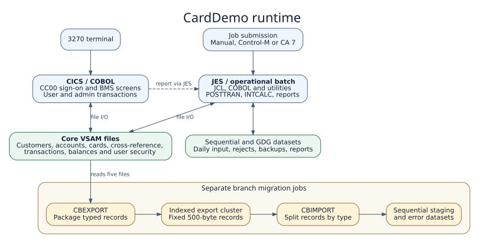
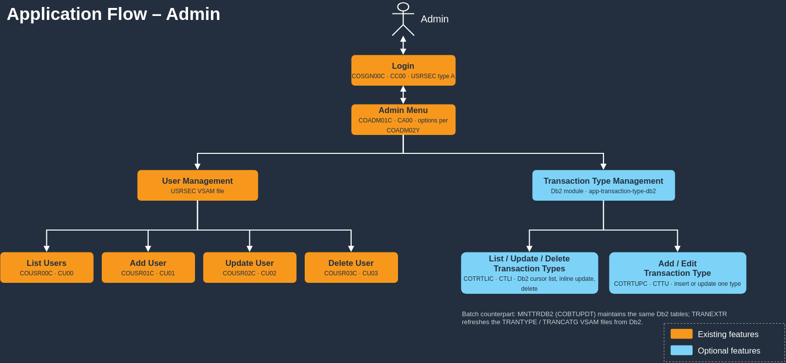

# CardDemo - Mainframe Credit Card Management Application

## Executive Summary
CardDemo is a comprehensive mainframe application that simulates a credit card management system. Designed specifically to showcase AWS and partner technologies for mainframe migration and modernization scenarios, it provides a realistic environment for testing various modernization approaches including discovery, migration, performance testing, service enablement, and more.

## Table of Contents
- [Description](#description)
- [Architecture and repository layout](#architecture-and-repository-layout)
- [Technologies](#technologies)
- [Optional Features](#optional-features)
- [Installation](#installation)
- [Running Batch Jobs](#running-batch-jobs)
- [Application Details](#application-details)
  - [User Functions](#user-functions)
  - [Admin Functions](#admin-functions)
  - [Application Inventory](#application-inventory)
  - [Application Screens](#application-screens)
- [Technical Highlights](#technical-highlights)
- [Support](#support)
- [Roadmap](#roadmap)
- [Contributing](#contributing)
- [License](#license)
- [Project Status](#project-status)

## Description
CardDemo is a mainframe application designed to test and showcase AWS and partner technology for mainframe migration and modernization use-cases. It provides a realistic environment for:

- Application discovery and analysis
- Migration assessment and planning
- Modernization strategy development
- Performance testing
- System augmentation
- Service enablement and extraction
- Test creation and automation

The application intentionally incorporates various coding styles and patterns to exercise analysis, transformation, and migration tooling across different mainframe programming paradigms.

## Architecture and repository layout

See the [architecture guide](docs/architecture.md) for the CICS and batch runtime, shared VSAM files, scheduler examples, and branch migration jobs.

## Technologies

### Core Technologies
- **COBOL**: Primary programming language
- **CICS**: Transaction processing
- **VSAM (KSDS with AIX)**: Data storage
- **JCL**: Batch processing
- **RACF**: Security
- **ASSEMBLER**: System-level programming
  - MVSWAIT: Timer control for batch jobs
  - COBDATFT: Date format conversion utility

### Optional Technologies
- **Db2**: Relational database management
- **IMS DB**: Hierarchical database
- **MQ**: Message queuing
- **JCL Utilities**: FTP, TXT2PDF, DB2 LOAD/UNLOAD, IMS DB LOAD/UNLOAD, Internal Reader
- **Advanced Data Formats**: COMP, COMP-3, Zoned Decimal, Signed, Unsigned
- **Additional Dataset Types**: VSAM (ESDS/RRDS), GDG, PDS
- **Record Formats**: VB, FBA, and others
- **Complex Copybook Structures**: REDEFINES, OCCURS, OCCURS DEPENDING ON

## Optional Features

CardDemo includes several optional modules that extend the base functionality:

1. **Credit Card Authorizations with IMS, DB2, and MQ**
   - Simulate credit card authorization requests using MQ
   - Look up account and customer data in VSAM and store authorization details in IMS DB
   - Record fraud cases in Db2
   - Features include:
     - Authorization request processing
     - Pending authorization summary and details
     - Batch purging of expired authorizations
   - More details: [Pending Authorization Extension](./app/app-authorization-ims-db2-mq)

2. **Transaction Type Management with DB2**
   - Maintain transaction type reference data in DB2 tables
   - Add, update, or delete transaction types from CICS transactions
   - Manage transaction types through batch jobs
   - Demonstrates DB2 integration patterns including cursors and SQL operations
   - More details: [Transaction Type Management](app/app-transaction-type-db2)

3. **Account Extractions using MQ and VSAM**
   - Extract and transmit account data through MQ channels
   - System date inquiry via MQ (CDRD transaction)
   - Account details inquiry via MQ (CDRA transaction)
   - Demonstrates asynchronous processing patterns
   - More details: [Account Extractions](app/app-vsam-mq)

4. **Additional JCL Utilities**
   - FTP integration
   - Text-to-PDF conversion
   - DB2 and IMS DB load/unload operations
   - Internal reader functionality

## Installation

### Prerequisites
- A z/OS environment with JES, VSAM, CICS, COBOL and assembler build tools, and a 3270 client for the online screens
- Optional: DB2, IMS DB, and MQ for extended features
- File transfer capability between local environment and mainframe

For rehosting, [Micro Focus and UniKix sample runtime archives](samples/m2) are provided for their respective platforms; they do not provide a standalone Linux or browser runtime.

### Installation Steps

1. **Prepare Your Environment**
   - Clone this repository to your local development environment
   - Ensure you have appropriate access to your mainframe environment

2. **Create Mainframe Datasets**
   - Choose a high-level qualifier (HLQ). `AWS.M2` is the sample: review dataset names, volumes, job cards, and the target CICS region in the JCL, PROCs, CSD, and report submission template before use.
   - Create source libraries with the following sample formats. Allocate a load library as required by your site's build procedures.

     | HLQ    | Name          | Format | Length |
     | :----- | :------------ | :----- | -----: |
     | AWS.M2 | CARDDEMO.JCL  | FB     |     80 |
     | AWS.M2 | CARDDEMO.PROC | FB     |     80 |
     | AWS.M2 | CARDDEMO.CBL  | FB     |     80 |
     | AWS.M2 | CARDDEMO.CPY  | FB     |     80 |
     | AWS.M2 | CARDDEMO.BMS  | FB     |     80 |
     | AWS.M2 | CARDDEMO.ASM  | FB     |     80 |
     | AWS.M2 | CARDDEMO.MACLIB | FB   |     80 |

3. **Upload Source Code**
   - Transfer the members under [`app/`](app) into the corresponding libraries. Put the application procedures from [`app/proc/`](app/proc) on the runtime JCL procedure search path, and put the compile procedures from [`samples/proc/`](samples/proc) where the sample compile jobs' `JCLLIB` can find them.
   - Transfer source as text using your site's tool (such as IND$FILE); transfer the EBCDIC data separately as binary.

4. **Upload Sample Data**
   - Transfer the fixed-record input files from [`app/data/EBCDIC/`](app/data/EBCDIC) in binary mode. Use `ACCTDATA.PS` for `ACCTFILE`; the directory also contains an `ACCDATA.PS` sample.
   - Allocate the following sequential inputs (not the target VSAM clusters):

     | Dataset name                      | Description                                  | Copybook     | Format | Length |
     | :---------------------------------| :------------------------------------------- | :----------- | :----- | -----: |
     | AWS.M2.CARDDEMO.ACCTDATA.PS       | Account Data                                 | CVACT01Y     | FB     |    300 |
     | AWS.M2.CARDDEMO.CARDDATA.PS       | Card Data                                    | CVACT02Y     | FB     |    150 |
     | AWS.M2.CARDDEMO.CUSTDATA.PS       | Customer Data                                | CVCUS01Y     | FB     |    500 |
     | AWS.M2.CARDDEMO.CARDXREF.PS       | Customer Account Card Cross reference        | CVACT03Y     | FB     |     50 |
     | AWS.M2.CARDDEMO.DALYTRAN.PS.INIT  | Transaction database initialization record   | CVTRA06Y     | FB     |    350 |
     | AWS.M2.CARDDEMO.DALYTRAN.PS       | Transaction data for posting                 | CVTRA06Y     | FB     |    350 |
     | AWS.M2.CARDDEMO.DISCGRP.PS        | Disclosure Groups                            | CVTRA02Y     | FB     |     50 |
     | AWS.M2.CARDDEMO.TRANCATG.PS       | Transaction Category Types                   | CVTRA04Y     | FB     |     60 |
     | AWS.M2.CARDDEMO.TRANTYPE.PS       | Transaction Types                            | CVTRA03Y     | FB     |     60 |
     | AWS.M2.CARDDEMO.TCATBALF.PS       | Transaction Category Balance                 | CVTRA01Y     | FB     |     50 |

5. **Initialize the Environment**
   - Adapt and submit the following [base JCL](app/jcl) and any jobs required by the selected extensions. Use demo datasets: initialization jobs can replace existing clusters.
   - Stop online access or close the affected files before loading; reopen them after the loads and CICS resource installation are complete. `TRANFILE` also issues CICS file commands, so configure its target region first.

     | Jobname  | Purpose                                           | Optional Module |
     | :------- | :------------------------------------------------ |:--------------- |
     | CLOSEFIL | Closes files opened by CICS                       |                 |
     | DEFGDGB  | Defines base generation data groups               |                 |
     | DUSRSECJ | Generates demo user records and loads the user security VSAM file | |
     | ACCTFILE | Loads Account database using sample data          |                 |
     | CARDFILE | Loads Card database with credit card sample data  |                 |
     | CUSTFILE | Creates customer database                         |                 |
     | XREFFILE | Loads Customer Card account cross reference       |                 |
     | CREADB21 | Creates CardDemo Db2 database and loads tables    | Db2: Transaction Type Mgmt |
     | TRANFILE | Copies initial Transaction file to VSAM           |                 |
     | DEFGDGD  | Defines additional generation data groups for Db2 | Db2: Transaction Type Mgmt |
     | TRANEXTR | Extracts TRAN type and category tables from Db2   | Db2: Transaction Type Mgmt |
     | DISCGRP  | Copies initial Disclosure Group file to VSAM      |                 |
     | TCATBALF | Copies initial TCATBALF file to VSAM              |                 |
     | TRANCATG | Copies initial transaction category file to VSAM  |                 |
     | TRANTYPE | Copies initial transaction type file to VSAM      |                 |

6. **Compile the Programs**
   - Adapt [BATCMP](samples/jcl/BATCMP.jcl), [BMSCMP](samples/jcl/BMSCMP.jcl), and [CICCMP](samples/jcl/CICCMP.jcl) for batch COBOL, BMS assembly, and CICS COBOL translation and compilation. The checked-in [BMS copybooks](app/cpy-bms) are available alongside the [business copybooks](app/cpy).
   - Assemble and link the utilities in [`app/asm/`](app/asm) using your site's procedures.

7. **Configure CICS Resources**
   - Use [`app/csd/CARDDEMO.CSD`](app/csd/CARDDEMO.CSD) as input to your site's DFHCSDUP job, or define the equivalent resources with CEDA. It defines the `CARDDEMO` group, including `CC00`, the enabled `CARDDLIB` load library, and the `JOBS` transient data queue backed by the `INREADER` DD for report submission.

8. **Install and Load Resources**
   - Install the group in the target CICS region (`CEDA INSTALL GROUP(CARDDEMO)`), verify that the files point to the initialized VSAM clusters, and run the site-adapted [OPENFIL](app/jcl/OPENFIL.jcl) as needed. Use CICS NEWCOPY when refreshing already loaded programs or mapsets.

### Accessing the Application
- **Online Functions**: From a 3270 session connected to the configured CICS region, enter `CC00`. These accounts are for the bundled demo data only:
  - Admin access: Use userid ADMIN001 with password PASSWORD
  - User access: Use userid USER0001 with password PASSWORD
- **Batch Functions**: See the "Running Batch Jobs" section below

## Running Batch Jobs

The table is an example batch sequence, not a universal schedule. Initialize the base datasets and GDGs first, supply the input for `POSTTRAN`, and check each job's return code before proceeding. Use the [scheduler examples](docs/architecture.md#scheduler-examples) for their specific job dependencies; [branch migration](docs/architecture.md#branch-migration-data-transfer) is a separate batch path.

| Jobname  | Purpose                                             | Optional Module |
| :------- | :-------------------------------------------------- |:--------------- |
| CLOSEFIL | Closes files opened by CICS                         |                 |
| ACCTFILE | Loads Account database using sample data            |                 |
| CARDFILE | Loads Card database with credit card sample data    |                 |
| XREFFILE | Loads Customer Card account cross reference to VSAM |                 |
| CUSTFILE | Creates customer database                           |                 |
| TRANBKP  | Back up and reinitialize the transaction master      |                 |
| TRANEXTR | Extracts latest Db2 data for Transaction types      | Db2: Transaction Type Mgmt |
| TRANCATG | Copies latest transaction category file to VSAM     |                 |
| TRANTYPE | Copies latest transaction type file to VSAM         |                 |
| DISCGRP  | Copies initial disclosure Group file to VSAM        |                 |
| TCATBALF | Copies initial TCATBALF file to VSAM                |                 |
| DUSRSECJ | Sets up user security VSAM file                     |                 |
| POSTTRAN | Core transaction processing job                     |                 |
| INTCALC  | Run interest calculations                           |                 |
| TRANBKP  | Back up posted transactions and reinitialize the transaction master | |
| COMBTRAN | Merge the latest transaction backup and system-generated transactions; reload the transaction master | |
| CREASTMT | Produce transaction statement                       |                 |
| TRANIDX  | Define alternate index on transaction file          |                 |
| OPENFIL  | Makes files available to CICS                       |                 |

`WAITSTEP` is available to workflows that need a delay. The authorization extension's `CBPAUP0J` purge is an independent optional job.

## Application Details

CardDemo is a comprehensive credit card management application built primarily using COBOL. It provides functionality for managing accounts, credit cards, transactions, and bill payments.

### User Types

The application supports two user roles:
- **Regular Users**: Can perform standard card management functions
- **Admin Users**: Can perform administrative functions like user management

### User Functions

The regular user can perform the following functions:
- View and update account information
- Manage credit cards
- View, add, and process transactions
- Generate transaction reports
- Make bill payments
- View pending authorizations (with optional module)

### Admin Functions

Admin users can perform the following functions:
- User management (list, add, update, delete)
- Transaction type management (with DB2 optional module)

### Application Inventory

#### Online Components

| Transaction | BMS Map | Program  | Function                        | Optional Module                    | Notes                                                     |
|:------------|:--------|:---------|:--------------------------------|:-----------------------------------|:----------------------------------------------------------|
| CC00        | COSGN00 | COSGN00C | Signon Screen                   |                                    |                                                           |
| CM00        | COMEN01 | COMEN01C | Main Menu                       |                                    |                                                           |
| CAVW        | COACTVW | COACTVWC | Account View                    |                                    |                                                           |
| CAUP        | COACTUP | COACTUPC | Account Update                  |                                    |                                                           |
| CCLI        | COCRDLI | COCRDLIC | Credit Card List                |                                    |                                                           |
| CCDL        | COCRDSL | COCRDSLC | Credit Card View                |                                    |                                                           |
| CCUP        | COCRDUP | COCRDUPC | Credit Card Update              |                                    |                                                           |
| CT00        | COTRN00 | COTRN00C | Transaction List                |                                    |                                                           |
| CT01        | COTRN01 | COTRN01C | Transaction View                |                                    |                                                           |
| CT02        | COTRN02 | COTRN02C | Transaction Add                 |                                    |                                                           |
| CR00        | CORPT00 | CORPT00C | Transaction Reports             |                                    |                                                           |
| CB00        | COBIL00 | COBIL00C | Bill Payment                    |                                    |                                                           |
| CPVS        | COPAU00 | COPAUS0C | Pending Authorization Summary   | IMS-DB2-MQ: Pending Authorizations | Read IMS and VSAM                                         |
| CPVD        | COPAU01 | COPAUS1C | Pending Authorization Details   | IMS-DB2-MQ: Pending Authorizations | Update IMS and Insert DB2                                 |
| CP00        |         | COPAUA0C | Process Authorization Requests  | IMS-DB2-MQ: Pending Authorizations | MQ trigger, request and response; Insert and Update to IMS|
| CA00        | COADM01 | COADM01C | Admin Menu                      | Db2: Transaction Type Mgmt         |                                                           |
| CU00        | COUSR00 | COUSR00C | List Users                      |                                    |                                                           |
| CU01        | COUSR01 | COUSR01C | Add User                        |                                    |                                                           |
| CU02        | COUSR02 | COUSR02C | Update User                     |                                    |                                                           |
| CU03        | COUSR03 | COUSR03C | Delete User                     |                                    |                                                           |
| CTTU        | COTRTUP | COTRTUPC | Tran Type add/edit              | Db2: Transaction Type Mgmt         | Update and insert on Db2                                  |
| CTLI        | COTRTLI | COTRTLIC | Tran Type list/update/delete    | Db2: Transaction Type Mgmt         | Demonstrates cursor and delete in Db2                     |
| CDRD        |         | CODATE01 | Inquire System Date via MQ      | MQ Integration                     | Demonstrates MQ request/response pattern                  |
| CDRA        |         | COACCT01 | Inquire account details via MQ  | MQ Integration                     | Demonstrates MQ request/response pattern                  |

#### Batch Components

| Job      | Program  | Function                                             | Optional Module |
|:---------|:---------|:-----------------------------------------------------|:---------------|
| DUSRSECJ | IEBGENER | Initial Load of User security file                   |                |
| DEFGDGB  | IDCAMS   | Setup GDG Bases                                      |                |
| DEFGDGD  | IDCAMS   | Setup more GDG Bases for Db2                         |                |
| ACCTFILE | IDCAMS   | Refresh Account Master                               |                |
| CARDFILE | IDCAMS   | Refresh Card Master                                  |                |
| CUSTFILE | IDCAMS   | Refresh Customer Master                              |                |
| CREADB21 | DSNTEP4  | Creates CardDemo Db2 database and loads tables       | Db2: Transaction Type Mgmt |
| TRANEXTR | DSNTIAUL | Extracts latest Db2 data for Transaction types       | Db2: Transaction Type Mgmt |
| DISCGRP  | IDCAMS   | Load Disclosure Group File                           |                |
| TRANFILE | IDCAMS   | Load Transaction Master file                         |                |
| TRANCATG | IDCAMS   | Load Transaction category types                      |                |
| TRANTYPE | IDCAMS   | Load Transaction type file                           |                |
| XREFFILE | IDCAMS   | Account, Card and Customer cross reference           |                |
| CLOSEFIL | SDSF     | Issue CICS commands to close selected VSAM files     |                |
| TCATBALF | IDCAMS   | Refresh Transaction Category Balance                 |                |
| TRANBKP  | IDCAMS   | Back up and redefine the transaction master          |                |
| POSTTRAN | CBTRN02C | Transaction processing job                           |                |
| TRANIDX  | IDCAMS   | Define AIX for transaction file                      |                |
| OPENFIL  | SDSF     | Issue CICS commands to open selected VSAM files      |                |
| INTCALC  | CBACT04C | Run interest calculations                            |                |
| COMBTRAN | SORT     | Combine transaction files                            |                |
| CREASTMT | CBSTM03A | Produce transaction statement                        |                |
| TRANREPT | CBTRN03C | Transaction report; CICS submits a job that invokes the TRANREPT procedure | |
| [CBEXPORT](app/jcl/CBEXPORT.jcl) | CBEXPORT | Package records from five VSAM datasets into an indexed export dataset | |
| [CBIMPORT](app/jcl/CBIMPORT.jcl) | CBIMPORT | Split an indexed export into sequential staging datasets | |
| ESDSRRDS | IDCAMS   | Create ESDS and RRDS VSAM files                      |                |
| CBPAUP0J | CBPAUP0C | Purge Expired Authorizations                         | IMS-DB2-MQ: Pending Authorizations |
| MNTTRDB2 | COBTUPDT | Maintain Transaction type table                      | Db2: Transaction Type Mgmt |
| WAITSTEP | COBSWAIT | Wait job for given time                              |                |

### Application Screens

#### Signon Screen

#### Main Menu

**Note**: Option 11 (Pending Authorizations) is only available with the optional Credit Card Authorizations feature. Please refer to [the authorization documentation](./app/app-authorization-ims-db2-mq) for details.

#### Admin Menu

**Note**: Options 5 and 6 will be enabled only if you install the Transaction Type Management with DB2 optional feature (transactions CTTU and CTLI).

## Technical Highlights

| Component | Domain Features | Technical Features |
|:----------|:----------------|:-------------------|
| **Base Application** | Customer Account Card Transaction Bill Payment Statement/Report | COBOL CICS JCL (Batch) VSAM (KSDS with AIX) |
| **Optional Features** | Authorization Fraud Transaction Type (Extension) | DB2 MQ IMS DB JCL Utilities Complex data formats Various dataset types Advanced copybook structures |

## Support

For questions, issues, or improvement requests, please raise an issue in the repository with detailed information about your concern. The maintainers will respond according to availability.

## Roadmap

The following features are planned for upcoming releases:

1. **Additional Database Syntax Usage Scenarios**
   - DB2 Rewards: Calculate rewards for transactions based on transaction types, categories, and rules
     - Will include stored procedures, functions, and dynamic SQL
   - Hierarchical database: IMS DC implementation

2. **Integration Enhancements**
   - FTP and SFTP integration
   - Web Service connectivity
   - Exposure of transactions for distributed application integration

## Contributing

We welcome contributions and enhancements to this codebase from the mainframe community. To contribute:

1. Fork the repository
2. Create your feature branch
3. Implement your changes with appropriate tests
4. Submit a pull request with a clear description of the changes

Feel free to raise issues, create code, and submit merge requests for enhancements to help build this application as a resource for programmers wanting to understand and modernize their mainframes.

## License

This project is intended to be a community resource and is released under the Apache 2.0 license.

## Project Status

The CardDemo application has been enhanced with optional features that extend its functionality:
- Credit Card Authorizations with IMS, DB2, and MQ
- Transaction Type Management with DB2
- Account Extractions using MQ and VSAM
- Additional JCL Utilities
- Enhanced Data and Copybook Features

These optional features make CardDemo an even more useful resource for customers looking to modernize their mainframe applications. With modules for DB2, MQ, IMS DB, JCL utilities, and more data formats now available, customers can leverage CardDemo to test a wider array of mainframe migration, refactoring, replatforming, and augmentation scenarios.
