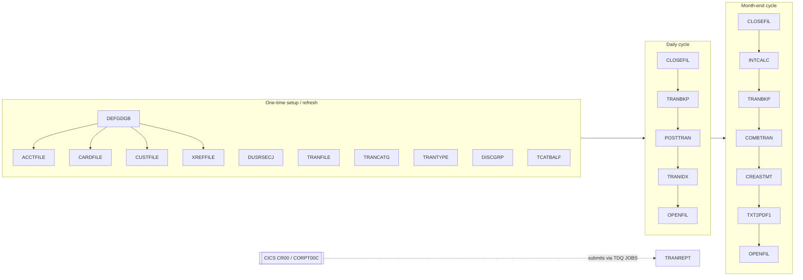
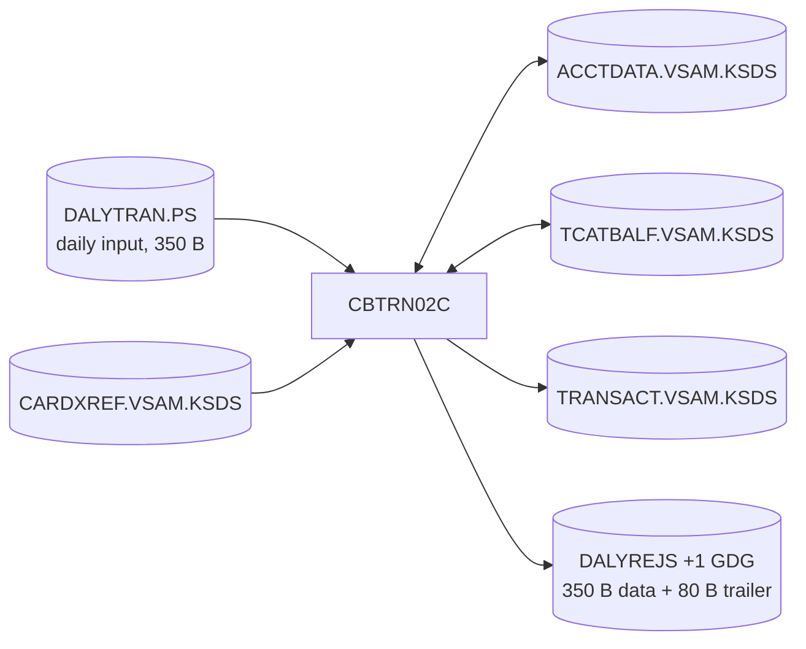
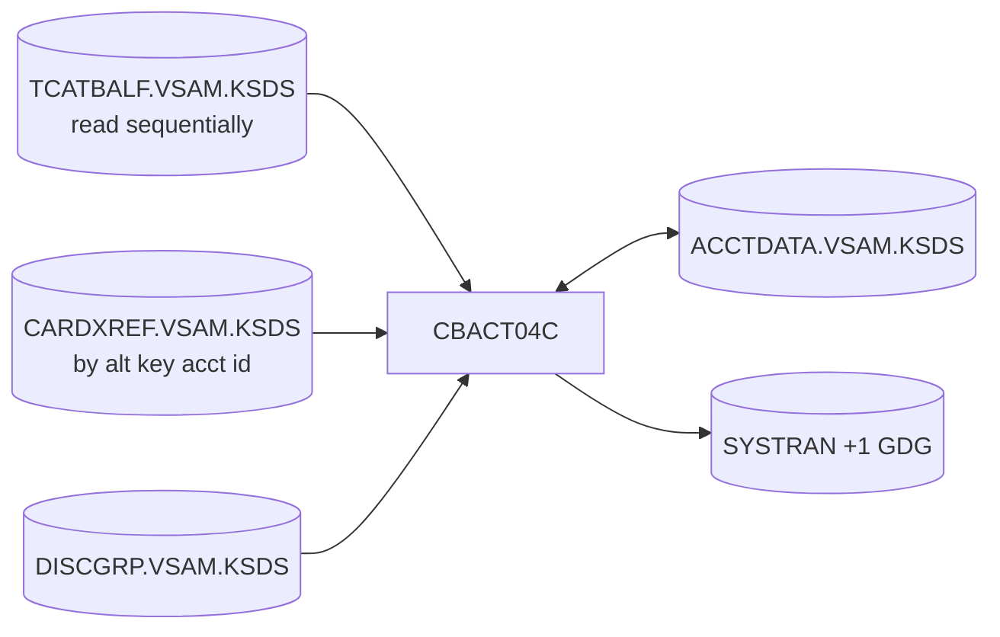
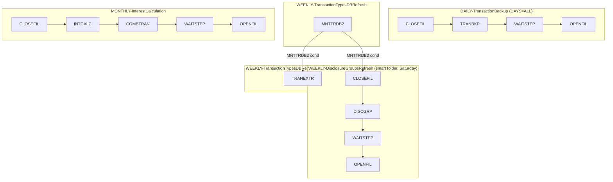
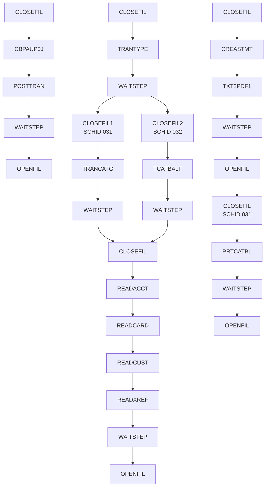
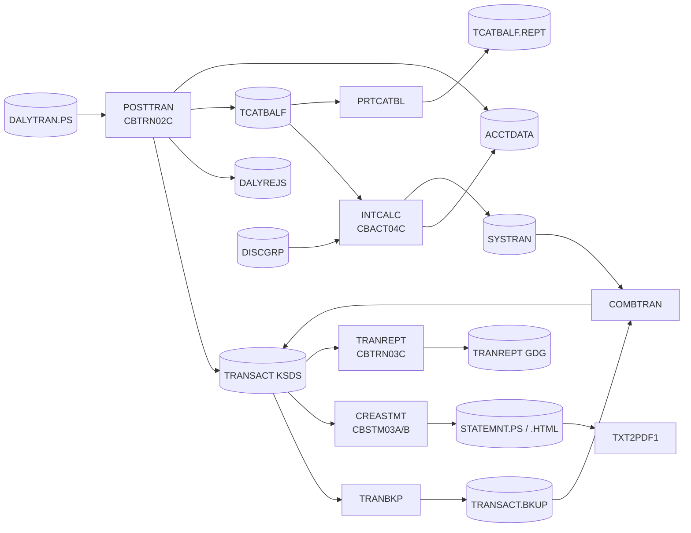

# CardDemo Batch Chain

This document describes the CardDemo batch processing chain: which jobs exist, the order they run in, the COBOL programs and datasets behind each job, and how the chain is scheduled in CA-7 and Control-M.

Everything here was derived from the sources in this repository:

| Area | Location |
| :--- | :--- |
| JCL | [`app/jcl/`](../app/jcl), [`app/proc/`](../app/proc), [`app/ctl/`](../app/ctl) |
| Batch COBOL | [`app/cbl/CB*.cbl`](../app/cbl), [`app/cbl/COBSWAIT.cbl`](../app/cbl/COBSWAIT.cbl) |
| Record layouts | [`app/cpy/`](../app/cpy) |
| Scheduler definitions | [`app/scheduler/CardDemo.ca7`](../app/scheduler/CardDemo.ca7), [`app/scheduler/CardDemo.controlm`](../app/scheduler/CardDemo.controlm) |
| Optional modules | [`app/app-transaction-type-db2/jcl/`](../app/app-transaction-type-db2/jcl), [`app/app-authorization-ims-db2-mq/jcl/`](../app/app-authorization-ims-db2-mq/jcl) |

All datasets share the high-level qualifier `AWS.M2.CARDDEMO`, which is left out of the tables below (`ACCTDATA.VSAM.KSDS` means `AWS.M2.CARDDEMO.ACCTDATA.VSAM.KSDS`).

---

## 1. Overview

The batch chain does four things:

1. **Setup and refresh.** Define GDG bases and (re)load the VSAM masters from the flat files in `app/data/EBCDIC`.
2. **Daily posting.** Validate the day's card transactions (`DALYTRAN.PS`), post them to the transaction master, and update account and category balances (`POSTTRAN` → `CBTRN02C`).
3. **Month end.** Calculate interest per account and category (`INTCALC` → `CBACT04C`), merge the system-generated interest transactions back into the transaction master (`COMBTRAN`), and print statements (`CREASTMT` → `CBSTM03A`/`CBSTM03B`).
4. **Reporting and utilities.** Produce the transaction detail report (`TRANREPT` → `CBTRN03C`, submitted from CICS), the category balance report (`PRTCATBL`), file dumps (`READ*`), and branch-migration export/import (`CBEXPORT`/`CBIMPORT`).

The online CICS region (`CICSAWSA`) and batch share the same VSAM files. Every job that updates a VSAM file is wrapped by `CLOSEFIL` (closes the files in CICS with `CEMT SET FIL(...) CLO` via SDSF) and `OPENFIL` (reopens them), usually with `WAITSTEP` in between.

---

## 2. Canonical run order

The README gives this order for a full end-to-end run (setup → posting → month end). The program column comes from each job's `EXEC PGM=`.

| # | Job | Main program(s) | What it does | Optional module |
| --: | :--- | :--- | :--- | :--- |
| 1 | `CLOSEFIL` | SDSF (`CEMT`) | Close `TRANSACT`, `CCXREF`, `ACCTDAT`, `CXACAIX`, `USRSEC` in CICS | |
| 2 | `ACCTFILE` | IDCAMS | Delete/define/REPRO `ACCTDATA.PS` → `ACCTDATA.VSAM.KSDS` | |
| 3 | `CARDFILE` | IDCAMS | Load `CARDDATA.VSAM.KSDS` and build AIX `CARDDATA.VSAM.AIX` | |
| 4 | `XREFFILE` | IDCAMS | Load `CARDXREF.VSAM.KSDS` and build AIX (account id) + path | |
| 5 | `CUSTFILE` | IDCAMS | Load `CUSTDATA.VSAM.KSDS` | |
| 6 | `TRANBKP` | IDCAMS (`REPROC`) | Back up `TRANSACT.VSAM.KSDS` to `TRANSACT.BKUP(+1)`, then delete and redefine an empty KSDS | |
| 7 | `TRANEXTR` | IEBGENER, DSNTIAUL | Back up and re-extract `TRANTYPE.PS`/`TRANCATG.PS` from Db2 | Db2 Transaction Type |
| 8 | `TRANCATG` | IDCAMS | Load `TRANCATG.VSAM.KSDS` | |
| 9 | `TRANTYPE` | IDCAMS | Load `TRANTYPE.VSAM.KSDS` | |
| 10 | `DISCGRP` | IDCAMS | Load `DISCGRP.VSAM.KSDS` (interest rates by disclosure group) | |
| 11 | `TCATBALF` | IDCAMS | Load `TCATBALF.VSAM.KSDS` (balance per account/type/category) | |
| 12 | `DUSRSECJ` | IEBGENER, IDCAMS | Build `USRSEC.PS` from in-stream data and load `USRSEC.VSAM.KSDS` | |
| 13 | **`POSTTRAN`** | **`CBTRN02C`** | **Validate and post daily transactions** | |
| 14 | **`INTCALC`** | **`CBACT04C`** | **Compute monthly interest and write system transactions** | |
| 15 | `TRANBKP` | IDCAMS | Back up the posted transaction master (feeds `COMBTRAN`) | |
| 16 | `COMBTRAN` | DFSORT, IDCAMS | Merge `TRANSACT.BKUP(0)` + `SYSTRAN(0)` → `TRANSACT.COMBINED(+1)` → reload KSDS | |
| 17 | **`CREASTMT`** | **`CBSTM03A`** + `CBSTM03B` | **Produce text and HTML account statements** | |
| 18 | `TRANIDX` | IDCAMS | Rebuild AIX `TRANSACT.VSAM.AIX` (key: processed timestamp) and path | |
| 19 | `OPENFIL` | SDSF (`CEMT`) | Reopen the files in CICS | |
| 20 | `WAITSTEP` | `COBSWAIT` | Wait (SYSIN value in centiseconds, default `00003600` = 36 s) | |
| 21 | `CBPAUP0J` | `CBPAUP0C` (IMS BMP) | Purge expired pending authorizations | IMS-Db2-MQ Authorizations |

Prerequisite jobs, run once per environment: `DEFGDGB` (GDG bases), `DALYREJS` (GDG for rejects), `REPTFILE` (GDG for `TRANREPT`), `DEFGDGD` (backup GDG bases for the reference files), `TRANFILE` (initial transaction master from `DALYTRAN.PS.INIT`), and `CREADB21` (Db2 objects, optional).

---

## 3. Core business jobs

### 3.1 `POSTTRAN` — daily transaction posting (`CBTRN02C`)

| DD | Dataset | Open mode | Copybook |
| :--- | :--- | :--- | :--- |
| `DALYTRAN` | `DALYTRAN.PS` | INPUT (sequential) | `CVTRA06Y` (350 B) |
| `TRANFILE` | `TRANSACT.VSAM.KSDS` | OUTPUT | `CVTRA05Y` (350 B) |
| `XREFFILE` | `CARDXREF.VSAM.KSDS` | INPUT (random by card number) | `CVACT03Y` (50 B) |
| `ACCTFILE` | `ACCTDATA.VSAM.KSDS` | I-O | `CVACT01Y` (300 B) |
| `TCATBALF` | `TCATBALF.VSAM.KSDS` | I-O | `CVTRA01Y` (50 B) |
| `DALYREJS` | `DALYREJS(+1)` | OUTPUT | 350 B record + 80 B validation trailer |

**Logic per daily record:**

1. **Validate** (`1500-VALIDATE-TRAN`):
   - Look up the card in `XREFFILE`. If it is missing, reject with **100** `INVALID CARD NUMBER FOUND`.
   - Read the account using `XREF-ACCT-ID`. If it is missing, reject with **101** `ACCOUNT RECORD NOT FOUND`.
   - Compute `ACCT-CURR-CYC-CREDIT − ACCT-CURR-CYC-DEBIT + DALYTRAN-AMT`. If it exceeds `ACCT-CREDIT-LIMIT`, reject with **102** `OVERLIMIT TRANSACTION`.
   - If `ACCT-EXPIRAION-DATE` < `DALYTRAN-ORIG-TS(1:10)`, reject with **103** `TRANSACTION RECEIVED AFTER ACCT EXPIRATION`.
2. **Post** (`2000-POST-TRANSACTION`), only if valid:
   - Map the daily record to `TRAN-RECORD` and set `TRAN-PROC-TS` to the current Db2-format timestamp.
   - `2700-UPDATE-TCATBAL`: add the amount to the TCATBAL record for key (account, type, category). The record is created if it does not exist.
   - `2800-UPDATE-ACCOUNT-REC`: add the amount to `ACCT-CURR-BAL`, and to `ACCT-CURR-CYC-CREDIT` if the amount is ≥ 0 or to `ACCT-CURR-CYC-DEBIT` if it is negative. A failed rewrite sets reason **109**.
   - `2900-WRITE-TRANSACTION-FILE`: write the posted transaction to the master.
3. **Reject** (`2500-WRITE-REJECT-REC`): write the original record plus the reason trailer to `DALYREJS(+1)`.

**Return code:** `0` if every record posted. `4` if any record was rejected (`WS-REJECT-COUNT > 0`). File errors abend through `CEE3ABD`.

### 3.2 `INTCALC` — month-end interest (`CBACT04C`)

`EXEC PGM=CBACT04C,PARM='2022071800'`. The PARM is the run date and becomes the prefix of generated transaction IDs.

**Logic:**

1. Read `TCATBALF` sequentially. The file is in key order, so records arrive grouped by account.
2. When the account changes:
   - Rewrite the previous account (`1050-UPDATE-ACCOUNT`): `ACCT-CURR-BAL += total interest`, then reset `ACCT-CURR-CYC-CREDIT` and `ACCT-CURR-CYC-DEBIT` to 0.
   - Read the new account and its xref record. The xref provides the card number for the generated transaction.
3. For each category balance, look up the rate in `DISCGRP` using key (`ACCT-GROUP-ID`, type, category). If that key is missing (status 23), retry with group `DEFAULT`.
4. If the rate is non-zero:
   - **Monthly interest = `TRAN-CAT-BAL × DIS-INT-RATE / 1200`**.
   - Write a system transaction to `SYSTRAN(+1)` with `TRAN-ID` = PARM date + running suffix, type `01`, category `05`, source `System`, and description `Int. for a/c <acct>`.
5. `1400-COMPUTE-FEES` is a placeholder and does nothing.

### 3.3 `COMBTRAN` — merge system transactions

- **STEP05R (DFSORT):** concatenates `TRANSACT.BKUP(0)` (the backup of posted transactions from `TRANBKP`) and `SYSTRAN(0)` (interest from `INTCALC`), sorts by `TRAN-ID` (bytes 1–16), and writes `TRANSACT.COMBINED(+1)`.
- **STEP10 (IDCAMS REPRO):** loads the combined file into `TRANSACT.VSAM.KSDS`.

### 3.4 `CREASTMT` — account statements (`CBSTM03A` / `CBSTM03B`)

| Step | Program | Function |
| :--- | :--- | :--- |
| `DELDEF01` | IDCAMS | Delete `TRXFL.SEQ`, then delete and redefine `TRXFL.VSAM.KSDS` |
| `STEP010` | SORT | Sort `TRANSACT.VSAM.KSDS` by card number (pos 263, 16) and transaction id (pos 1, 16) into `TRXFL.SEQ` |
| `STEP020` | IDCAMS | REPRO `TRXFL.SEQ` → `TRXFL.VSAM.KSDS` |
| `STEP030` | IEFBR14 | Delete the old `STATEMNT.PS` and `STATEMNT.HTML` |
| `STEP040` | `CBSTM03A` | For each xref record, read the customer and account, then print a statement with that card's transactions to `STATEMNT.PS` (text) and `STATEMNT.HTML` |

`CBSTM03A` does no file I/O of its own. It calls the subroutine `CBSTM03B` for every open, read, and close on `TRNXFILE`, `XREFFILE`, `CUSTFILE`, and `ACCTFILE`. It also walks the z/OS PSA/TCB/TIOT control blocks to display the job's DD names, and uses `ALTER`/`GO TO` dispatch. Transactions are buffered in an in-memory table of 51 cards × 10 transactions. In CA-7 the job is followed by `TXT2PDF1`, which converts `STATEMNT.PS` into `STATEMNT.PS.PDF` with the TXT2PDF REXX tool.

### 3.5 `TRANREPT` — transaction detail report (`CBTRN03C`)

This job is normally **submitted from CICS**. Transaction `CR00` (program `CORPT00C`) builds JCL that invokes `PROC=TRANREPT` with the user's start and end dates and writes it to the extrapartition TDQ `JOBS`, which feeds the internal reader. `app/jcl/TRANREPT.jcl` is the standalone version, with dates hard-coded to `2022-01-01` → `2022-07-06`.

| Step | Program | Function |
| :--- | :--- | :--- |
| `STEP05R` (REPROC) | IDCAMS | Back up `TRANSACT.VSAM.KSDS` → `TRANSACT.BKUP(+1)` |
| `STEP05R` | SORT | `INCLUDE` records with `TRAN-PROC-DT` between the start and end dates, sort by `TRAN-CARD-NUM` → `TRANSACT.DALY(+1)` |
| `STEP10R` | `CBTRN03C` | Read `DATEPARM`, then produce the 133-byte report `TRANREPT(+1)` with type and category descriptions from `TRANTYPE`/`TRANCATG`, account id from `CARDXREF`, and page, account, and grand totals |

### 3.6 `CBPAUP0J` — purge expired authorizations (optional)

IMS BMP `DFSRRC00 PARM='BMP,CBPAUP0C,PSBPAUTB'`. `CBPAUP0C` deletes pending-authorization segments older than `P-EXPIRY-DAYS`, which defaults to **5** when the SYSIN value is not numeric.

### 3.7 Db2 transaction-type jobs (optional)

| Job | Program | Function |
| :--- | :--- | :--- |
| `CREADB21` | DSNTEP4 / DSNTIAD | Create the CardDemo Db2 database and load `TRANSACTION_TYPE` and categories (`TYPRUN=SCAN` as shipped) |
| `MNTTRDB2` | `COBTUPDT` | Apply add (`A`), update (`U`), and delete (`D`) records from `INPFILE` to the transaction type table. `*` lines are comments |
| `TRANEXTR` | IEBGENER, DSNTIAUL | Back up `TRANTYPE.PS`/`TRANCATG.PS` to GDGs, then unload the Db2 tables into new flat files. Those files feed `TRANTYPE`/`TRANCATG` |

---

## 4. Scheduling

### 4.1 Control-M (`CardDemo.controlm`)

Jobs run under application `CARD-DEMO`, and most have `MAXRERUN=5` and `MAXWAIT=7`. Jobs are chained with IN/OUT conditions named `<folder>-<job>`. Each job adds its own condition when it completes, and the next job deletes it once consumed.

| Folder | Frequency | Chain |
| :--- | :--- | :--- |
| `DAILY-TransactionBackup` | Every day | `CLOSEFIL → TRANBKP → WAITSTEP → OPENFIL` |
| `WEEKLY-TransactionTypesDBRefresh` | No explicit day rule in the export | `MNTTRDB2` (sets the condition that triggers both smart folders) |
| `WEEKLY-DisclosureGroupsRefresh` (smart) | Saturday (`DAYS="SA"`), after `MNTTRDB2` | `CLOSEFIL → DISCGRP → WAITSTEP → OPENFIL` |
| `WEEKLY-TransactionTypesDBRefresh` (smart) | Saturday, after `MNTTRDB2` | `TRANEXTR` |
| `MONTHLY-InterestCalculation` | Monthly (folder has no explicit `DAYS`/`MONTHDAYS`) | `CLOSEFIL → INTCALC → COMBTRAN → WAITSTEP → OPENFIL` |

### 4.2 CA-7 (`CardDemo.ca7`)

The CA-7 `LJOB` listing defines job-completion triggers. Every job has `JCLLIB=&CARDDEMOPRODJCL` and is marked **maint only**. Schedule ids (`SCHID`) 030/031/032 separate parallel branches.

The listing contains four trigger streams:

1. **Posting:** `CLOSEFIL → CBPAUP0J → POSTTRAN → WAITSTEP → OPENFIL`
2. **Reference data refresh:** `CLOSEFIL → TRANTYPE → WAITSTEP`, which forks into `CLOSEFIL1 → TRANCATG` (031) and `CLOSEFIL2 → TCATBALF` (032). Both branches join at `CLOSEFIL`, which triggers the verification dumps `READACCT → READCARD → READCUST → READXREF → WAITSTEP → OPENFIL`.
3. **Statements:** `CLOSEFIL → CREASTMT → TXT2PDF1 → WAITSTEP → OPENFIL`
4. **Category balance report:** `CLOSEFIL → PRTCATBL → WAITSTEP → OPENFIL` (031)

---

## 5. Dataset lineage

### 5.1 VSAM masters

| VSAM cluster | Key | Loaded by | Source | Read by | Updated by |
| :--- | :--- | :--- | :--- | :--- | :--- |
| `ACCTDATA.VSAM.KSDS` | acct id (11) | `ACCTFILE` | `ACCTDATA.PS` | INTCALC, CREASTMT, READACCT, CBEXPORT, CICS | POSTTRAN, INTCALC |
| `CARDDATA.VSAM.KSDS` (+AIX) | card num | `CARDFILE` | `CARDDATA.PS` | READCARD, CBEXPORT, CICS | — |
| `CUSTDATA.VSAM.KSDS` | cust id | `CUSTFILE` | `CUSTDATA.PS` | CREASTMT, READCUST, CBEXPORT, CICS | — |
| `CARDXREF.VSAM.KSDS` (+AIX by acct) | card num | `XREFFILE` | `CARDXREF.PS` | POSTTRAN, INTCALC, TRANREPT, CREASTMT, READXREF, CBEXPORT | — |
| `TRANSACT.VSAM.KSDS` (+AIX by proc ts) | tran id (16) | `TRANFILE`, `TRANBKP` (empty), `COMBTRAN` | `DALYTRAN.PS.INIT`, `TRANSACT.COMBINED` | TRANREPT, CREASTMT, CBEXPORT, CICS | POSTTRAN |
| `TCATBALF.VSAM.KSDS` | acct + type + cat | `TCATBALF` | `TCATBALF.PS` | INTCALC, PRTCATBL | POSTTRAN |
| `DISCGRP.VSAM.KSDS` | group + type + cat | `DISCGRP` | `DISCGRP.PS` | INTCALC | — |
| `TRANTYPE.VSAM.KSDS` | type cd | `TRANTYPE` | `TRANTYPE.PS` (or Db2 via TRANEXTR) | TRANREPT | — |
| `TRANCATG.VSAM.KSDS` | type + cat | `TRANCATG` | `TRANCATG.PS` (or Db2 via TRANEXTR) | TRANREPT | — |
| `USRSEC.VSAM.KSDS` | user id | `DUSRSECJ` | in-stream | CICS sign-on | CICS user admin |

### 5.2 GDGs (defined in `DEFGDGB` unless noted)

| GDG base | Limit | Written by | Read by |
| :--- | :--- | :--- | :--- |
| `TRANSACT.BKUP` | 5 | TRANBKP, TRANREPT | COMBTRAN |
| `SYSTRAN` | 5 | INTCALC | COMBTRAN |
| `TRANSACT.COMBINED` | 5 | COMBTRAN | COMBTRAN STEP10 |
| `TRANSACT.DALY` | 5 | TRANREPT (sort) | CBTRN03C |
| `TRANREPT` | 5 (`DEFGDGB`) / 10 (`REPTFILE`) | CBTRN03C | — |
| `TCATBALF.BKUP` | 5 | PRTCATBL | PRTCATBL sort |
| `DALYREJS` | 5 (`DALYREJS`) | POSTTRAN | — |
| `TRANTYPE.BKUP`, `TRANCATG.PS.BKUP`, `DISCGRP.BKUP` | 5 (`DEFGDGD`) | TRANEXTR, DEFGDGD | — |

### 5.3 End-to-end data flow

---

## 6. Utility and supporting jobs

| Job | Program | Purpose |
| :--- | :--- | :--- |
| `READACCT` | `CBACT01C` | Dump accounts to `ACCTDATA.PSCOMP` (fixed with COMP fields), `ARRYPS` (array/OCCURS layout), and `VBPS` (variable-length). Calls `COBDATFT` (assembler, `app/asm`) to format dates |
| `READCARD` / `READCUST` / `READXREF` | `CBACT02C` / `CBCUS01C` / `CBACT03C` | Read and DISPLAY each record of the card, customer, and xref files |
| `PRTCATBL` | REPROC + SORT | Back up TCATBALF and sort by account, type, and category into `TCATBALF.REPT` |
| `CBEXPORT` | `CBEXPORT` | Export customer, account, xref, transaction, and card data to `EXPORT.DATA` (layout `CVEXPORT`) for branch migration |
| `CBIMPORT` | `CBIMPORT` | Split `EXPORT.DATA` into `*.IMPORT` files plus `IMPORT.ERRORS` |
| `ESDSRRDS` | IDCAMS | Demo ESDS and RRDS versions of the user security file |
| `WAITSTEP` | `COBSWAIT` → `MVSWAIT` (assembler) | Pause for the number of centiseconds in SYSIN |
| `FTPJCL`, `INTRDRJ1`, `INTRDRJ2` | FTP, IDCAMS | FTP and internal-reader samples |
| `CBADMCDJ` | DFHCSDUP | Define CICS CSD resources (not part of the batch data chain) |
| `DEFCUST` | IDCAMS | Legacy customer cluster definition (uses a different HLQ, `AWS.CUSTDATA.CLUSTER`) |

`REPROC` ([`app/proc/REPROC.prc`](../app/proc/REPROC.prc)) is a one-step IDCAMS procedure. Its SYSIN is `&CNTLLIB(REPROCT)`, which contains `REPRO INFILE(FILEIN) OUTFILE(FILEOUT)`. Callers override `PRC001.FILEIN` and `PRC001.FILEOUT`.

`CBTRN01C` is an earlier version of the posting program. It reads `DALYTRAN` and verifies the card and account, but posts nothing. No JCL in the repository runs it.

---

## 7. Restart and operational notes

- **File contention:** a CICS-owned VSAM file must be closed (`CLOSEFIL`) before batch opens it for update, and reopened (`OPENFIL`) afterwards. The SDSF `CEMT` commands target region `CICSAWSA`.
- **`POSTTRAN` RC=4** means some records were rejected, not that the job failed. Check `DALYREJS(+1)`: each record is the 350-byte original followed by an 80-byte trailer holding the reason code (100–103, 109) and its description.
- **Rerunning `POSTTRAN`** against the same `DALYTRAN.PS` posts the transactions again. It adds to the account and TCATBAL balances and writes duplicate transaction IDs. Restore from `TRANSACT.BKUP` and the source flat files instead.
- **`TRANBKP` empties the transaction master.** It redefines an empty KSDS after the backup. The transaction AIX is not rebuilt until `TRANIDX` runs.
- **`INTCALC` resets the cycle credit and debit to 0** for every account it touches, so run it only once per cycle. Change the date `PARM` each month, because it seeds the generated `TRAN-ID`s.
- **GDG relative references:** `COMBTRAN` reads generation `(0)` of `TRANSACT.BKUP` and `SYSTRAN`, so `TRANBKP` and `INTCALC` must run before it in the same cycle.
- **Abends:** every batch COBOL program calls `CEE3ABD` on unexpected file status and shows the status through `9910-DISPLAY-IO-STATUS`.

### Observations from the code

These come from reading the source. They have not been confirmed by running the jobs.

- **`CBTRN02C`:** when a transaction is both over limit and past the account expiration date, the reason recorded is **103**, because the checks run in sequence and the second overwrites the first. A failed account rewrite (109) does not stop the transaction from being written to the master.
- **`CBTRN03C`:** the date filter uses `NEXT SENTENCE` inside an inline `PERFORM`. That transfers control past the `END-PERFORM.` period, so an out-of-range record would end the loop early. In practice the `SORT INCLUDE` step already filters by date, which masks this. In the EOF branch the last record's `TRAN-AMT` is added to the totals a second time.
- **`CBACT04C`:** `1400-COMPUTE-FEES` is empty, so no fees are calculated.
- **Order differences:** the run order differs between the README (`POSTTRAN → INTCALC → TRANBKP → COMBTRAN`), Control-M (`INTCALC → COMBTRAN` monthly, `TRANBKP` daily), and CA-7 (posting stream without `INTCALC`/`COMBTRAN`). Treat the README order as the reference for a full end-to-end run.
