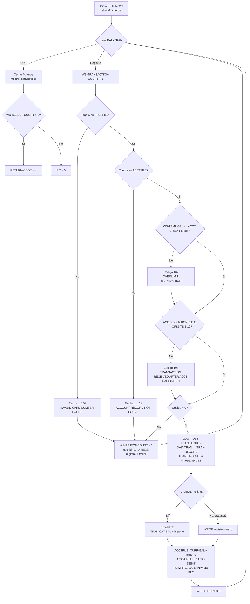
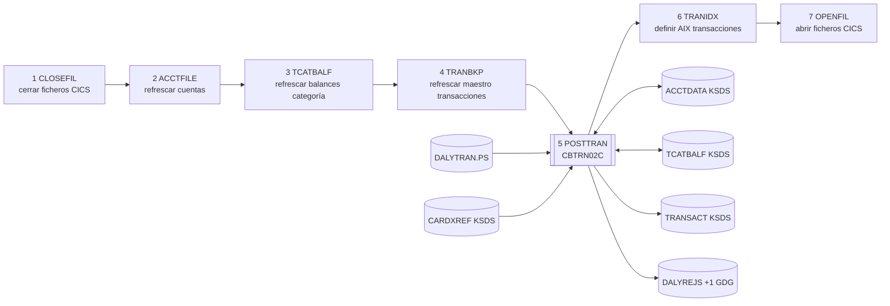

# Requisitos funcionales del job batch POSTTRAN

## 1. Identificación

| Elemento | Valor |
|---|---|
| Job | `POSTTRAN` ([`app/jcl/POSTTRAN.jcl`](../app/jcl/POSTTRAN.jcl)) |
| Paso | `STEP15 EXEC PGM=CBTRN02C` |
| Programa | `CBTRN02C` ([`app/cbl/CBTRN02C.cbl`](../app/cbl/CBTRN02C.cbl)) |
| Librería de carga | `AWS.M2.CARDDEMO.LOADLIB` (`STEPLIB`) |
| Tipo | Batch COBOL sobre ficheros secuenciales y VSAM KSDS |
| Propósito | Procesar y postear el archivo de transacciones diarias (`DALYTRAN`), actualizando el maestro de transacciones (`TRANFILE`), los balances de cuentas (`ACCTFILE`) y los balances por categoría de transacción (`TCATBALF`). Las transacciones que no superan las validaciones se escriben en el fichero de rechazos (`DALYREJS`). |

## 2. Archivos (sentencias DD)

Según [`app/jcl/POSTTRAN.jcl`](../app/jcl/POSTTRAN.jcl) y las cláusulas `SELECT` / `OPEN` de `CBTRN02C`:

| DD | Dataset | Organización / acceso | Apertura en CBTRN02C | Uso |
|---|---|---|---|---|
| `DALYTRAN` | `AWS.M2.CARDDEMO.DALYTRAN.PS` | Secuencial (PS), `DISP=SHR` | `OPEN INPUT` | Entrada: transacciones diarias (registro de 350 bytes, copybook `CVTRA06Y`). |
| `XREFFILE` | `AWS.M2.CARDDEMO.CARDXREF.VSAM.KSDS` | VSAM KSDS, acceso aleatorio por número de tarjeta | `OPEN INPUT` | Referencia tarjeta → cuenta (copybook `CVACT03Y`). |
| `ACCTFILE` | `AWS.M2.CARDDEMO.ACCTDATA.VSAM.KSDS` | VSAM KSDS, acceso aleatorio por id de cuenta | `OPEN I-O` | Lectura y actualización (`REWRITE`) de balances de cuenta (copybook `CVACT01Y`). |
| `TCATBALF` | `AWS.M2.CARDDEMO.TCATBALF.VSAM.KSDS` | VSAM KSDS, acceso aleatorio por clave cuenta + tipo + categoría | `OPEN I-O` | Lectura, creación (`WRITE`) y actualización (`REWRITE`) de balances por categoría (copybook `CVTRA01Y`). |
| `TRANFILE` | `AWS.M2.CARDDEMO.TRANSACT.VSAM.KSDS` | VSAM KSDS, acceso aleatorio por id de transacción | `OPEN OUTPUT` | Salida: maestro de transacciones posteadas (copybook `CVTRA05Y`). |
| `DALYREJS` | `AWS.M2.CARDDEMO.DALYREJS(+1)` | Nueva generación GDG, `DISP=(NEW,CATLG,DELETE)`, `RECFM=F`, `LRECL=430`, `SPACE=(CYL,(1,1),RLSE)` | `OPEN OUTPUT` | Salida: transacciones rechazadas (350 bytes de registro original + 80 bytes de trailer de validación). |

`SYSPRINT` y `SYSOUT` se dirigen a `SYSOUT=*` (estadísticas y mensajes `DISPLAY`).

## 3. Requisitos funcionales

Las referencias de línea corresponden a [`app/cbl/CBTRN02C.cbl`](../app/cbl/CBTRN02C.cbl) en `main`.

### RF-01 — Lectura secuencial de DALYTRAN (líneas 202-219)

- El programa lee `DALYTRAN` registro a registro (`1000-DALYTRAN-GET-NEXT`) hasta fin de fichero (file status `10` → `END-OF-FILE = 'Y'`).
- Por cada registro leído incrementa `WS-TRANSACTION-COUNT`, inicializa el código y la descripción de rechazo (`WS-VALIDATION-FAIL-REASON = 0`, descripción en blanco) y ejecuta `1500-VALIDATE-TRAN`.
- Si el código de rechazo queda en 0 se postea la transacción (RF-06); en caso contrario se incrementa `WS-REJECT-COUNT` y se escribe el rechazo (RF-10).
- Cualquier file status distinto de `00` o `10` en la lectura provoca abend del programa.

### RF-02 — Validación de tarjeta en XREFFILE (líneas 380-391)

- Se busca `DALYTRAN-CARD-NUM` como clave en `XREFFILE` (`1500-A-LOOKUP-XREF`).
- Si la clave no existe (`INVALID KEY`): rechazo **100** — `INVALID CARD NUMBER FOUND`.
- Si la tarjeta existe se obtiene `XREF-ACCT-ID`, que se usa en RF-03, RF-07 y RF-08.
- Si la tarjeta es inválida no se ejecutan las validaciones de cuenta (RF-03 a RF-05).

### RF-03 — Validación de cuenta en ACCTFILE (líneas 393-399)

- Se lee `ACCTFILE` con clave `XREF-ACCT-ID` (`1500-B-LOOKUP-ACCT`).
- Si la cuenta no existe (`INVALID KEY`): rechazo **101** — `ACCOUNT RECORD NOT FOUND`.

### RF-04 — Validación de límite de crédito (líneas 403-413)

- Con la cuenta encontrada se calcula:

  `WS-TEMP-BAL = ACCT-CURR-CYC-CREDIT − ACCT-CURR-CYC-DEBIT + DALYTRAN-AMT`

- Si `WS-TEMP-BAL` supera `ACCT-CREDIT-LIMIT` (es decir, no se cumple `ACCT-CREDIT-LIMIT >= WS-TEMP-BAL`): rechazo **102** — `OVERLIMIT TRANSACTION`.

### RF-05 — Validación de expiración de cuenta (líneas 414-420)

- Si `ACCT-EXPIRAION-DATE` (nombre del campo tal como figura en el copybook) es menor que la fecha de origen de la transacción `DALYTRAN-ORIG-TS(1:10)` (formato `AAAA-MM-DD`): rechazo **103** — `TRANSACTION RECEIVED AFTER ACCT EXPIRATION`.
- Esta validación se evalúa siempre después de RF-04; si ambas fallan, el código final registrado es **103** (sobrescribe al 102).

### RF-06 — Posteo de transacción válida (2000-POST-TRANSACTION, líneas 424-443)

- Se copian de `DALYTRAN-RECORD` a `TRAN-RECORD`: id, tipo, categoría, origen, descripción, importe, id/nombre/ciudad/código postal del comercio, número de tarjeta y timestamp de origen.
- `TRAN-PROC-TS` se asigna con la fecha/hora actual en formato timestamp DB2 (`AAAA-MM-DD-HH.MM.SS.mm0000`), generado por `Z-GET-DB2-FORMAT-TIMESTAMP` a partir de `FUNCTION CURRENT-DATE`.
- A continuación se ejecutan, en este orden: RF-07 (TCATBALF), RF-08 (ACCTFILE) y RF-09 (TRANFILE).

### RF-07 — Actualización de TCATBALF (líneas 467-499)

- Clave: `XREF-ACCT-ID` + `DALYTRAN-TYPE-CD` + `DALYTRAN-CAT-CD`.
- Si el registro existe (status `00`): se suma `DALYTRAN-AMT` a `TRAN-CAT-BAL` y se hace `REWRITE` (`2700-B-UPDATE-TCATBAL-REC`).
- Si no existe (status `23`, `INVALID KEY`): se inicializa un registro nuevo con la clave y `TRAN-CAT-BAL = DALYTRAN-AMT` y se hace `WRITE` (`2700-A-CREATE-TCATBAL-REC`).
- Cualquier otro status en la lectura, o un status distinto de `00` en el `WRITE`/`REWRITE`, provoca abend.

### RF-08 — Actualización de ACCTFILE (líneas 545-559)

- Se suma `DALYTRAN-AMT` a `ACCT-CURR-BAL`.
- Si `DALYTRAN-AMT >= 0` se suma a `ACCT-CURR-CYC-CREDIT`; si es negativo, a `ACCT-CURR-CYC-DEBIT`.
- Se reescribe el registro (`REWRITE`). Si falla con `INVALID KEY` se asigna el código **109** — `ACCOUNT RECORD NOT FOUND`.

### RF-09 — Escritura en TRANFILE (líneas 562-564)

- Se escribe `TRAN-RECORD` en `TRANFILE` (`2900-WRITE-TRANSACTION-FILE`).
- Un status distinto de `00` provoca abend (`ERROR WRITING TO TRANSACTION FILE`).

### RF-10 — Escritura de rechazos en DALYREJS (líneas 446-451)

- El registro de rechazo (430 bytes) se compone de:
  - `REJECT-TRAN-DATA` (350 bytes): copia íntegra de `DALYTRAN-RECORD`.
  - `VALIDATION-TRAILER` (80 bytes): `WS-VALIDATION-FAIL-REASON` (4 dígitos) + `WS-VALIDATION-FAIL-REASON-DESC` (76 caracteres).
- Un status distinto de `00` en la escritura provoca abend (`ERROR WRITING TO REJECTS FILE`).

### RF-11 — Estadísticas finales y código de retorno (líneas 227-231)

- Tras cerrar todos los ficheros se muestran por `SYSOUT`:
  - `TRANSACTIONS PROCESSED :` + `WS-TRANSACTION-COUNT`
  - `TRANSACTIONS REJECTED  :` + `WS-REJECT-COUNT`
- Si `WS-REJECT-COUNT > 0` se asigna `RETURN-CODE = 4`; si no hubo rechazos el paso termina con RC = 0.

### Tratamiento de errores de E/S (requisito transversal)

- Errores de apertura, lectura, escritura o cierre de cualquier fichero muestran el file status (`9910-DISPLAY-IO-STATUS`) y terminan el programa con abend **999** mediante `CEE3ABD` (`9999-ABEND-PROGRAM`).
- Excepciones controladas, que no provocan abend:
  - Fin de fichero (status `10`) en la lectura de `DALYTRAN` (RF-01).
  - `INVALID KEY` en la lectura de `XREFFILE` → rechazo 100 (RF-02).
  - `INVALID KEY` en la lectura de `ACCTFILE` → rechazo 101 (RF-03).
  - Registro no encontrado (status `23`) en la lectura de `TCATBALF` → creación del registro (RF-07).
  - `INVALID KEY` en el `REWRITE` de `ACCTFILE` → código 109 (RF-08, ver O-01).

## 4. Matriz de códigos de rechazo

| Código | Descripción | Requisito | Origen | Efecto |
|---|---|---|---|---|
| 100 | `INVALID CARD NUMBER FOUND` | RF-02 | Tarjeta no encontrada en `XREFFILE` | Transacción no posteada; escrita en `DALYREJS`. |
| 101 | `ACCOUNT RECORD NOT FOUND` | RF-03 | Cuenta de `XREF-ACCT-ID` no encontrada en `ACCTFILE` | Transacción no posteada; escrita en `DALYREJS`. |
| 102 | `OVERLIMIT TRANSACTION` | RF-04 | `WS-TEMP-BAL > ACCT-CREDIT-LIMIT` | Transacción no posteada; escrita en `DALYREJS`. |
| 103 | `TRANSACTION RECEIVED AFTER ACCT EXPIRATION` | RF-05 | `ACCT-EXPIRAION-DATE < DALYTRAN-ORIG-TS(1:10)` | Transacción no posteada; escrita en `DALYREJS`. Prevalece sobre 102 si ambas fallan. |
| 109 | `ACCOUNT RECORD NOT FOUND` | RF-08 | `REWRITE` de `ACCTFILE` con `INVALID KEY` | Ver observación O-01. |

## 5. Contexto operativo

`POSTTRAN` es el **Job 5 ("Core processing job")** del pipeline de posteo definido en [`scripts/run_posting.sh`](../scripts/run_posting.sh), que envía los JCL a JES por FTP:

| Orden | JCL | Función |
|---|---|---|
| 1 | `CLOSEFIL.jcl` | Cerrar ficheros en CICS (espera 5 s) |
| 2 | `ACCTFILE.jcl` | Refrescar el maestro de cuentas |
| 3 | `TCATBALF.jcl` | Refrescar balances por categoría de transacción |
| 4 | `TRANBKP.jcl` | Refrescar el maestro de transacciones |
| **5** | **`POSTTRAN.jcl`** | **Procesamiento principal: posteo de transacciones diarias (espera 10 s)** |
| 6 | `TRANIDX.jcl` | Definir el índice alternativo sobre el fichero de transacciones (espera 5 s) |
| 7 | `OPENFIL.jcl` | Reabrir ficheros en CICS |

Precondiciones: los ficheros VSAM deben estar cerrados en CICS y refrescados (jobs 1-4) antes de ejecutar POSTTRAN. Postcondiciones: el AIX de `TRANSACT` se reconstruye (job 6) y los ficheros vuelven a abrirse en CICS (job 7).

## 6. Criterios de aceptación

| Id | Criterio |
|---|---|
| CA-01 | Toda transacción de `DALYTRAN` que supera RF-02 a RF-05 queda escrita en `TRANFILE` con los campos mapeados en RF-06 copiados desde `DALYTRAN` (no se copian `DALYTRAN-PROC-TS` ni el `FILLER` final de 20 bytes) y `TRAN-PROC-TS` informado con el timestamp de proceso en formato DB2. |
| CA-02 | Por cada transacción posteada, `ACCT-CURR-BAL` de la cuenta se incrementa en `DALYTRAN-AMT`, y `ACCT-CURR-CYC-CREDIT` (importe ≥ 0) o `ACCT-CURR-CYC-DEBIT` (importe < 0) se incrementa en el mismo importe. |
| CA-03 | Por cada transacción posteada, `TRAN-CAT-BAL` de la clave cuenta + tipo + categoría se incrementa en `DALYTRAN-AMT`; si la clave no existía se crea con ese importe. |
| CA-04 | Toda transacción que falla una validación aparece en la nueva generación de `DALYREJS` con el registro original y el trailer con código (100, 101, 102 o 103) y descripción del motivo, y no modifica `TRANFILE`, `ACCTFILE` ni `TCATBALF`. |
| CA-05 | `SYSOUT` muestra `TRANSACTIONS PROCESSED` igual al número de registros de `DALYTRAN` y `TRANSACTIONS REJECTED` igual al número de registros de `DALYREJS`. |
| CA-06 | El paso termina con RC = 0 si no hubo rechazos y RC = 4 si hubo al menos uno. |
| CA-07 | Un error de E/S no controlado termina el job con abend 999 y el file status en `SYSOUT`. |

## 7. Observaciones del código actual

Comportamientos observados en `CBTRN02C` relevantes para pruebas o modernización (no se proponen cambios en este documento):

- **O-01 — Código 109 tras el posteo.** El código 109 se asigna en `2800-UPDATE-ACCOUNT-REC`, dentro de `2000-POST-TRANSACTION`, después de decidir que la transacción es válida. En ese punto `TCATBALF` ya se ha actualizado, la transacción se escribe igualmente en `TRANFILE` y no se escribe en `DALYREJS` ni se cuenta en `WS-REJECT-COUNT`.
- **O-02 — Prioridad 103 sobre 102.** RF-04 y RF-05 se evalúan de forma independiente; si ambas fallan, solo queda registrado el 103.
- **O-03 — TRANFILE abierto en OUTPUT.** `0100-TRANFILE-OPEN` abre `TRANFILE` con `OPEN OUTPUT` (línea 256); por eso el pipeline refresca el maestro de transacciones (job 4, `TRANBKP`) antes de POSTTRAN.
- **O-04 — Status mostrado al cerrar DALYREJS.** `9300-DALYREJS-CLOSE` muestra `XREFFILE-STATUS` en lugar de `DALYREJS-STATUS` si el cierre falla (línea 649).

## 8. Diagramas

### 8.1 Flujo de validación y posteo

### 8.2 Pipeline batch de posteo (`scripts/run_posting.sh`)

