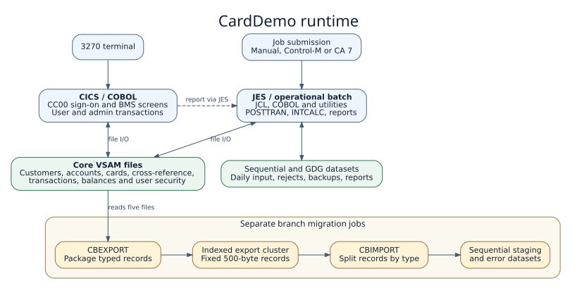

# CardDemo architecture

CardDemo simulates credit-card servicing on a mainframe. The base application is a 3270 interface running in CICS plus COBOL batch programs submitted through JES. The two paths share VSAM files. Optional modules add Db2, IMS DB, and IBM MQ; they are not required to run the base application.



## Online transaction processing

The [base CICS resource group](../app/csd/CARDDEMO.CSD) binds transaction IDs to programs, mapsets and file definitions. A 3270 session starts at `CC00` ([`COSGN00C`](../app/cbl/COSGN00C.cbl)). The sign-on program reads the `USRSEC` VSAM file and transfers control to the user menu (`COMEN01C`) or admin menu (`COADM01C`) based on the user type, passing session context in a CICS COMMAREA. BMS mapsets define the terminal screens.

The user menu leads to account, card, transaction, bill-payment, and report functions. The admin menu leads to user maintenance and, if installed, Db2 transaction-type maintenance. See the [online inventory](../README.md#online-components) for transaction IDs and the separate [user](../diagrams/Application-Flow-User.png) and [admin](../diagrams/Application-Flow-Admin.png) screen flows.

The core files are VSAM key-sequenced data sets (KSDS). The card cross-reference links a card number to its account and customer. Alternate indexes (AIX) provide alternate lookup paths; for example, `CXACAIX` is the card cross-reference path keyed by account. The [VSAM model](../diagrams/CARDDEMO-DataModel.drawio) shows the core record relationships, and the [business copybooks](../app/cpy) describe the record layouts.

## Operational batch

JCL in [`app/jcl/`](../app/jcl) binds COBOL file names to datasets and runs utilities such as IDCAMS and SORT. The table describes related jobs and their data dependencies, not a single scheduler definition.

| Job | What it does |
| --- | --- |
| [`POSTTRAN`](../app/jcl/POSTTRAN.jcl) | Runs `CBTRN02C`: reads the sequential daily input, posts accepted transactions to the transaction master, updates account and category balances, and writes rejected records to a GDG generation. |
| [`INTCALC`](../app/jcl/INTCALC.jcl) | Runs `CBACT04C`: reads balances and disclosure rates, updates accounts, and writes a generation of system-generated transactions. |
| [`TRANBKP`](../app/jcl/TRANBKP.jcl), [`COMBTRAN`](../app/jcl/COMBTRAN.jcl), [`TRANIDX`](../app/jcl/TRANIDX.jcl) | Back up and redefine the transaction master, merge the latest backup with system-generated transactions and reload it, then rebuild its alternate index and path. |
| [`CREASTMT`](../app/jcl/CREASTMT.JCL), [`TRANREPT`](../app/jcl/TRANREPT.jcl) | Produce statements (`CBSTM03A`) and transaction reports (`CBTRN03C`). The online report program [`CORPT00C`](../app/cbl/CORPT00C.cbl) also submits JCL to JES through the CICS `JOBS` queue to invoke the [`TRANREPT` procedure](../app/proc/TRANREPT.prc). |

[`CLOSEFIL`](../app/jcl/CLOSEFIL.jcl) and [`OPENFIL`](../app/jcl/OPENFIL.jcl) use SDSF to send CICS commands for selected shared files. [`DEFGDGB`](../app/jcl/DEFGDGB.jcl) defines base generation data groups (GDGs) for versioned batch output.

### Scheduler examples

| Artifact | Scope |
| --- | --- |
| [`CardDemo.controlm`](../app/scheduler/CardDemo.controlm) | Control-M XML with daily transaction backup, weekly disclosure-group and Db2 transaction-type refresh, and monthly interest-calculation workflows. For example, the daily folder orders `CLOSEFIL`, `TRANBKP`, `WAITSTEP`, and `OPENFIL` through conditions. |
| [`CardDemo.ca7`](../app/scheduler/CardDemo.ca7) | CA 7 job listing with schedule IDs, prerequisites, and triggered jobs; it includes `POSTTRAN` and file-close/open jobs. |

These are separate scheduler examples, not prerequisites for submitting JCL. Neither schedules the branch migration jobs below.

## Branch migration data transfer

1. [`CBEXPORT.jcl`](../app/jcl/CBEXPORT.jcl) uses IDCAMS to replace the indexed `AWS.M2.CARDDEMO.EXPORT.DATA` cluster. Then [`CBEXPORT`](../app/cbl/CBEXPORT.cbl) reads the customer, account, card cross-reference, transaction, and card VSAM files. Each export record carries a type marker (`C`, `A`, `X`, `T`, or `D`), a sequence number, and type-specific data defined in [`CVEXPORT`](../app/cpy/CVEXPORT.cpy). The cluster is defined for fixed 500-byte records.
2. [`CBIMPORT.jcl`](../app/jcl/CBIMPORT.jcl) points to that same indexed cluster. [`CBIMPORT`](../app/cbl/CBIMPORT.cbl) dispatches records by type to sequential staging outputs and writes unrecognized types to an error output. The supplied JCL explicitly allocates the customer, account, cross-reference, and transaction staging datasets and the error dataset. It does not load any target VSAM clusters.

The [EBCDIC export sample](../app/data/EBCDIC/AWS.M2.CARDDEMO.EXPORT.DATA.PS) is a separate sequential file in the repository, not the indexed input allocated by the import job.

## Optional modules

| Module | Integration |
| --- | --- |
| [Pending authorizations](../app/app-authorization-ims-db2-mq) | MQ request/reply; authorization data in IMS DB, account lookups in VSAM, and fraud reporting in Db2. Includes CICS screens and a batch purge. |
| [Transaction type management](../app/app-transaction-type-db2) | CICS and batch maintain Db2 reference data. Batch extraction feeds the VSAM copies used by the base application. |
| [Account extractions](../app/app-vsam-mq) | MQ request/reply for system-date and VSAM account inquiries. |

## Where things live

| Path | Contents |
| --- | --- |
| [`app/cbl/`](../app/cbl), [`app/cpy/`](../app/cpy), [`app/asm/`](../app/asm) | Base online and batch COBOL, business copybooks, and assembler helpers. |
| [`app/bms/`](../app/bms), [`app/cpy-bms/`](../app/cpy-bms), [`app/csd/`](../app/csd) | BMS map source, map copybooks, and CICS resource definitions. |
| [`app/jcl/`](../app/jcl), [`app/proc/`](../app/proc), [`app/scheduler/`](../app/scheduler) | Jobs, callable JCL procedures, and scheduler examples. |
| [`app/data/`](../app/data), [`app/catlg/`](../app/catlg) | ASCII and EBCDIC sample inputs and a sample dataset catalog listing. |
| [`samples/`](../samples), [`scripts/`](../scripts) | Sample z/OS compile JCL and procedures, Micro Focus and UniKix archives, and site-specific helper scripts. |

See the [installation guide](../README.md#installation) for z/OS prerequisites and setup. The helper scripts are not a self-contained Linux build or test harness.

## Update the diagram

Edit the [Graphviz source](../diagrams/CardDemo-Runtime.dot), then regenerate the SVG from the repository root:

```sh
dot -Tsvg diagrams/CardDemo-Runtime.dot -o diagrams/CardDemo-Runtime.svg
```
