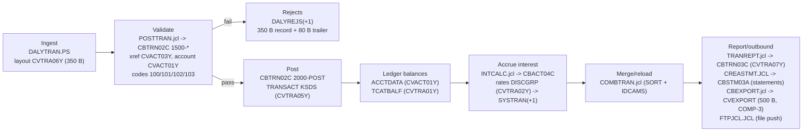

# Financial feeder readout: what is in the estate, and what to migrate first

**Scope.** This repository is a *representative* COBOL/CICS/VSAM corpus, not the production estate. Every claim below is cited to a file and line range in this repo or to a finding in the completed migration-docs code scan `scan-41385c5e0f5d44b4b21be9404949d5ad` (177 findings: 143 open, 34 dismissed; open severities 16 critical / 37 high / 65 medium / 25 low; open findings by category: 65 batch-job, 38 interactive-screen, 9 data-definition, 6 build-job, 5 scheduler-workflow). Nothing here asserts output equivalence with a mainframe run, productivity figures, or any certification or authorization status.

**Estate at a glance** (from `docs/discovery/inventory.json` on branch `devin/1789602209-estate-discovery-dossier`): 237 artifacts; 44 COBOL programs (17 batch, 25 online, 2 utility), 41 copybooks, 21 BMS maps, 46 JCL jobs, 2 procs, 4 CSD files; 548 resolved and 125 unresolved dependency edges; 2,658 conversion constructs, including 818 COMP/binary, 736 REDEFINES, 50 COMP-3, 185 GO TO, 240 EXEC CICS.

## Flow: ingest -> validate -> post -> ledger balances -> report/outbound

Daily order in [`scripts/run_full_batch.sh`](../../scripts/run_full_batch.sh#L46-L66): POSTTRAN -> INTCALC -> TRANBKP -> COMBTRAN -> TRANIDX -> OPENFIL. TRANREPT and CREASTMT are separate jobs (CREASTMT is scheduled in [`app/scheduler`](../../app/scheduler) CA-7 definitions).

## Work units mapped to feeder stages

| Stage | Programs / JCL / copybooks | What the code does (cited) | Scan finding |
|---|---|---|---|
| Ingest & validation | `CBTRN01C`, `CBTRN02C`; `POSTTRAN.jcl`; `CVTRA06Y`, `CVACT03Y`, `CVACT01Y` | Read loop counts each record, validates, then posts or rejects ([CBTRN02C L202-L219](../../app/cbl/CBTRN02C.cbl#L202-L219)). Reason codes: 100 card not in xref, 101 account missing, 102 over limit, 103 after expiry ([L380-L422](../../app/cbl/CBTRN02C.cbl#L380-L422)). 103 is tested after 102 and overwrites it. Rejects keep the input record plus an 80-byte trailer ([L446-L465](../../app/cbl/CBTRN02C.cbl#L446-L465)). | POSTTRAN job; CBTRN02C posting; CBTRN01C validation |
| Posting & ledger update | `CBTRN02C`; `CVTRA05Y`, `CVTRA01Y`, `CVACT01Y`; `COMBTRAN.jcl` | Post order is category balance, then account, then transaction write ([L424-L444](../../app/cbl/CBTRN02C.cbl#L424-L444)). Category balance is created or updated ([L467-L528](../../app/cbl/CBTRN02C.cbl#L467-L528)). Account balance and cycle credit/debit are updated; a REWRITE failure sets 109, but no reject is written ([L545-L560](../../app/cbl/CBTRN02C.cbl#L545-L560)). Money is zoned `S9(10)V99` DISPLAY, not COMP-3 ([CVACT01Y L7-L14](../../app/cpy/CVACT01Y.cpy#L7-L14), [CVTRA05Y L10](../../app/cpy/CVTRA05Y.cpy#L10)). | CBTRN02C posting; COMBTRAN merge/reload |
| Interest & fee accrual | `INTCALC.jcl` (PARM date), `CBACT04C`; `CVTRA01Y`, `CVTRA02Y` | `(TRAN-CAT-BAL * DIS-INT-RATE) / 1200` has no ROUNDED clause ([CBACT04C L464-L467](../../app/cbl/CBACT04C.cbl#L464-L467)). There is a DEFAULT rate-group fallback ([L437-L443](../../app/cbl/CBACT04C.cbl#L437-L443)). Interest is added to the balance and the cycle totals are zeroed ([L352-L356](../../app/cbl/CBACT04C.cbl#L352-L356)). The fees paragraph is an empty stub ([L518-L519](../../app/cbl/CBACT04C.cbl#L518-L519)). The run date is hard-coded in [INTCALC.jcl L22](../../app/jcl/INTCALC.jcl#L22). | INTCALC job; CBACT04C accrual |
| Reporting & outbound files | `TRANREPT.jcl`/`CBTRN03C` (`CVTRA07Y`); `CREASTMT.JCL`/`CBSTM03A`; `CBEXPORT.jcl` (`CVEXPORT`); `FTPJCL.JCL` | The report filters on DATEPARM and writes account, page and grand totals ([CBTRN03C L177-L203](../../app/cbl/CBTRN03C.cbl#L177-L203), [L293-L318](../../app/cbl/CBTRN03C.cbl#L293-L318)). Statements are written as text and HTML ([CREASTMT.JCL L79-L96](../../app/jcl/CREASTMT.JCL#L79-L96)). The export record is 500 bytes with COMP-3 money fields ([CVEXPORT L41-L71](../../app/cpy/CVEXPORT.cpy#L41-L71)). The FTP push carries host, user and password in-stream ([FTPJCL.JCL L30-L40](../../app/jcl/FTPJCL.JCL#L30-L40)). | CBTRN03C report; CBEXPORT/CBIMPORT; statement jobs |
| Control totals | `CBTRN02C`, `CBTRN03C`, `CBSTM03A` | Processed and rejected counts are displayed; RC=4 is set if any record was rejected ([CBTRN02C L227-L231](../../app/cbl/CBTRN02C.cbl#L227-L231)). Report totals are listed above. No trailer, hash total or cross-job balancing record was found in `app/cbl` or `app/cpy`. | (code search) |
| Online maintenance | CICS `CAVW`/`CAUP` account, `CT00-CT02` transactions, `CB00` bill pay | The online programs are pseudo-conversational: each returns with TRANSID + COMMAREA ([COSGN00C L98-L100](../../app/cbl/COSGN00C.cbl#L98-L100)) and shares the account/transaction VSAM files that batch uses. | 38 open interactive-screen findings |
| Security | `COSGN00C`, `COADM01C`, `COMEN01C`, `COUSR00C-03C`; `CSUSR01Y`, `COCOM01Y` | Passwords are 8-byte plaintext in USRSEC ([CSUSR01Y L18-L23](../../app/cpy/CSUSR01Y.cpy#L18-L23)). Sign-on compares the password and routes by user type A/U ([COSGN00C L223-L236](../../app/cbl/COSGN00C.cbl#L223-L236), [COCOM01Y L26-L28](../../app/cpy/COCOM01Y.cpy#L26-L28)). The admin-only check is a menu option gate ([COMEN01C L136-L141](../../app/cbl/COMEN01C.cbl#L136-L141)). Add-user writes the password as entered ([COUSR01C L157-L159](../../app/cbl/COUSR01C.cbl#L157-L159)). No audit record of admin changes was found. | COSGN00C; COUSR00C/01C/02C/03C; COADM01C |

## Migrate first: ranked candidate slices

1. **Transaction report (TRANREPT -> CBTRN03C).**
   - *Risk:* low. The slice only reads; it never updates a master file.
   - *Coupling:* reads TRANSACT, CARDXREF, TRANTYPE, TRANCATG and DATEPARM, and writes one report.
   - *Testability:* highest. The fixed-format report has page, account and grand totals that can be diffed line by line against a captured mainframe output. Edge cases to keep: the `NEXT SENTENCE` date filter and the end-of-file total behavior.
2. **Interest accrual (INTCALC -> CBACT04C).**
   - *Risk:* medium. It has one money formula, but sub-cent truncation and the DEFAULT rate fallback must match exactly.
   - *Coupling:* reads TCATBALF, CARDXREF (AIX), ACCTDATA and DISCGRP; writes SYSTRAN and rewrites accounts.
   - *Testability:* good. The output is deterministic for a given category-balance file and run date. Fees are a stub today, so the slice is small.
3. **Daily posting (POSTTRAN -> CBTRN02C).**
   - *Risk:* highest. This is the ledger write path: three masters are updated, ordering matters (account before transaction write), and there are the 103-over-102 and 109-no-reject edge cases.
   - *Coupling:* DALYTRAN, CARDXREF, ACCTDATA, TCATBALF, TRANSACT and DALYREJS.
   - *Testability:* good once 1 and 2 have established the decimal and record-layout harness. Gate it on reject-file and balance parity.

The sign-on and user administration path (COSGN00C/COUSR*) is a **parallel Zero Trust track**, not a batch slice. Replacing plaintext USRSEC credentials and adding enforced RBAC and audit is the gap the code shows. Whether that meets the mandate is decided by the program's authorizing officials.

## What the scan could not determine (asks for the system owner)

- **Feeder formats.** Which feeder systems produce the daily transaction file, their record formats, encodings and arrival windows? Only `DALYTRAN.PS` / CVTRA06Y exists here.
- **External reconciliation.** What control totals does the downstream accounting system or payment-processing interface reconcile against (record counts, hash totals, trailer records)? None are in the code.
- **Outbound interface spec.** What is the authoritative layout, transport and acknowledgement protocol for the outbound file? The FTP job here is a placeholder.
- **Reject handling.** What is the operational process for rejects: who corrects them, how they are resubmitted, and the SLA?
- **Calendar and rounding.** What is the business calendar and run-date source? INTCALC hard-codes its PARM date. Is interest truncation intended policy?
- **Network-DB access.** Which programs in the production estate use the SQL-mode network database? Its access patterns are not represented here; only the optional DB2/IMS modules are.
- **Identity and audit.** What are the identity provider, role catalogue and audit-log requirements for the target? Is there a retention policy for reports and statements?
- **Test baselines.** Can captured mainframe outputs be provided for a reference business day, to serve as parity baselines?
