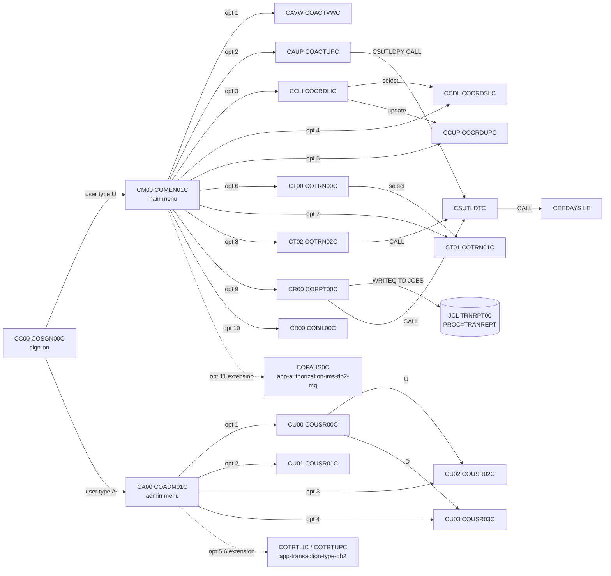
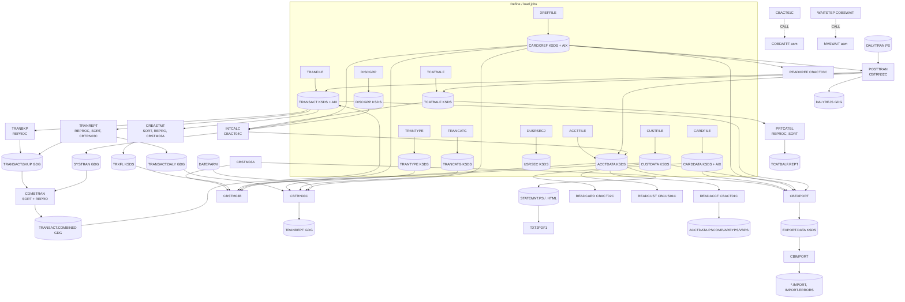

# CardDemo inventory — programs, copybooks, JCL and datasets

Ticket UNT149-1 (phase: discovery and scope). Everything below is read from the source under `app/`
at the commit this PR is based on. Statements marked **Hypothesis** are inferences, not facts from
the source.

## 1. Scope statement

**In scope:** the core VSAM/CICS/COBOL application under `app/`:
`app/cbl` (31 programs), `app/cpy` (30 copybooks), `app/cpy-bms` (17 BMS symbolic-map copybooks),
`app/bms` (17 mapsets), `app/jcl` (38 jobs), `app/proc` (2 procedures), `app/ctl` (1 IDCAMS control
member), `app/asm` + `app/maclib` (2 Assembler routines and their macros), `app/csd/CARDDEMO.CSD`,
`app/scheduler` (Control-M and CA-7 definitions), `app/catlg/LISTCAT.txt`, and the sample data in
`app/data/ASCII` (9 files) and `app/data/EBCDIC` (13 files).

**Out of scope:** the extension directories `app/app-authorization-ims-db2-mq`,
`app/app-transaction-type-db2` and `app/app-vsam-mq` (IMS/DB2/MQ variants) are not inventoried here;
they are referenced only where the core source points at them (menu options, scheduler jobs).

The COBOL under `app/` is the read-only reference for the migration; this document does not change it.

## 2. Counts

| Artifact | Directory | Count | Notes |
|---|---|---|---|
| COBOL programs | `app/cbl` | 31 | 17 CICS online, 12 batch (incl. 1 called subroutine), 2 utilities/subroutines — see §3 |
| Copybooks | `app/cpy` | 30 | 15 record/data layouts, 15 working-storage / procedure / menu copybooks |
| BMS symbolic-map copybooks | `app/cpy-bms` | 17 | one per mapset in `app/bms` |
| BMS mapsets | `app/bms` | 17 | one map per mapset |
| JCL jobs | `app/jcl` | 38 | 12 run application COBOL programs; the rest are IDCAMS/utility jobs |
| Procedures | `app/proc` | 2 | `REPROC`, `TRANREPT` |
| IDCAMS control | `app/ctl` | 1 | `REPROCT.ctl` (`REPRO INFILE(FILEIN) OUTFILE(FILEOUT)`) |
| Assembler | `app/asm`, `app/maclib` | 2 + 2 | `COBDATFT.asm`/`COCDATFT.mac`, `MVSWAIT.asm`/`ASMWAIT.mac` |
| CICS resource definitions | `app/csd/CARDDEMO.CSD` | 8 FILE, 17 MAPSET, 18 PROGRAM, 18 TRANSACTION, 1 TDQUEUE | group `CARDDEMO` |
| Schedules | `app/scheduler` | 2 | `CardDemo.controlm` (4 folders), `CardDemo.ca7` (job trigger listing) |
| Sample data | `app/data/ASCII`, `app/data/EBCDIC` | 9 + 13 | see §6 |

## 3. Programs (`app/cbl`, 31)

Classification is from the source, not the file-name prefix: a program is *CICS online* if it issues
`EXEC CICS`; *batch* if it has a `PROCEDURE DIVISION` driven by `SELECT`/`OPEN`; *utility/subroutine*
otherwise. (The ticket text said 18 online / 13 batch; the source gives 17 online — `COBSWAIT` is a
batch utility despite the `CO` prefix — and 14 non-CICS programs.)

Dataset column conventions: for batch programs `DDNAME = dataset (open mode)` where the dataset comes
from the JCL in `app/jcl` that runs the program; for online programs `CICS FILE name (CICS commands)`
where the FILE → dataset mapping is in §5.1. Copybooks `DFHAID`/`DFHBMSCA` are CICS-supplied and not
in `app/cpy`.

### 3.1 CICS online programs (17)

| Program | Tran (CSD) | Mapset / map | Copybooks (`app/cpy`, `app/cpy-bms`) | CICS files used (commands) | Programs XCTL'd / CALLed |
|---|---|---|---|---|---|
| COSGN00C | CC00 | COSGN00 / COSGN0A | COCOM01Y COTTL01Y CSDAT01Y CSMSG01Y CSUSR01Y, COSGN00 | USRSEC (READ) | XCTL `COADM01C` (user type A) or `COMEN01C` (literal targets) |
| COMEN01C | CM00 | COMEN01 / COMEN1A | COCOM01Y COMEN02Y COTTL01Y CSDAT01Y CSMSG01Y CSUSR01Y, COMEN01 | none (defines `USRSEC` literal, no file command) | XCTL `CDEMO-MENU-OPT-PGMNAME(WS-OPTION)` from COMEN02Y table (COACTVWC COACTUPC COCRDLIC COCRDSLC COCRDUPC COTRN00C COTRN01C COTRN02C CORPT00C COBIL00C COPAUS0C); XCTL `CDEMO-TO-PROGRAM`; INQUIRE PROGRAM before XCTL |
| COADM01C | CA00 | COADM01 / COADM1A | COADM02Y COCOM01Y COTTL01Y CSDAT01Y CSMSG01Y CSUSR01Y, COADM01 | none | XCTL `CDEMO-ADMIN-OPT-PGMNAME(WS-OPTION)` from COADM02Y table (COUSR00C COUSR01C COUSR02C COUSR03C COTRTLIC COTRTUPC); XCTL `CDEMO-TO-PROGRAM` (back to COSGN00C) |
| COACTVWC | CAVW | COACTVW / CACTVWA | COCOM01Y COTTL01Y CSDAT01Y CSMSG01Y CSMSG02Y CSUSR01Y CVACT01Y CVACT02Y CVACT03Y CVCRD01Y CVCUS01Y, COACTVW | CXACAIX (READ by acct id), ACCTDAT (READ), CUSTDAT (READ) | XCTL `CDEMO-TO-PROGRAM` (COMEN01C on PF3) |
| COACTUPC | CAUP | COACTUP / CACTUPA | COCOM01Y COTTL01Y CSDAT01Y CSLKPCDY CSMSG01Y CSMSG02Y CSSETATY CSUSR01Y CSUTLDPY CVACT01Y CVACT03Y CVCRD01Y CVCUS01Y, COACTUP | CXACAIX (READ), ACCTDAT (READ, READ UPDATE, REWRITE), CUSTDAT (READ, READ UPDATE, REWRITE) | XCTL `CDEMO-TO-PROGRAM`; CSUTLDPY performs date edits (CSUTLDPY contains a `CALL 'CSUTLDTC'`) |
| COCRDLIC | CCLI | COCRDLI / CCRDLIA | COCOM01Y COTTL01Y CSDAT01Y CSMSG01Y CSUSR01Y CVACT02Y CVCRD01Y, COCRDLI | CARDDAT (STARTBR, READNEXT, READPREV, ENDBR); `CARDAIX` literal defined | XCTL `CCARD-NEXT-PROG` (COCRDSLC / COCRDUPC on row select), XCTL `LIT-MENUPGM` (COMEN01C) |
| COCRDSLC | CCDL | COCRDSL / CCRDSLA | COCOM01Y COTTL01Y CSDAT01Y CSMSG01Y CSMSG02Y CSUSR01Y CVACT02Y CVCRD01Y CVCUS01Y, COCRDSL | CARDDAT (READ by card), CARDAIX (READ by acct id) | XCTL `CDEMO-TO-PROGRAM` (COCRDLIC / COMEN01C) |
| COCRDUPC | CCUP | COCRDUP / CCRDUPA | COCOM01Y COTTL01Y CSDAT01Y CSMSG01Y CSMSG02Y CSUSR01Y CVACT02Y CVCRD01Y CVCUS01Y, COCRDUP | CARDDAT (READ, READ UPDATE, REWRITE) | XCTL `CDEMO-TO-PROGRAM` (COCRDLIC / COMEN01C) |
| COTRN00C | CT00 | COTRN00 / COTRN0A | COCOM01Y COTTL01Y CSDAT01Y CSMSG01Y CVTRA05Y, COTRN00 | TRANSACT (STARTBR, READNEXT, READPREV, ENDBR) | XCTL `CDEMO-TO-PROGRAM` (COTRN01C on select, COMEN01C, COSGN00C) |
| COTRN01C | CT01 | COTRN01 / COTRN1A | COCOM01Y COTTL01Y CSDAT01Y CSMSG01Y CVTRA05Y, COTRN01 | TRANSACT (READ) | XCTL `CDEMO-TO-PROGRAM` (COTRN00C / COMEN01C / COSGN00C) |
| COTRN02C | CT02 | COTRN02 / COTRN2A | COCOM01Y COTTL01Y CSDAT01Y CSMSG01Y CVACT01Y CVACT03Y CVTRA05Y, COTRN02 | CXACAIX (READ by acct), CCXREF (READ by card), TRANSACT (STARTBR, READPREV, ENDBR to get last id; WRITE); `ACCTDAT` literal defined, not read | XCTL `CDEMO-TO-PROGRAM`; CALL `CSUTLDTC` (date validation) |
| CORPT00C | CR00 | CORPT00 / CORPT0A | COCOM01Y COTTL01Y CSDAT01Y CSMSG01Y CVTRA05Y, CORPT00 | none; WRITEQ TD `JOBS` (extra-partition TDQ → internal reader) with an embedded `TRNRPT00` job that runs `PROC=TRANREPT` | XCTL `CDEMO-TO-PROGRAM`; CALL `CSUTLDTC` |
| COBIL00C | CB00 | COBIL00 / COBIL0A | COCOM01Y COTTL01Y CSDAT01Y CSMSG01Y CVACT01Y CVACT03Y CVTRA05Y, COBIL00 | ACCTDAT (READ UPDATE, REWRITE), CXACAIX (READ), TRANSACT (STARTBR, READPREV, ENDBR; WRITE) | XCTL `CDEMO-TO-PROGRAM` (COMEN01C / COSGN00C) |
| COUSR00C | CU00 | COUSR00 / COUSR0A | COCOM01Y COTTL01Y CSDAT01Y CSMSG01Y CSUSR01Y, COUSR00 | USRSEC (STARTBR, READNEXT, READPREV, ENDBR) | XCTL `CDEMO-TO-PROGRAM` (COUSR02C / COUSR03C on select, COADM01C, COSGN00C) |
| COUSR01C | CU01 | COUSR01 / COUSR1A | COCOM01Y COTTL01Y CSDAT01Y CSMSG01Y CSUSR01Y, COUSR01 | USRSEC (WRITE) | XCTL `CDEMO-TO-PROGRAM` (COADM01C / COSGN00C) |
| COUSR02C | CU02 | COUSR02 / COUSR2A | COCOM01Y COTTL01Y CSDAT01Y CSMSG01Y CSUSR01Y, COUSR02 | USRSEC (READ UPDATE, REWRITE) | XCTL `CDEMO-TO-PROGRAM` (COADM01C / COSGN00C) |
| COUSR03C | CU03 | COUSR03 / COUSR3A | COCOM01Y COTTL01Y CSDAT01Y CSMSG01Y CSUSR01Y, COUSR03 | USRSEC (READ UPDATE, DELETE) | XCTL `CDEMO-TO-PROGRAM` (COADM01C / COSGN00C) |

Every online program also issues `SEND MAP`/`RECEIVE MAP` on its own mapset and `RETURN TRANSID(own
tranid) COMMAREA(CARDDEMO-COMMAREA)` (pseudo-conversational). The commarea is `COCOM01Y` (160 bytes).

### 3.2 Batch programs (12)

| Program | Run by (JCL step) | Copybooks | Files: DDNAME = dataset (open mode, organization) | Calls |
|---|---|---|---|---|
| CBACT01C | READACCT STEP05 | CODATECN CVACT01Y | ACCTFILE = ACCTDATA.VSAM.KSDS (INPUT, KSDS sequential); OUTFILE = ACCTDATA.PSCOMP (OUTPUT, seq); ARRYFILE = ACCTDATA.ARRYPS (OUTPUT, seq); VBRCFILE = ACCTDATA.VBPS (OUTPUT, seq) | CALL `COBDATFT` (asm, date conversion), CALL `CEE3ABD` (LE abend) |
| CBACT02C | READCARD STEP05 | CVACT02Y | CARDFILE = CARDDATA.VSAM.KSDS (INPUT, KSDS sequential) | — |
| CBACT03C | READXREF STEP05 | CVACT03Y | XREFFILE = CARDXREF.VSAM.KSDS (INPUT, KSDS sequential) | — |
| CBACT04C | INTCALC STEP15 (`PARM='2022071800'`) | CVACT01Y CVACT03Y CVTRA01Y CVTRA02Y CVTRA05Y | TCATBALF = TCATBALF.VSAM.KSDS (INPUT, sequential); XREFFILE = CARDXREF.VSAM.KSDS (INPUT, RANDOM, `ALTERNATE RECORD KEY` acct id → XREFFIL1 = CARDXREF.VSAM.AIX.PATH); ACCTFILE = ACCTDATA.VSAM.KSDS (I-O, RANDOM); DISCGRP = DISCGRP.VSAM.KSDS (INPUT, RANDOM); TRANSACT = SYSTRAN(+1) (OUTPUT, seq) | — |
| CBCUS01C | READCUST STEP05 | CVCUS01Y | CUSTFILE = CUSTDATA.VSAM.KSDS (INPUT, KSDS sequential) | — |
| CBEXPORT | CBEXPORT STEP02 | CVACT01Y CVACT02Y CVACT03Y CVCUS01Y CVEXPORT CVTRA05Y | CUSTFILE, ACCTFILE, XREFFILE, TRANSACT, CARDFILE = the five master KSDS (INPUT, sequential); EXPFILE = EXPORT.DATA (OUTPUT, KSDS keyed on `EXPORT-SEQUENCE-NUM`) | — |
| CBIMPORT | CBIMPORT STEP01 | CVACT01Y CVACT02Y CVACT03Y CVCUS01Y CVEXPORT CVTRA05Y | EXPFILE = EXPORT.DATA (INPUT, KSDS); CUSTOUT = CUSTDATA.IMPORT, ACCTOUT = ACCTDATA.IMPORT, XREFOUT = CARDXREF.IMPORT, TRNXOUT = TRANSACT.IMPORT, ERROUT = IMPORT.ERRORS (OUTPUT, seq); CARDOUT (OUTPUT, seq) — **no `CARDOUT` DD in `CBIMPORT.jcl`** | — |
| CBSTM03A | CREASTMT STEP040 | COSTM01 CUSTREC CVACT01Y CVACT03Y | STMTFILE = STATEMNT.PS (OUTPUT, seq); HTMLFILE = STATEMNT.HTML (OUTPUT, seq); reads TRNXFILE/XREFFILE/CUSTFILE/ACCTFILE only through CBSTM03B | CALL `CBSTM03B` (3 call sites: open, read, close, dispatched on `WS-M03B-AREA`) |
| CBSTM03B | subroutine of CBSTM03A | none | TRNXFILE = TRXFL.VSAM.KSDS (INPUT, sequential, key card+tran id 32); XREFFILE = CARDXREF.VSAM.KSDS (INPUT, sequential); CUSTFILE = CUSTDATA.VSAM.KSDS (INPUT, RANDOM); ACCTFILE = ACCTDATA.VSAM.KSDS (INPUT, RANDOM) | — |
| CBTRN01C | **no JCL in `app/jcl` runs it** | CVACT01Y CVACT02Y CVACT03Y CVCUS01Y CVTRA05Y CVTRA06Y | DALYTRAN (INPUT, seq); CUSTFILE, XREFFILE, CARDFILE, ACCTFILE, TRANFILE (INPUT, RANDOM KSDS) — DD names only; datasets by analogy with POSTTRAN (**Hypothesis**) | — |
| CBTRN02C | POSTTRAN STEP15 | CVACT01Y CVACT03Y CVTRA01Y CVTRA05Y CVTRA06Y | DALYTRAN = DALYTRAN.PS (INPUT, seq); XREFFILE = CARDXREF.VSAM.KSDS (INPUT, RANDOM); TRANFILE = TRANSACT.VSAM.KSDS (OUTPUT, RANDOM); DALYREJS = DALYREJS(+1) (OUTPUT, seq); ACCTFILE = ACCTDATA.VSAM.KSDS (I-O, RANDOM); TCATBALF = TCATBALF.VSAM.KSDS (I-O, RANDOM) | — |
| CBTRN03C | TRANREPT STEP10R (also via `TRANREPT.prc`) | CVACT03Y CVTRA03Y CVTRA04Y CVTRA05Y CVTRA07Y | TRANFILE = TRANSACT.DALY(+1) (INPUT, seq); CARDXREF = CARDXREF.VSAM.KSDS, TRANTYPE = TRANTYPE.VSAM.KSDS, TRANCATG = TRANCATG.VSAM.KSDS (INPUT, RANDOM); DATEPARM = DATEPARM (INPUT, seq, 80-byte start/end date); TRANREPT = TRANREPT(+1) (OUTPUT, seq) | — |

### 3.3 Utilities / subroutines (2)

| Program | Type | Run by / called by | Files | Calls |
|---|---|---|---|---|
| COBSWAIT | batch utility (no files, no CICS) | WAITSTEP | `ACCEPT PARM-VALUE FROM SYSIN` (centiseconds) | CALL `MVSWAIT` (asm) |
| CSUTLDTC | called subroutine (`PROCEDURE DIVISION USING LS-DATE, LS-DATE-FORMAT, LS-RESULT`) | CORPT00C, COTRN02C, and CSUTLDPY (copied by COACTUPC) | none | CALL `CEEDAYS` (LE date → Lilian) |

Neither `COBSWAIT` nor `CSUTLDTC` has a `DEFINE PROGRAM` in `CARDDEMO.CSD`. **Hypothesis:** `CSUTLDTC` is
statically linked into its callers.

### 3.4 Assembler (`app/asm`)

| Routine | Macro | Called by | Purpose |
|---|---|---|---|
| COBDATFT | `app/maclib/COCDATFT.mac` | CBACT01C | date-format conversion driven by the `CODATECN` parameter block (**Hypothesis**, inferred from the caller and the copybook; the asm comments are sparse) |
| MVSWAIT | `app/maclib/ASMWAIT.mac` | COBSWAIT | waits for the passed interval (`ASMWAIT` macro: "START INTERVAL CONTROL TIMER") |

## 4. Copybooks

### 4.1 Record / data layouts (`app/cpy`)

Lengths marked ✓ were confirmed by compiling a `LENGTH OF` probe with GnuCOBOL (`cobc -std=ibm`);
others are summed from the PICs. "Signed/packed" lists `S9` and `COMP`/`COMP-3` fields.

| Copybook | 01 record | Describes (dataset) | Len | Key field(s) | Signed / packed fields |
|---|---|---|---|---|---|
| CVACT01Y | ACCOUNT-RECORD | ACCTDATA.VSAM.KSDS, ACCTDATA.PS | 300 ✓ | ACCT-ID 9(11) @0 | ACCT-CURR-BAL, ACCT-CREDIT-LIMIT, ACCT-CASH-CREDIT-LIMIT, ACCT-CURR-CYC-CREDIT, ACCT-CURR-CYC-DEBIT — all `S9(10)V99` display; no COMP-3 |
| CVACT02Y | CARD-RECORD | CARDDATA.VSAM.KSDS, CARDDATA.PS | 150 ✓ | CARD-NUM X(16) @0; AIX CARD-ACCT-ID 9(11) @16 | none |
| CVACT03Y | CARD-XREF-RECORD | CARDXREF.VSAM.KSDS, CARDXREF.PS | 50 | XREF-CARD-NUM X(16) @0; AIX XREF-ACCT-ID 9(11) @25 | none |
| CVCUS01Y | CUSTOMER-RECORD | CUSTDATA.VSAM.KSDS, CUSTDATA.PS | 500 ✓ | CUST-ID 9(09) @0 | none (CUST-SSN 9(09), CUST-FICO-CREDIT-SCORE 9(03) unsigned) |
| CUSTREC | CUSTOMER-RECORD | same layout as CVCUS01Y (CUST-DOB field named `CUST-DOB-YYYYMMDD`); used only by CBSTM03A | 500 | CUST-ID 9(09) @0 | none. Lines 6–8 are indented with tab characters — GnuCOBOL rejects it (see §9) |
| CVTRA01Y | TRAN-CAT-BAL-RECORD | TCATBALF.VSAM.KSDS, TCATBALF.PS | 50 | TRAN-CAT-KEY 17 = TRANCAT-ACCT-ID 9(11) + TRANCAT-TYPE-CD X(2) + TRANCAT-CD 9(4) | TRAN-CAT-BAL `S9(09)V99` |
| CVTRA02Y | DIS-GROUP-RECORD | DISCGRP.VSAM.KSDS, DISCGRP.PS | 50 | DIS-GROUP-KEY 16 = DIS-ACCT-GROUP-ID X(10) + DIS-TRAN-TYPE-CD X(2) + DIS-TRAN-CAT-CD 9(4) | DIS-INT-RATE `S9(04)V99` |
| CVTRA03Y | TRAN-TYPE-RECORD | TRANTYPE.VSAM.KSDS, TRANTYPE.PS | 60 | TRAN-TYPE X(02) @0 | none |
| CVTRA04Y | TRAN-CAT-RECORD | TRANCATG.VSAM.KSDS, TRANCATG.PS | 60 ✓ | TRAN-CAT-KEY 6 = TRAN-TYPE-CD X(2) + TRAN-CAT-CD 9(4) | none |
| CVTRA05Y | TRAN-RECORD | TRANSACT.VSAM.KSDS, TRANSACT.* GDGs, SYSTRAN | 350 ✓ | TRAN-ID X(16) @0; AIX TRAN-PROC-TS X(26) @304 | TRAN-AMT `S9(09)V99` |
| CVTRA06Y | DALYTRAN-RECORD | DALYTRAN.PS, DALYTRAN.PS.INIT, DALYREJS (rejects = record + reason) | 350 ✓ | DALYTRAN-ID X(16) | DALYTRAN-AMT `S9(09)V99` |
| CVTRA07Y | REPORT-NAME-HEADER, TRANSACTION-DETAIL-REPORT, headers/totals | TRANREPT report lines (133 wide) | n/a | — | edited pictures `-ZZZ,ZZZ,ZZZ.ZZ`, `+ZZZ,ZZZ,ZZZ.ZZ` |
| CVEXPORT | EXPORT-RECORD | EXPORT.DATA (KSDS) / EXPORT.DATA.PS; 5 REDEFINES record types (customer, account, transaction, card xref, card) | 500 ✓ | EXPORT-SEQUENCE-NUM `9(9) COMP` @27 (4 bytes) | COMP: EXPORT-SEQUENCE-NUM, EXP-CUST-ID, EXP-ACCT-CURR-CYC-DEBIT, EXP-TRAN-MERCHANT-ID, EXP-XREF-ACCT-ID, EXP-CARD-ACCT-ID, EXP-CARD-CVV-CD; COMP-3: EXP-CUST-FICO-CREDIT-SCORE, EXP-ACCT-CURR-BAL, EXP-ACCT-CASH-CREDIT-LIMIT, EXP-TRAN-AMT; display S9: EXP-ACCT-CREDIT-LIMIT, EXP-ACCT-CURR-CYC-CREDIT |
| COSTM01 | TRNX-RECORD | TRXFL.VSAM.KSDS (TRANSACT re-keyed by card num + tran id for statements) | 350 ✓ | TRNX-KEY 32 = TRNX-CARD-NUM X(16) + TRNX-ID X(16) | TRNX-AMT `S9(09)V99` |
| CSUSR01Y | SEC-USER-DATA | USRSEC.VSAM.KSDS, USRSEC.PS | 80 ✓ | SEC-USR-ID X(08) @0 | none (SEC-USR-PWD X(08) plain text) |
| UNUSED1Y | UNUSED-DATA | same shape as CSUSR01Y; **not copied by any program** | 80 | — | none |

### 4.2 Working-storage, procedure and table copybooks (`app/cpy`)

| Copybook | Kind | Content | Used by |
|---|---|---|---|
| COCOM01Y | WS | `CARDDEMO-COMMAREA` (160 bytes): from/to tranid+program, user id/type (A/U), program context, customer/account/card ids, last map/mapset | all 17 online programs |
| COMEN02Y | table | main-menu options (count 11) → program names, incl. `COPAUS0C` (extension program, not in `app/cbl`) | COMEN01C |
| COADM02Y | table | admin-menu options (count 6) → COUSR00C..03C, `COTRTLIC`, `COTRTUPC` (extension programs) | COADM01C |
| COTTL01Y | WS | screen title literals | all online |
| CSDAT01Y | WS | current date/time work fields | all online |
| CSMSG01Y | WS | common messages | all online |
| CSMSG02Y | WS | abend-data work area | COACTVWC COACTUPC COCRDSLC COCRDUPC |
| CSLKPCDY | WS | 88-level lookup of valid US phone area codes, state codes, zip prefixes | COACTUPC |
| CSSETATY | procedure (REPLACING template) | sets screen attribute to red / `*` for a field in error | COACTUPC |
| CSSTRPFY | procedure | `YYYY-STORE-PFKEY`: maps EIBAID to `CCARD-AID-*` flags | **not copied by any program** (programs code the EVALUATE inline) |
| CSUTLDPY | procedure | date edits `EDIT-DATE-CCYYMMDD`, `EDIT-YEAR-CCYY`, `EDIT-MONTH`, `EDIT-DAY`, `EDIT-DATE-OF-BIRTH`; calls `CSUTLDTC` | COACTUPC |
| CSUTLDWY | WS | working storage for CSUTLDPY (`WS-EDIT-DATE-*`, `WS-DATE-VALIDATION-RESULT`) | **not copied by any program** (COACTUPC declares the fields inline) |
| CVCRD01Y | WS | `CC-WORK-AREAS`: AID flags, next prog/mapset/map, error/return messages, acct/card/cust ids | COACTVWC COACTUPC COCRDLIC COCRDSLC COCRDUPC |
| CODATECN | WS | `CODATECN-REC` parameter block for the COBDATFT assembler routine (input/output date + format type + error msg) | CBACT01C |

### 4.3 BMS symbolic maps (`app/cpy-bms`, 17) and mapsets (`app/bms`, 17)

Each `app/bms/<MAPSET>.bms` defines one mapset (`DFHMSD`) with one map (`DFHMDI`), and
`app/cpy-bms/<MAPSET>.CPY` is its symbolic copybook (`<map>I` / `<map>O` structures).

| Mapset (file) | Map | Symbolic copybook | Program | Tran |
|---|---|---|---|---|
| COSGN00 | COSGN0A | COSGN00.CPY | COSGN00C | CC00 |
| COMEN01 | COMEN1A | COMEN01.CPY | COMEN01C | CM00 |
| COADM01 | COADM1A | COADM01.CPY | COADM01C | CA00 |
| COACTVW | CACTVWA | COACTVW.CPY | COACTVWC | CAVW |
| COACTUP | CACTUPA | COACTUP.CPY | COACTUPC | CAUP |
| COCRDLI | CCRDLIA | COCRDLI.CPY | COCRDLIC | CCLI |
| COCRDSL | CCRDSLA | COCRDSL.CPY | COCRDSLC | CCDL |
| COCRDUP | CCRDUPA | COCRDUP.CPY | COCRDUPC | CCUP |
| COTRN00 | COTRN0A | COTRN00.CPY | COTRN00C | CT00 |
| COTRN01 | COTRN1A | COTRN01.CPY | COTRN01C | CT01 |
| COTRN02 | COTRN2A | COTRN02.CPY | COTRN02C | CT02 |
| CORPT00 | CORPT0A | CORPT00.CPY | CORPT00C | CR00 |
| COBIL00 | COBIL0A | COBIL00.CPY | COBIL00C | CB00 |
| COUSR00 | COUSR0A | COUSR00.CPY | COUSR00C | CU00 |
| COUSR01 | COUSR1A | COUSR01.CPY | COUSR01C | CU01 |
| COUSR02 | COUSR2A | COUSR02.CPY | COUSR02C | CU02 |
| COUSR03 | COUSR3A | COUSR03.CPY | COUSR03C | CU03 |

## 5. CICS resources (`app/csd/CARDDEMO.CSD`, group CARDDEMO)

### 5.1 Files

| CICS FILE | Dataset | Record copybook | Attributes |
|---|---|---|---|
| ACCTDAT | AWS.M2.CARDDEMO.ACCTDATA.VSAM.KSDS | CVACT01Y | BROWSE/DELETE/READ/UPDATE(YES), RLSACCESS(NO), JOURNAL(NO) |
| CARDDAT | AWS.M2.CARDDEMO.CARDDATA.VSAM.KSDS | CVACT02Y | same |
| CARDAIX | AWS.M2.CARDDEMO.CARDDATA.VSAM.AIX.PATH (card by account id) | CVACT02Y | same |
| CCXREF | AWS.M2.CARDDEMO.CARDXREF.VSAM.KSDS | CVACT03Y | same |
| CXACAIX | AWS.M2.CARDDEMO.CARDXREF.VSAM.AIX.PATH (xref by account id) | CVACT03Y | same |
| CUSTDAT | AWS.M2.CARDDEMO.CUSTDATA.VSAM.KSDS | CVCUS01Y | same |
| TRANSACT | AWS.M2.CARDDEMO.TRANSACT.VSAM.KSDS | CVTRA05Y | same |
| USRSEC | AWS.M2.CARDDEMO.USRSEC.VSAM.KSDS | CSUSR01Y | same |

`DEFINE TDQUEUE(JOBS)`: extra-partition output queue, RECORDSIZE(80) FIXED UNBLOCKED, DISPOSITION(MOD)
— the internal-reader queue written by CORPT00C.

### 5.2 Transactions → programs (18)

| Tran | Program (CSD) | Source in `app/cbl` |
|---|---|---|
| CC00 | COSGN00C | yes |
| CM00 | COMEN01C | yes |
| CA00 | COADM01C | yes |
| CAVW | COACTVWC | yes |
| CAUP | COACTUPC | yes |
| CCLI | COCRDLIC | yes |
| CCDL | COCRDSLC | yes |
| CCUP | COCRDUPC | yes |
| CT00 | COTRN00C | yes |
| CT01 | COTRN01C | yes |
| CT02 | COTRN02C | yes |
| CR00 | CORPT00C | yes |
| CB00 | COBIL00C | yes |
| CU00 | COUSR00C | yes |
| CU01 | COUSR01C | yes |
| CU02 | COUSR02C | yes |
| CU03 | COUSR03C | yes |
| CDV1 | COCRDSEC | **no** — `COCRDSEC` has a `DEFINE PROGRAM` but no source anywhere in the repository |

The 17 `DEFINE MAPSET` entries match `app/bms` one-to-one. `README.md` lists the same 17 core
transactions plus extension transactions (CPVS, CPVD, CP00, CTTU, CTLI, CDRD) that live in the `app-*`
directories.

## 6. Datasets

All names are under HLQ `AWS.M2.CARDDEMO` unless shown in full. "Defined by" is the JCL that issues the
IDCAMS `DEFINE`.

### 6.1 VSAM KSDS

| Dataset | KEYS(len off) | RECSZ | Defined / loaded by | Loaded from | Record copybook | Readers / writers |
|---|---|---|---|---|---|---|
| ACCTDATA.VSAM.KSDS | 11 0 | 300 | ACCTFILE.jcl | ACCTDATA.PS | CVACT01Y | CICS ACCTDAT; CBACT01C(I), CBACT04C(I-O), CBTRN02C(I-O), CBTRN01C(I), CBEXPORT(I), CBSTM03B(I) |
| CARDDATA.VSAM.KSDS | 16 0 | 150 | CARDFILE.jcl | CARDDATA.PS | CVACT02Y | CICS CARDDAT/CARDAIX; CBACT02C, CBTRN01C, CBEXPORT (I) |
| CARDXREF.VSAM.KSDS | 16 0 | 50 | XREFFILE.jcl | CARDXREF.PS | CVACT03Y | CICS CCXREF/CXACAIX; CBACT03C, CBACT04C, CBTRN01C, CBTRN02C, CBTRN03C, CBEXPORT, CBSTM03B (I) |
| CUSTDATA.VSAM.KSDS | 9 0 | 500 | CUSTFILE.jcl | CUSTDATA.PS | CVCUS01Y | CICS CUSTDAT; CBCUS01C, CBTRN01C, CBEXPORT, CBSTM03B (I) |
| TRANSACT.VSAM.KSDS | 16 0 | 350 | TRANFILE.jcl, TRANBKP.jcl | DALYTRAN.PS.INIT (TRANFILE), TRANSACT.COMBINED(+1) (COMBTRAN) | CVTRA05Y | CICS TRANSACT; CBTRN02C(O), CBTRN01C(I), CBEXPORT(I); unloaded by REPROC in TRANBKP/TRANREPT/PRTCATBL |
| USRSEC.VSAM.KSDS | 8 0 | 80 | DUSRSECJ.jcl | USRSEC.PS (in-stream) | CSUSR01Y | CICS USRSEC only |
| TCATBALF.VSAM.KSDS | 17 0 | 50 | TCATBALF.jcl | TCATBALF.PS | CVTRA01Y | CBACT04C(I), CBTRN02C(I-O); unloaded by PRTCATBL |
| DISCGRP.VSAM.KSDS | 16 0 | 50 | DISCGRP.jcl | DISCGRP.PS | CVTRA02Y | CBACT04C(I) |
| TRANTYPE.VSAM.KSDS | 2 0 | 60 | TRANTYPE.jcl | TRANTYPE.PS | CVTRA03Y | CBTRN03C(I) |
| TRANCATG.VSAM.KSDS | 6 0 | 60 | TRANCATG.jcl | TRANCATG.PS | CVTRA04Y | CBTRN03C(I) |
| TRXFL.VSAM.KSDS | 32 0 | 350 | CREASTMT.JCL | TRXFL.SEQ (SORT of TRANSACT by card+tran id) | COSTM01 | CBSTM03B(I) |
| EXPORT.DATA | 4 28 | 500 | CBEXPORT.jcl | written by CBEXPORT | CVEXPORT | CBEXPORT(O), CBIMPORT(I) |
| AWS.CUSTDATA.CLUSTER | 10 0 | 500 | DEFCUST.jcl | — | — | not referenced by any program or other JCL (different HLQ and key length) |
| USRSEC.VSAM.ESDS, USRSEC.VSAM.RRDS | — | 80 | ESDSRRDS.jcl | ESDSRRDS.PS | CSUSR01Y | not referenced by any program (ESDS/RRDS demonstration) |

### 6.2 Alternate indexes and paths

| AIX / PATH | Base | KEYS(len off) = field | Defined by | Used as |
|---|---|---|---|---|
| CARDDATA.VSAM.AIX / .AIX.PATH | CARDDATA.VSAM.KSDS | 11 16 = CARD-ACCT-ID | CARDFILE.jcl | CICS CARDAIX |
| CARDXREF.VSAM.AIX / .AIX.PATH | CARDXREF.VSAM.KSDS | 11 25 = XREF-ACCT-ID | XREFFILE.jcl | CICS CXACAIX; INTCALC `XREFFIL1` DD for CBACT04C alternate key |
| TRANSACT.VSAM.AIX / .AIX.PATH | TRANSACT.VSAM.KSDS | 26 304 = TRAN-PROC-TS | TRANFILE.jcl, TRANIDX.jcl | not used by any program in `app/` |

### 6.3 Sequential datasets

| Dataset | Produced by | Consumed by | Layout |
|---|---|---|---|
| ACCTDATA.PS, CARDDATA.PS, CARDXREF.PS, CUSTDATA.PS, TCATBALF.PS, DISCGRP.PS, TRANTYPE.PS, TRANCATG.PS | shipped (`app/data/EBCDIC`) | IDCAMS REPRO load jobs | master copybooks (§4.1) |
| DALYTRAN.PS | shipped | POSTTRAN (CBTRN02C DALYTRAN) | CVTRA06Y |
| DALYTRAN.PS.INIT | shipped (1 record) | TRANFILE (seed of TRANSACT) | CVTRA06Y |
| USRSEC.PS | DUSRSECJ (IEBGENER in-stream) | DUSRSECJ REPRO | CSUSR01Y |
| ESDSRRDS.PS | ESDSRRDS | ESDSRRDS REPRO | CSUSR01Y |
| DATEPARM | not created by any job in `app/jcl` (CORPT00C writes it in-stream as `//STEP10R.DATEPARM DD *`) | TRANREPT STEP10R (CBTRN03C) | 80 bytes: start date X(10), end date X(10) |
| ACCTDATA.PSCOMP, ACCTDATA.ARRYPS, ACCTDATA.VBPS | READACCT (CBACT01C) | — | program-defined output records |
| STATEMNT.PS, STATEMNT.HTML | CREASTMT (CBSTM03A) | TXT2PDF1 (STATEMNT.PS) | statement text / HTML lines |
| TRXFL.SEQ | CREASTMT STEP010 SORT | CREASTMT STEP020 REPRO → TRXFL.VSAM.KSDS | COSTM01 |
| TCATBALF.REPT | PRTCATBL SORT | — | CVTRA01Y |
| CUSTDATA.IMPORT, ACCTDATA.IMPORT, CARDXREF.IMPORT, TRANSACT.IMPORT, IMPORT.ERRORS | CBIMPORT | — | master copybooks / error lines |
| EXPORT.DATA.PS | shipped (`app/data/EBCDIC`) | — (the JCL uses the KSDS `EXPORT.DATA`) | CVEXPORT |
| AWS.M2.CARDEMO.FTP.TEST(.BKUP, .BKUP.INTRDR) | INTRDRJ1 / INTRDRJ2 | INTRDR demo | n/a (note the HLQ typo `CARDEMO` is in the source) |

### 6.4 Generation data groups

| GDG base | LIMIT | Defined by | Written by (+1) | Read by |
|---|---|---|---|---|
| TRANSACT.BKUP | 5 | DEFGDGB | TRANBKP, TRANREPT, TRANREPT.prc (REPROC unload of TRANSACT) | COMBTRAN (0), TRANREPT SORT (+1) |
| TRANSACT.DALY | 5 | DEFGDGB | TRANREPT STEP05R SORT | CBTRN03C |
| TRANREPT | 5 (DEFGDGB) / 10 (REPTFILE) | DEFGDGB, REPTFILE | CBTRN03C | — |
| TCATBALF.BKUP | 5 | DEFGDGB | PRTCATBL REPROC | PRTCATBL SORT |
| SYSTRAN | 5 | DEFGDGB | INTCALC (CBACT04C TRANSACT) | COMBTRAN (0) |
| TRANSACT.COMBINED | 5 | DEFGDGB | COMBTRAN SORT | COMBTRAN REPRO → TRANSACT KSDS |
| DALYREJS | 5 | DALYREJS.jcl | POSTTRAN (CBTRN02C) | — |
| TRANTYPE.BKUP, TRANCATG.PS.BKUP, DISCGRP.BKUP | 5 | DEFGDGD (+ IEBGENER first generation from the .PS files) | — | — |

### 6.5 Sample data files

| `app/data/EBCDIC` file | bytes | = records × LRECL | `app/data/ASCII` file | lines / max len | Layout |
|---|---|---|---|---|---|
| AWS.M2.CARDDEMO.ACCTDATA.PS | 15000 | 50 × 300 | acctdata.txt | 50 / 300 | CVACT01Y |
| AWS.M2.CARDDEMO.ACCDATA.PS | 15000 | 50 × 300 | — | — | same size as ACCTDATA.PS; not referenced by any JCL (**Hypothesis:** older copy / typo) |
| AWS.M2.CARDDEMO.CARDDATA.PS | 7500 | 50 × 150 | carddata.txt | 50 / 150 | CVACT02Y |
| AWS.M2.CARDDEMO.CARDXREF.PS | 2500 | 50 × 50 | cardxref.txt | 50 / 36 (trailing filler trimmed) | CVACT03Y |
| AWS.M2.CARDDEMO.CUSTDATA.PS | 25000 | 50 × 500 | custdata.txt | 50 / 500 | CVCUS01Y |
| AWS.M2.CARDDEMO.DALYTRAN.PS | 105000 | 300 × 350 | dailytran.txt | 300 / 350 | CVTRA06Y |
| AWS.M2.CARDDEMO.DALYTRAN.PS.INIT | 350 | 1 × 350 | — | — | CVTRA06Y |
| AWS.M2.CARDDEMO.DISCGRP.PS | 2550 | 51 × 50 | discgrp.txt | 51 / 50 | CVTRA02Y |
| AWS.M2.CARDDEMO.TCATBALF.PS | 2500 | 50 × 50 | tcatbal.txt | 50 / 51 | CVTRA01Y |
| AWS.M2.CARDDEMO.TRANCATG.PS | 1080 | 18 × 60 | trancatg.txt | 18 / 61 | CVTRA04Y |
| AWS.M2.CARDDEMO.TRANTYPE.PS | 420 | 7 × 60 | trantype.txt | 7 / 61 | CVTRA03Y |
| AWS.M2.CARDDEMO.USRSEC.PS | 800 | 10 × 80 | — | — | CSUSR01Y |
| AWS.M2.CARDDEMO.EXPORT.DATA.PS | 250000 | 500 × 500 | — | — | CVEXPORT |

The ASCII `tcatbal/trancatg/trantype` files are one byte longer than their LRECL (**Hypothesis:** a
trailing CR or delimiter); `cardxref.txt` lines are shorter because trailing FILLER spaces were
dropped. `app/catlg/LISTCAT.txt` is an IDCAMS `LISTCAT LEVEL(AWS.M2.CARDDEMO) ALL` listing from 2022
that confirms the catalog entries for the datasets above.

## 7. JCL (`app/jcl`, 38) and procedures (`app/proc`, 2)

| Job | Steps (PGM) | Key DD → dataset | Purpose |
|---|---|---|---|
| ACCTFILE | STEP05 IDCAMS delete; STEP10 IDCAMS define; STEP15 IDCAMS REPRO | ACCTDATA=ACCTDATA.PS → ACCTVSAM=ACCTDATA.VSAM.KSDS | define/load account KSDS |
| CARDFILE | CLCIFIL SDSF (CEMT CLO CARDDAT, CARDAIX); STEP05 delete; STEP10 define; STEP15 REPRO; STEP40 DEFINE AIX; STEP50 DEFINE PATH; STEP60 BLDINDEX; OPCIFIL SDSF (CEMT OPE) | CARDDATA=CARDDATA.PS → CARDVSAM=CARDDATA.VSAM.KSDS; AIX CARDDATA.VSAM.AIX(.PATH) | define/load card KSDS + account-id AIX |
| XREFFILE | STEP05 delete; STEP10 define; STEP15 REPRO; STEP20 DEFINE AIX; STEP25 PATH; STEP30 BLDINDEX | XREFDATA=CARDXREF.PS → XREFVSAM=CARDXREF.VSAM.KSDS; AIX CARDXREF.VSAM.AIX(.PATH) | define/load xref KSDS + account-id AIX |
| CUSTFILE | CLCIFIL SDSF (CLO CUSTDAT); STEP05; STEP10; STEP15 REPRO; OPCIFIL SDSF (OPE) | CUSTDATA=CUSTDATA.PS → CUSTVSAM=CUSTDATA.VSAM.KSDS | define/load customer KSDS |
| TRANFILE | CLCIFIL SDSF (CLO TRANSACT, CXACAIX); STEP05 delete cluster+AIX; STEP10 define; STEP15 REPRO; STEP20/25/30 AIX+PATH+BLDINDEX; OPCIFIL SDSF | TRANSACT=DALYTRAN.PS.INIT → TRANVSAM=TRANSACT.VSAM.KSDS; AIX TRANSACT.VSAM.AIX | define/seed transaction KSDS + proc-timestamp AIX |
| TRANIDX | STEP20 DEFINE AIX; STEP25 PATH; STEP30 BLDINDEX | TRANSACT.VSAM.AIX(.PATH) | (re)build transaction AIX only |
| TRANBKP | JCLLIB PROC; STEP05R PROC=REPROC; STEP05 IDCAMS delete cluster+AIX; STEP10 IDCAMS define (COND=(4,LT)) | REPROC FILEIN=TRANSACT.VSAM.KSDS → FILEOUT=TRANSACT.BKUP(+1) | back up and re-create empty transaction KSDS |
| TCATBALF | STEP05; STEP10 define; STEP15 REPRO | TCATBAL=TCATBALF.PS → TCATBALV=TCATBALF.VSAM.KSDS | define/load category-balance KSDS |
| DISCGRP | STEP05; STEP10 define; STEP15 REPRO | DISCGRP=DISCGRP.PS → DISCVSAM=DISCGRP.VSAM.KSDS | define/load disclosure-group KSDS |
| TRANTYPE | STEP05; STEP10 define; STEP15 REPRO | TRANTYPE=TRANTYPE.PS → TTYPVSAM=TRANTYPE.VSAM.KSDS | define/load transaction-type KSDS |
| TRANCATG | STEP05; STEP10 define; STEP15 REPRO | TRANCATG=TRANCATG.PS → TCATVSAM=TRANCATG.VSAM.KSDS | define/load transaction-category KSDS |
| DUSRSECJ | PREDEL IEFBR14; STEP01 IEBGENER (in-stream users); STEP02 IDCAMS define; STEP03 REPRO | SYSUT2=USRSEC.PS; IN=USRSEC.PS → OUT=USRSEC.VSAM.KSDS | create user-security KSDS |
| ESDSRRDS | PREDEL IEFBR14; STEP01 IEBGENER; STEP02 define ESDS; STEP03 REPRO; STEP04 define RRDS; STEP05 REPRO | ESDSRRDS.PS → USRSEC.VSAM.ESDS, USRSEC.VSAM.RRDS | ESDS/RRDS demonstration |
| DEFCUST | STEP05 IDCAMS delete; STEP05 IDCAMS define | AWS.CUSTDATA.CLUSTER (KEYS 10 0) | alternate customer cluster; duplicate step name `STEP05` in source |
| DEFGDGB | STEP05 IDCAMS | GDG bases TRANSACT.BKUP, TRANSACT.DALY, TRANREPT, TCATBALF.BKUP, SYSTRAN, TRANSACT.COMBINED (LIMIT 5) | define GDG bases |
| DEFGDGD | STEP10/30/50 IDCAMS define GDG; STEP20/40/60 IEBGENER | TRANTYPE.PS→TRANTYPE.BKUP(+1); TRANCATG.PS→TRANCATG.PS.BKUP(+1); DISCGRP.PS→DISCGRP.BKUP(+1) | reference-data GDGs + first generation |
| DALYREJS | STEP05 IDCAMS | GDG DALYREJS LIMIT(5) | define rejects GDG |
| REPTFILE | STEP05 IDCAMS | GDG TRANREPT LIMIT(10) | define report GDG (also in DEFGDGB with LIMIT 5) |
| CLOSEFIL | CLCIFIL SDSF | `CEMT SET FIL(...) CLO` for TRANSACT CCXREF ACCTDAT CXACAIX USRSEC | close CICS files before batch |
| OPENFIL | OPCIFIL SDSF | `CEMT SET FIL(...) OPE` for the same five | re-open CICS files |
| WAITSTEP | WAIT PGM=COBSWAIT | STEPLIB=LOADLIB; SYSIN in-stream centiseconds | pause between jobs |
| POSTTRAN | STEP15 PGM=CBTRN02C | TRANFILE=TRANSACT.VSAM.KSDS; DALYTRAN=DALYTRAN.PS; XREFFILE; DALYREJS=DALYREJS(+1); ACCTFILE; TCATBALF | post daily transactions |
| INTCALC | STEP15 PGM=CBACT04C PARM='2022071800' | TCATBALF; XREFFILE; XREFFIL1=CARDXREF.VSAM.AIX.PATH; ACCTFILE; DISCGRP; TRANSACT=SYSTRAN(+1) | interest and fees |
| COMBTRAN | STEP05R SORT; STEP10 IDCAMS REPRO | SORTIN=TRANSACT.BKUP(0)+SYSTRAN(0) → SORTOUT=TRANSACT.COMBINED(+1) → TRANSACT.VSAM.KSDS | merge system transactions into master |
| TRANREPT | JCLLIB PROC; STEP05R PROC=REPROC; STEP05R SORT (INCLUDE on TRAN-PROC-DT vs PARM dates); STEP10R PGM=CBTRN03C | TRANSACT KSDS → TRANSACT.BKUP(+1) → TRANSACT.DALY(+1); CARDXREF, TRANTYPE, TRANCATG KSDS; DATEPARM; TRANREPT(+1) | transaction report (also submitted by CORPT00C as `TRNRPT00` via PROC) ; two steps share the name `STEP05R` |
| PRTCATBL | JCLLIB PROC; DELDEF IEFBR14; STEP05R PROC=REPROC; STEP10R SORT | TCATBALF KSDS → TCATBALF.BKUP(+1) → TCATBALF.REPT | print category balances |
| CREASTMT | DELDEF01 IDCAMS define TRXFL; STEP010 SORT; STEP020 REPRO; STEP030 IEFBR14; STEP040 PGM=CBSTM03A | TRANSACT KSDS → TRXFL.SEQ → TRXFL.VSAM.KSDS; TRNXFILE, XREFFILE, ACCTFILE, CUSTFILE; STMTFILE=STATEMNT.PS, HTMLFILE=STATEMNT.HTML | statements (text + HTML) |
| TXT2PDF1 | TXT2PDF IKJEFT1B (REXX `TXT2PDF`) | INDD=STATEMNT.PS; SYSEXEC=AWS.M2.LBD.TXT2PDF.EXEC | convert statement to PDF |
| READACCT | PREDEL IEFBR14; STEP05 PGM=CBACT01C | ACCTFILE; OUTFILE=ACCTDATA.PSCOMP; ARRYFILE=ACCTDATA.ARRYPS; VBRCFILE=ACCTDATA.VBPS | read/print accounts |
| READCARD | STEP05 PGM=CBACT02C | CARDFILE=CARDDATA.VSAM.KSDS | read/print cards |
| READCUST | STEP05 PGM=CBCUS01C | CUSTFILE=CUSTDATA.VSAM.KSDS | read/print customers |
| READXREF | STEP05 PGM=CBACT03C | XREFFILE=CARDXREF.VSAM.KSDS | read/print xref |
| CBEXPORT | STEP01 IDCAMS define EXPORT.DATA; STEP02 PGM=CBEXPORT | CUSTFILE ACCTFILE XREFFILE TRANSACT CARDFILE (KSDS) → EXPFILE=EXPORT.DATA | multi-record export |
| CBIMPORT | STEP01 PGM=CBIMPORT | EXPFILE=EXPORT.DATA → CUSTOUT/ACCTOUT/XREFOUT/TRNXOUT (*.IMPORT), ERROUT=IMPORT.ERRORS | import/split export file (no CARDOUT DD) |
| CBADMCDJ | STEP1 DFHCSDUP | DFHCSD=OEM.CICSTS.DFHCSD | defines a CARDDEMO group with **different** resource names (COSGN00M, COACT00S, COTRN00S, CCDM/CCT1-4 …) that do not match `CARDDEMO.CSD` or `app/cbl` (**Hypothesis:** older naming scheme) |
| FTPJCL | STEP1 PGM=FTP | in-stream server/user/password placeholders | FTP template |
| INTRDRJ1 | IDCAMS REPRO; STEP01 IEBGENER SYSUT1=AWS.M2.CARDDEMO.JCL(INTRDRJ2) → INTRDR | AWS.M2.CARDEMO.FTP.TEST → .BKUP | internal-reader chaining demo |
| INTRDRJ2 | IDCAMS REPRO | FTP.TEST.BKUP → FTP.TEST.BKUP.INTRDR | second job of the demo |

| Procedure | Steps | Notes |
|---|---|---|
| REPROC.prc | PRC001 IDCAMS, FILEIN/FILEOUT=NULLFILE overridden by caller, SYSIN=&CNTLLIB(REPROCT) → `app/ctl/REPROCT.ctl` | generic VSAM unload/load |
| TRANREPT.prc | STEP01R PROC=REPROC; STEP05R SORT; STEP10R PGM=CBTRN03C — same DDs as TRANREPT.jcl | its PROC statement reads `//REPROC PROC` (**Hypothesis:** copy/paste; the member name is what CORPT00C's `EXEC PROC=TRANREPT` resolves) |

## 8. Scheduling (`app/scheduler`)

### 8.1 Control-M (`CardDemo.controlm`, application CARD-DEMO)

| Folder | Jobs in order (IN/OUT conditions chain them) | Calendar |
|---|---|---|
| DAILY-TransactionBackup | CLOSEFIL → TRANBKP → WAITSTEP → OPENFIL | DAYS="ALL" |
| WEEKLY-TransactionTypesDBRefresh | MNTTRDB2 → TRANEXTR (DB2 extension jobs, not in `app/jcl`) ; sub-folder DisclosureGroupsRefresh | DAYS="SA" |
| WEEKLY-DisclosureGroupsRefresh | (after MNTTRDB2) CLOSEFIL → DISCGRP → WAITSTEP → OPENFIL | DAYS="SA" |
| MONTHLY-InterestCalculation | CLOSEFIL → INTCALC → COMBTRAN → WAITSTEP → OPENFIL | folder-level (no DAYS attribute on the jobs) |

### 8.2 CA-7 (`CardDemo.ca7`, `LJOB,LIST=ALL` output, system CARDDEMO)

Trigger chains read from the "TRIGGERED JOBS" sections (SCHID 030 unless noted):

- CLOSEFIL → CBPAUP0J (IMS/DB2/MQ extension job) → POSTTRAN → WAITSTEP → OPENFIL
- CLOSEFIL → TRANTYPE → WAITSTEP → CLOSEFIL1 (SCHID 031) → TRANCATG → WAITSTEP → CLOSEFIL, and CLOSEFIL2 (SCHID 032) → TCATBALF → WAITSTEP → CLOSEFIL
- CLOSEFIL → READACCT → READCARD → READCUST → READXREF → WAITSTEP → OPENFIL
- CLOSEFIL → CREASTMT → TXT2PDF1 → WAITSTEP → OPENFIL
- CLOSEFIL → PRTCATBL → WAITSTEP → OPENFIL

Neither schedule runs TRANREPT (submitted online by CORPT00C), CBEXPORT/CBIMPORT, or the file-define jobs.

## 9. Program → dataset matrix

R = read, W = write/add, U = read-for-update/rewrite, D = delete, B = browse. Online programs through
the CICS FILE name; batch through the DD.

| Program | ACCTDATA | CARDDATA (+AIX) | CARDXREF (+AIX) | CUSTDATA | TRANSACT | USRSEC | TCATBALF | DISCGRP | TRANTYPE | TRANCATG | TRXFL | EXPORT.DATA | Sequential / GDG |
|---|---|---|---|---|---|---|---|---|---|---|---|---|---|
| COSGN00C | | | | | | R | | | | | | | |
| COMEN01C | | | | | | | | | | | | | |
| COADM01C | | | | | | | | | | | | | |
| COACTVWC | R | | R (AIX) | R | | | | | | | | | |
| COACTUPC | U | | R (AIX) | U | | | | | | | | | |
| COCRDLIC | | B | | | | | | | | | | | |
| COCRDSLC | | R (+AIX) | | | | | | | | | | | |
| COCRDUPC | | U | | | | | | | | | | | |
| COTRN00C | | | | | B | | | | | | | | |
| COTRN01C | | | | | R | | | | | | | | |
| COTRN02C | | | R (+AIX) | | B W | | | | | | | | |
| CORPT00C | | | | | | | | | | | | | TDQ JOBS (W) |
| COBIL00C | U | | R (AIX) | | B W | | | | | | | | |
| COUSR00C | | | | | | B | | | | | | | |
| COUSR01C | | | | | | W | | | | | | | |
| COUSR02C | | | | | | U | | | | | | | |
| COUSR03C | | | | | | D | | | | | | | |
| CBACT01C | R | | | | | | | | | | | | ACCTDATA.PSCOMP/.ARRYPS/.VBPS (W) |
| CBACT02C | | R | | | | | | | | | | | |
| CBACT03C | | | R | | | | | | | | | | |
| CBACT04C | U | | R (+AIX) | | | | R | R | | | | | SYSTRAN(+1) (W) |
| CBCUS01C | | | | R | | | | | | | | | |
| CBEXPORT | R | R | R | R | R | | | | | | | W | |
| CBIMPORT | | | | | | | | | | | | R | *.IMPORT, IMPORT.ERRORS (W) |
| CBSTM03A | | | | | | | | | | | | | STATEMNT.PS/.HTML (W) |
| CBSTM03B | R | | R | R | | | | | | | R | | |
| CBTRN01C | R | R | R | R | R | | | | | | | | DALYTRAN (R) |
| CBTRN02C | U | | R | | W | | U | | | | | | DALYTRAN.PS (R), DALYREJS(+1) (W) |
| CBTRN03C | | | R | | | | | | R | R | | | TRANSACT.DALY(+1) (R), DATEPARM (R), TRANREPT(+1) (W) |
| COBSWAIT | | | | | | | | | | | | | SYSIN (R) |
| CSUTLDTC | | | | | | | | | | | | | |

## 10. Call / flow graphs

### 10.1 Online navigation (XCTL) and calls

All sub-screens XCTL back to their menu (`CDEMO-TO-PROGRAM`, PF3) and most return to COSGN00C when
invoked without a commarea; those edges are omitted for readability.

### 10.2 Batch flow (jobs → programs → datasets)

## 11. Observations and hypotheses for later tickets

Facts (from source):

1. `CBTRN01C` is not executed by any JCL in `app/jcl`; `CBTRN02C` (POSTTRAN) is the posting job that is scheduled.
2. `CBIMPORT.cbl` SELECTs `CARD-OUTPUT ASSIGN TO CARDOUT` and opens it, but `CBIMPORT.jcl` has no `CARDOUT` DD.
3. `CARDDEMO.CSD` transaction `CDV1` → program `COCRDSEC` has no source in the repository; `COMEN02Y` option 11 (`COPAUS0C`) and `COADM02Y` options 5–6 (`COTRTLIC`, `COTRTUPC`) point at programs in the out-of-scope `app-*` directories.
4. `UNUSED1Y`, `CSSTRPFY` and `CSUTLDWY` are not copied by any program in `app/cbl`.
5. `TRANSACT.VSAM.AIX` (by `TRAN-PROC-TS`) is defined (TRANFILE, TRANIDX) but no program in `app/` reads through it.
6. `CBSTM03A` uses `ALTER ... TO PROCEED TO` / `GO TO` to switch the file-open paragraph (relevant for translation).
7. `CORPT00C` embeds an 80-column JCL stream (`TRNRPT00`, `PROC=TRANREPT`, in-stream `DATEPARM`) and writes it to TDQ `JOBS`.
8. The CA-7 chain starts POSTTRAN after `CBPAUP0J`, a job from `app-authorization-ims-db2-mq`; the Control-M daily folder does not run POSTTRAN at all.

Hypotheses:

- `EXPORT.DATA` is defined with `KEYS(4 28)` while `EXPORT-SEQUENCE-NUM` sits at offset 27 (1 + 26 bytes) in `CVEXPORT`; the one-byte difference is probably a defect in `CBEXPORT.jcl` and should be confirmed before porting the export/import pair.
- `TRANREPT` GDG is defined twice with different limits (DEFGDGB LIMIT 5, REPTFILE LIMIT 10); REPTFILE is probably the later definition.
- `AWS.M2.CARDDEMO.ACCDATA.PS` in `app/data/EBCDIC` is an older copy of `ACCTDATA.PS` (same size, not referenced).
- `CBADMCDJ.jcl` reflects an earlier naming scheme and is not the CSD the online programs run with.

## 12. GnuCOBOL syntax check of the non-CICS programs (aid for the golden-set work)

`cobc -fsyntax-only -std=ibm -I app/cpy app/cbl/<PGM>` (GnuCOBOL as installed on the build VM). This
is only a syntax gate for choosing golden-set candidates; it is not a statement about mainframe compile
status and the CICS programs were not checked (they need the CICS translator).

| Program | Result | Note |
|---|---|---|
| CBACT01C | OK | |
| CBACT02C | OK | |
| CBACT03C | OK | |
| CBACT04C | OK | |
| CBCUS01C | OK | |
| CBEXPORT | FAIL | `RECORD KEY IS EXPORT-SEQUENCE-NUM` names a field that is in WORKING-STORAGE (CVEXPORT), not in the FD record — GnuCOBOL: "'EXPORT-SEQUENCE-NUM' is not defined" |
| CBIMPORT | FAIL | same cause (`CBIMPORT.cbl:40`) |
| CBSTM03A | FAIL | `CUSTREC.cpy` lines 6–8 start with tab characters; GnuCOBOL reports "unbalanced parentheses" and 39 follow-on errors. `CVCUS01Y` (same layout, no tabs) compiles |
| CBSTM03B | OK | |
| CBTRN01C | OK | |
| CBTRN02C | OK | |
| CBTRN03C | OK | |
| COBSWAIT | OK | |
| CSUTLDTC | OK | |

**Hypothesis:** the three failures are tolerated by Enterprise COBOL (tabs are accepted by the IBM
compiler; the RECORD KEY issue may be masked by how the program was compiled on the mainframe) — they
need to be confirmed against the mainframe listings before the golden set relies on these programs.
