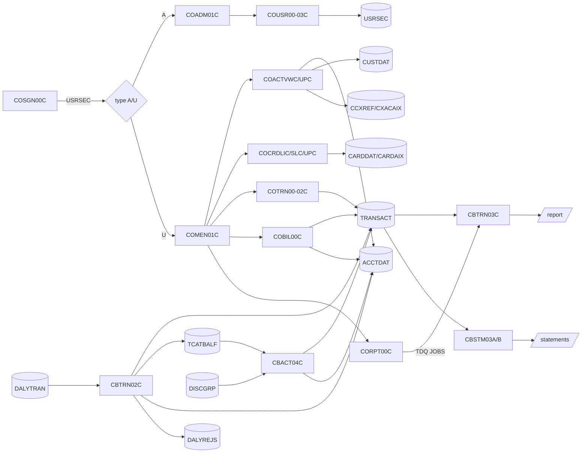

# 01 - Legacy inventory (generated from the repository)

Generated by scanning `app/` (core application only; optional modules are listed at the end). Regenerate with `python3 modernization/tools/gen_inventory.py` if the legacy sources change.

## (a) Online CICS transactions

| Transaction | Program | Mapset | Files | Function |
|---|---|---|---|---|
| CAUP | COACTUPC | COACTUP | ACCTDAT, CARDAIX, CARDDAT, CUSTDAT, CXACAIX | Accept and process ACCOUNT UPDATE |
| CAVW | COACTVWC | COACTVW | ACCTDAT, CARDAIX, CARDDAT, CUSTDAT, CXACAIX | Accept and process Account View request |
| CA00 | COADM01C | COADM01 | USRSEC | Admin Menu for Admin users |
| CB00 | COBIL00C | COBIL00 | ACCTDAT, CXACAIX, TRANSACT | Bill Payment - Pay account balance in full and a |
| CCDL | COCRDSLC | COCRDSL | CARDAIX, CARDDAT | Accept and process credit card detail request |
| CCLI | COCRDLIC | COCRDLI | CARDAIX, CARDDAT | List Credit Cards |
| CCUP | COCRDUPC | COCRDUP | CARDAIX, CARDDAT | Accept and process credit card detail request |
| CC00 | COSGN00C | COSGN00 | USRSEC | Signon Screen for the CardDemo Application |
| CM00 | COMEN01C | COMEN01 | USRSEC | Main Menu for the Regular users |
| CR00 | CORPT00C | CORPT00 | TRANSACT | Print Transaction reports by submitting batch |
| CT00 | COTRN00C | COTRN00 | TRANSACT | List Transactions from TRANSACT file |
| CT01 | COTRN01C | COTRN01 | TRANSACT | View a Transaction from TRANSACT file |
| CT02 | COTRN02C | COTRN02 | ACCTDAT, CCXREF, CXACAIX, TRANSACT | Add a new Transaction to TRANSACT file |
| CU00 | COUSR00C | COUSR00 | USRSEC | List all users from USRSEC file |
| CU01 | COUSR01C | COUSR01 | USRSEC | Add a new Regular/Admin user to USRSEC file |
| CU02 | COUSR02C | COUSR02 | USRSEC | Update a user in USRSEC file |
| CU03 | COUSR03C | COUSR03 | USRSEC | Delete a user from USRSEC file |

BMS mapsets in `app/bms`: COACTUP, COACTVW, COADM01, COBIL00, COCRDLI, COCRDSL, COCRDUP, COMEN01, CORPT00, COSGN00, COTRN00, COTRN01, COTRN02, COUSR00, COUSR01, COUSR02, COUSR03

## (b) Batch JCL jobs

| Job | Steps (PGM) | Description |
|---|---|---|
| ACCTFILE | STEP05:IDCAMS, STEP10:IDCAMS, STEP15:IDCAMS | All Rights Reserved. |
| CARDFILE | CLCIFIL:SDSF, STEP05:IDCAMS, STEP10:IDCAMS, STEP15:IDCAMS, STEP40:IDCAMS, STEP50:IDCAMS, STEP60:IDCAMS, OPCIFIL:SDSF | All Rights Reserved. |
| CBADMCDJ | STEP1:DFHCSDUP | All Rights Reserved. |
| CBEXPORT | STEP01:IDCAMS, STEP02:CBEXPORT | All Rights Reserved. |
| CBIMPORT | STEP01:CBIMPORT | All Rights Reserved. |
| CLOSEFIL | CLCIFIL:SDSF | All Rights Reserved. |
| COMBTRAN | STEP05R:SORT, STEP10:IDCAMS | All Rights Reserved. |
| CUSTFILE | CLCIFIL:SDSF, STEP05:IDCAMS, STEP10:IDCAMS, STEP15:IDCAMS, OPCIFIL:SDSF | All Rights Reserved. |
| DALYREJS | STEP05:IDCAMS | All Rights Reserved. |
| DEFCUST | STEP05:IDCAMS, STEP05:IDCAMS | All Rights Reserved. |
| DEFGDGB | STEP05:IDCAMS | All Rights Reserved. |
| DEFGDGD | STEP10:IDCAMS, STEP20:IEBGENER, STEP30:IDCAMS, STEP40:IEBGENER, STEP50:IDCAMS, STEP60:IEBGENER | RESTART=STEP30                                                     JOB05067 |
| DISCGRP | STEP05:IDCAMS, STEP10:IDCAMS, STEP15:IDCAMS | All Rights Reserved. |
| DUSRSECJ | PREDEL:IEFBR14, STEP01:IEBGENER, STEP02:IDCAMS, STEP03:IDCAMS | All Rights Reserved. |
| ESDSRRDS | PREDEL:IEFBR14, STEP01:IEBGENER, STEP02:IDCAMS, STEP03:IDCAMS, STEP04:IDCAMS, STEP05:IDCAMS | All Rights Reserved. |
| INTCALC | STEP15:CBACT04C | All Rights Reserved. |
| OPENFIL | OPCIFIL:SDSF | All Rights Reserved. |
| POSTTRAN | STEP15:CBTRN02C | All Rights Reserved. |
| PRTCATBL | DELDEF:IEFBR14, STEP05R:PROC, STEP10R:SORT | All Rights Reserved. |
| READACCT | PREDEL:IEFBR14, STEP05:CBACT01C | All Rights Reserved. |
| READCARD | STEP05:CBACT02C | All Rights Reserved. |
| READCUST | STEP05:CBCUS01C | All Rights Reserved. |
| READXREF | STEP05:CBACT03C | All Rights Reserved. |
| REPTFILE | STEP05:IDCAMS | All Rights Reserved. |
| TCATBALF | STEP05:IDCAMS, STEP10:IDCAMS, STEP15:IDCAMS | All Rights Reserved. |
| TRANBKP | STEP05R:PROC, STEP05:IDCAMS, STEP10:IDCAMS | All Rights Reserved. |
| TRANCATG | STEP05:IDCAMS, STEP10:IDCAMS, STEP15:IDCAMS | All Rights Reserved. |
| TRANFILE | CLCIFIL:SDSF, STEP05:IDCAMS, STEP10:IDCAMS, STEP15:IDCAMS, STEP20:IDCAMS, STEP25:IDCAMS, STEP30:IDCAMS, OPCIFIL:SDSF | All Rights Reserved. |
| TRANIDX | STEP20:IDCAMS, STEP25:IDCAMS, STEP30:IDCAMS | All Rights Reserved. |
| TRANREPT | STEP05R:PROC, STEP05R:SORT, STEP10R:CBTRN03C | All Rights Reserved. |
| TRANTYPE | STEP05:IDCAMS, STEP10:IDCAMS, STEP15:IDCAMS | All Rights Reserved. |
| WAITSTEP | WAIT:COBSWAIT | All Rights Reserved. |
| XREFFILE | STEP05:IDCAMS, STEP10:IDCAMS, STEP15:IDCAMS, STEP20:IDCAMS, STEP25:IDCAMS, STEP30:IDCAMS | All Rights Reserved. |

## (c) VSAM datasets and record layouts

| Dataset (DD) | Type / key | Record | Copybook | Alternate index | Modern table |
|---|---|---|---|---|---|
| ACCTDAT | KSDS, ACCT-ID 9(11) @0 | 300 | CVACT01Y | - | account |
| CARDDAT | KSDS, CARD-NUM X(16) @0 | 150 | CVACT02Y | CARDAIX: CARD-ACCT-ID @16 len 11 (non-unique) | card (+ ix_card_acct_id) |
| CUSTDAT | KSDS, CUST-ID 9(9) @0 | 500 | CVCUS01Y | - | customer |
| CCXREF | KSDS, XREF-CARD-NUM X(16) @0 | 50 | CVACT03Y | CXACAIX: XREF-ACCT-ID @25 len 11 (non-unique) | card_xref (+ ix_card_xref_acct_id) |
| TRANSACT | KSDS, TRAN-ID X(16) @0 | 350 | CVTRA05Y | TRANSACT AIX: TRAN-PROC-TS @304 len 26 | card_transaction (+ ix_card_transaction_proc_ts) |
| USRSEC | KSDS, SEC-USR-ID X(8) @0 | 80 | CSUSR01Y | - | user_security |
| DISCGRP | KSDS, group+type+cat (16) | 50 | CVTRA02Y | - | disclosure_group |
| TCATBALF | KSDS, acct+type+cat (17) | 50 | CVTRA01Y | - | tran_cat_balance |
| TRANCATG | KSDS, type+cat (6) | 60 | CVTRA04Y | - | transaction_category |
| TRANTYPE | KSDS, type (2) | 60 | CVTRA03Y | - | transaction_type |
| DALYTRAN | Sequential PS | 350 | CVTRA06Y | - | daily_transaction (staging) |
| DALYREJS | Sequential PS (GDG) | 430 | CVTRA06Y + 80-byte trailer | - | daily_transaction_reject |

Field-level offsets are encoded in `modernization/data-migration/.../CopybookLayouts.java` and verified against the sample data by `LegacyDataParityTest`.

## (d) Data flows

## Optional modules (phase 2)

| Module | Files by type |
|---|---|
| app-authorization-ims-db2-mq | .cpy: 11, .cbl: 8, .jcl: 5, .psb: 4, .dbd: 4, .ddl: 2 |
| app-transaction-type-db2 | .ctl: 7, .ddl: 4, .cpy: 4, .cbl: 3, .jcl: 3, .bms: 2 |
| app-vsam-mq | .cbl: 2, .md: 1, .csd: 1 |

## Totals (core)

COBOL programs: 31, copybooks: 30, BMS mapsets: 17, JCL members: 33, CICS transactions in CSD: 18.
