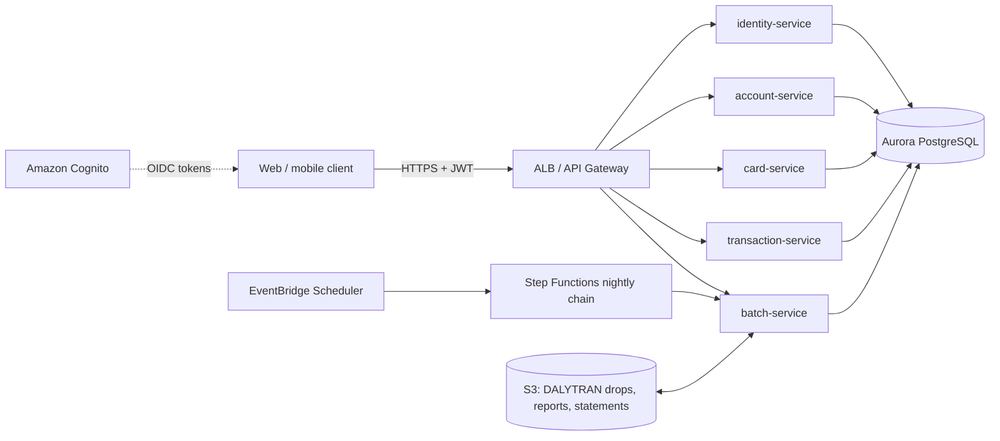

# CardDemo modernization: COBOL/CICS/VSAM to Java/Spring Boot on AWS

This folder is the design for re-architecting CardDemo into cloud-native services. The code is in
[`/modernization`](../../modernization). The legacy COBOL, BMS, JCL and copybooks under `app/` are not changed.

| Doc | Contents |
|---|---|
| [01-inventory.md](01-inventory.md) | Generated catalog of transactions, programs, mapsets, JCL, VSAM files and data flows |
| [02-domain-decomposition.md](02-domain-decomposition.md) | Service boundaries and how CICS patterns map to REST |
| [03-data-migration-runbook.md](03-data-migration-runbook.md) | VSAM to Aurora PostgreSQL mapping, EBCDIC/COMP-3 conversion, load, reconciliation, cutover |
| [04-security.md](04-security.md) | RACF/USRSEC to Cognito/JWT |
| [05-batch.md](05-batch.md) | JCL jobs to Spring Batch, EventBridge Scheduler and Step Functions |
| [06-traceability.md](06-traceability.md) | Per-program mapping to endpoints, classes and parity tests |
| [07-phase2-optional-modules.md](07-phase2-optional-modules.md) | IMS/DB2/MQ authorization, DB2 transaction types and MQ inquiry modules |

## Target architecture



- **Runtime:** Java 21, Spring Boot 3.3, one container per service (ECS Fargate or EKS). All services are stateless.
- **Data:** a single Aurora PostgreSQL database. The schema is owned by Flyway (`common/src/main/resources/db/migration`).
  Each service only touches the tables of its own domain. Splitting into one database per service later only needs
  connection config changes.
- **Security:** each service validates a bearer JWT. Roles `ADMIN` and `USER` come from the USRSEC user types `A` and `U`.
- **Batch:** Spring Batch jobs in `batch-service`, started from the REST API, the in-process scheduler (locally) or
  Step Functions (on AWS).

## Key decisions

| Topic | Legacy | Modern | Why |
|---|---|---|---|
| Screens | BMS maps, pseudo-conversational with COMMAREA | REST + JSON, one call per screen action | Stateless and horizontally scalable |
| Browse state | COMMAREA first/last key and page number | `KeysetPage` returns `firstKey`/`lastKey`/`pageNumber` and the client sends them back as `after`/`before` | Same PF7/PF8 behavior, no server session |
| Two-step confirms (CT02, CB00) | Re-display the screen asking "Confirm (Y/N)" | `confirmationRequired=true` until the client sends `confirm=Y` | Explicit and stateless |
| Concurrent update (CAUP, CCUP) | READ UPDATE, then compare to the values that were displayed | JPA `@Version`, and the client echoes the version it was shown | Same "Record changed by some one else" result |
| Transaction IDs | Browse to the last TRAN-ID and add 1 | PostgreSQL sequence `tran_id_seq`, zero-padded to 16 characters | Safe under concurrency; same format |
| Passwords | Plain text in USRSEC | BCrypt; values upper-cased like COSGN00C does | Security baseline |
| Messages | Screen message line | `ApiError.message` / `message`, text kept verbatim | Clients and tests can check parity |

## Translation tooling

AWS Mainframe Modernization automated refactoring (Blu Age) or a COBOL-to-Java transpiler can speed up a first pass,
especially for the long edit paragraphs in COACTUPC. This codebase was written by hand from the COBOL sources so the
domain model is idiomatic. Every rule taken from COBOL cites the paragraph or program it comes from in a code comment,
and has a parity test (see [06-traceability.md](06-traceability.md)).

## Building and running

```bash
cd modernization
JAVA_HOME=/usr/lib/jvm/java-21-openjdk-amd64 mvn -B verify      # unit + parity tests (H2 in PostgreSQL mode)
mvn -B package -DskipTests && docker compose up --build          # Postgres + loader + 5 services
```

Swagger UI is at `http://localhost:808{1..5}/swagger-ui.html`. Sign in with `POST :8081/api/v1/auth/signon`
(`ADMIN001`/`PASSWORD` or `USER0001`/`PASSWORD`, from the legacy DUSRSECJ seed) and use the token on the other services.

## Known deviations from legacy behavior (intentional)

1. The password is upper-cased before it is hashed on user add/update. COSGN00C upper-cases the password before
   comparing it, but COUSR01C stores it as typed, so mixed-case passwords could never sign on.
2. User type must be `A` or `U`. COUSR01C accepts any character.
3. CVV and password are never returned by the API.
4. Transaction IDs come from a sequence instead of "last + 1".
5. The sample `app/data` ASCII and EBCDIC files disagree in two records. The loader loads whichever source you pick,
   and `LegacyDataParityTest` lists the two differences.
