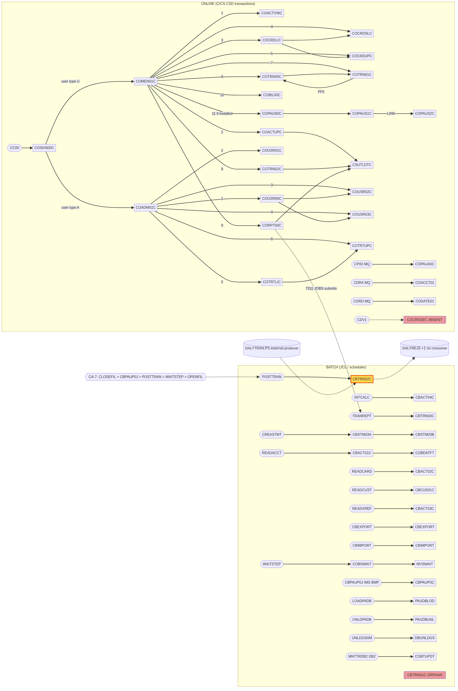
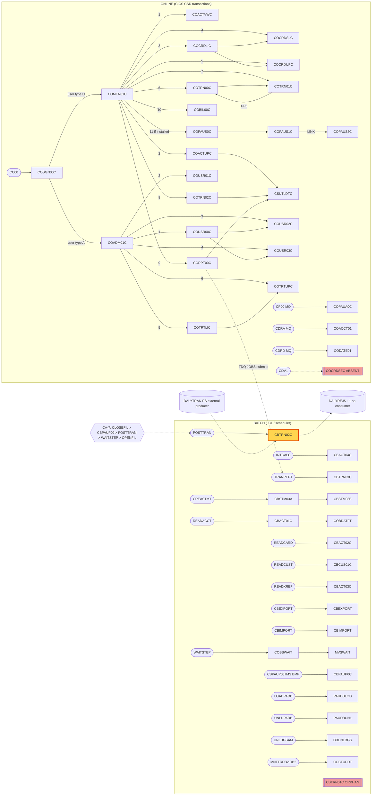

# CardDemo module inventory

Produced by `!mf_module_inventory_analysis` on 2026-11-19 (session devin-c4fce2ffab2c4abaac2aa02e217e00e4) over `app/**` at commit `07a8fbb`, branch `devin/1795090039-mf-posttran-stream`. Analysis only: no code, no plan, no FRs. Every claim cites `<path>:<line>`. Context: `.migration/00_context.md`; conventions: `.migration/02_conventions.md`.

**Status: awaiting STOP B (blocking).** The user asked for stream **POSTTRAN**; this inventory proposes its process type, hard stop and exclusions (§9) for the user to confirm. Nothing here chooses a stream.

Reproduce: `python3 functional/CARDDEMO/inventory/callgraph.py . functional/CARDDEMO/inventory > functional/CARDDEMO/inventory/edges.tsv && python3 functional/CARDDEMO/inventory/coverage.py . functional/CARDDEMO/inventory` (runbook R-08/R-09). Evidence files: `inventory/edges.tsv` (272 edges), `inventory/graph.json`, `inventory/coverage.json`, `inventory/module_flow.mmd/.png`.

## 1. Module file set (the coverage denominator)

Bounded mechanically as every COBOL and Assembler source under `app/**` (prefix rules in `02_conventions.md`), which is also the closure of everything the module's programs CALL/XCTL/LINK (no callee resolves outside this set except LE/MQ/IMS/DB2 runtime and the absent `COCRDSEC`).

| Location | Programs | Count |
|---|---|---|
| `app/cbl` | CBACT01C CBACT02C CBACT03C CBACT04C CBCUS01C CBEXPORT CBIMPORT CBSTM03A CBSTM03B CBTRN01C CBTRN02C CBTRN03C COACTUPC COACTVWC COADM01C COBIL00C COBSWAIT COCRDLIC COCRDSLC COCRDUPC COMEN01C CORPT00C COSGN00C COTRN00C COTRN01C COTRN02C COUSR00C COUSR01C COUSR02C COUSR03C CSUTLDTC | 31 |
| `app/app-authorization-ims-db2-mq/cbl` | CBPAUP0C COPAUA0C COPAUS0C COPAUS1C COPAUS2C DBUNLDGS PAUDBLOD PAUDBUNL | 8 |
| `app/app-transaction-type-db2/cbl` | COBTUPDT COTRTLIC COTRTUPC | 3 |
| `app/app-vsam-mq/cbl` | COACCT01 CODATE01 | 2 |
| `app/asm` | COBDATFT MVSWAIT | 2 |
| **Total** | | **46** |

## 2. Call graph method

`inventory/callgraph.py` scans every source line, skipping column-7 comments, and emits `caller -> callee` with `<file>:<line>`: static `CALL '<lit>'`, dynamic `CALL <var>` (resolving MOVEd/VALUE literals per call site: the MOVEs between the previous dispatch on the same variable, or the paragraph start, and the site; when that region only defaults an empty variable, the MOVEs in other paragraphs that are not consumed locally are added and tagged `[SITE+INBOUND]`; `[PROGRAM-WIDE]` marks the fallback), `EXEC CICS XCTL/LINK/START/RETURN TRANSID` (multi-line), CALLs inside COPY/`EXEC SQL INCLUDE` members (attributed to the including program), JCL `EXEC PGM=`/`EXEC PROC=`/TSO `RUN PROGRAM`, and CSD `DEFINE TRANSACTION ... PROGRAM(...)`. LE/MQ/IMS/DB2 runtime modules (`CEE3ABD CEEDAYS MQ* CBLTDLI DSNTIAC`) and system utilities (`IDCAMS SORT IEBGENER IEFBR14 SDSF DFSRRC00 IKJEFT01/1B FTP DFHCSDUP`) are tagged, not followed.

Edge counts (`inventory/edges.tsv`): CALL 19, CALL-VIA-COPYBOOK 1, CALL-DYNAMIC-VIA-COPYBOOK 1, CALL-RUNTIME 43, CICS-XCTL 2, CICS-XCTL-DYNAMIC 30, CICS-LINK-DYNAMIC 1, CICS-RETURN-TRANSID-DYNAMIC 24, CSD-TRANSACTION 25, JCL-EXEC 12, JCL-IMS-PARM 4 (IMS programs started by `DFSRRC00 PARM='BMP|DLI,<pgm>,...'`), JCL-PROC 4, JCL-TSO-RUN 1, JCL-UTILITY 109 = **276** (272 before the 2026-11-19 review fix that made the IMS PARM declarations explicit edges).

### 2.1 Unresolved / dynamic edges (headline risk)

No dynamic edge is left unresolved. (2026-11-19 review fix: per-site resolution replaced program-wide literal lists, which had attributed every MOVEd target to every dispatch in a program, e.g. `COUSR00C.cbl:197` also listed COUSR03C. The program-level graph, stream membership, shared map and the 46 = 37 + 8 + 1 arithmetic are unchanged.) 19 edges were not auto-resolved by the script (literal sits in a `VALUE` on a continuation line, or the target is the caller's caller); each is resolved by hand:

| Call site | Variable | Resolution |
|---|---|---|
| `app/cbl/COMEN01C.cbl:156`, `:185` | `CDEMO-MENU-OPT-PGMNAME(WS-OPTION)` | table `app/cpy/COMEN02Y.cpy` (11 entries, count `:21`): COACTVWC COACTUPC COCRDLIC COCRDSLC COCRDUPC COTRN00C COTRN01C COTRN02C CORPT00C COBIL00C COPAUS0C |
| `app/cbl/COADM01C.cbl:146` | `CDEMO-ADMIN-OPT-PGMNAME(WS-OPTION)` | table `app/cpy/COADM02Y.cpy` (6 entries, count `:22`): COUSR00C COUSR01C COUSR02C COUSR03C COTRTLIC COTRTUPC |
| `app/cbl/COCRDLIC.cbl:538`, `:566` | `CCARD-NEXT-PROG` | `LIT-CARDDTLPGM` = COCRDSLC (`:196`, MOVE `:526`); `LIT-CARDUPDPGM` = COCRDUPC (`:204`, MOVE `:554`) |
| `app/cbl/COCRDLIC.cbl:402` | `LIT-MENUPGM` | COMEN01C (`:188`) |
| `app/cbl/COACTVWC.cbl:349`, `COACTUPC.cbl:956`, `COCRDSLC.cbl:331`, `COCRDUPC.cbl:473` | `CDEMO-TO-PROGRAM` | `LIT-MENUPGM` = COMEN01C (`COACTVWC.cbl:169`, `COACTUPC.cbl:558`) or `CDEMO-FROM-PROGRAM` (return to caller, e.g. `COACTVWC.cbl:336-338`) |
| `app/app-transaction-type-db2/cbl/COTRTLIC.cbl:620`, `COTRTUPC.cbl:457` | `CDEMO-TO-PROGRAM` | `LIT-ADMINPGM` = COADM01C (`COTRTLIC.cbl:47`, `COTRTUPC.cbl:210`), `LIT-ADDTPGM` = COTRTUPC (`COTRTLIC.cbl:50`, MOVE `:638`) or `CDEMO-FROM-PROGRAM` |
| `app/app-authorization-ims-db2-mq/cbl/COPAUS1C.cbl:368` | `CDEMO-TO-PROGRAM` | `WS-PGM-AUTH-SMRY` = COPAUS0C (`:34`, MOVE `:168`, `:185`) |
| 8 x `RETURN TRANSID(LIT-THISTRANID)` (COACTVWC `:402`, COACTUPC `:1015`, COCRDLIC `:615`, COCRDSLC `:402`, COCRDUPC `:554`, COTRTUPC `:567`, ...) | own trancode | pseudo-conversational re-entry into the same program (CAVW, CAUP, CCLI, CCDL, CCUP, CTTU) |
| `app/app-transaction-type-db2/cpy/CSDB2RPY.cpy:57` (via `COTRTLIC.cbl:2055`) | `LIT-DSNTIAC` | DB2 runtime `DSNTIAC` (`COTRTLIC.cbl:54`) |

Return navigation through `CDEMO-FROM-PROGRAM` is a runtime value by design; it is treated as a B5 return to the calling stream (BND-011), not as an ownership edge.

## 3. Entry points (each proven by a runtime declaration)

| Id | Kind | Trigger | Proof | Runtime def in repo? |
|---|---|---|---|---|
| CC00 -> COSGN00C | ONLINE (terminal) | sign-on trancode | `app/csd/CARDDEMO.CSD:378` | yes |
| CM00 -> COMEN01C, CA00 -> COADM01C | ONLINE (menus) | XCTL from COSGN00C by user type (`app/cbl/COSGN00C.cbl:230-240`) | `app/csd/CARDDEMO.CSD:399`, `:327` | yes |
| CAVW CAUP CCLI CCDL CCUP CT00 CT01 CT02 CR00 CB00 CU00-CU03 | ONLINE (menu routes, also directly enterable trancodes) | menu option / trancode | `app/csd/CARDDEMO.CSD:306-479` | yes |
| CPVS, CPVD | ONLINE (extension) | main menu option 11 / trancode | `app/app-authorization-ims-db2-mq/csd/CRDDEMO2.csd:49`, `:39` | yes (extension CSD) |
| CTLI, CTTU | ONLINE (extension, Db2) | admin options 5-6 / trancode | `app/app-transaction-type-db2/csd/CRDDEMOD.csd:25`, `:35` | yes (extension CSD) |
| CP00 -> COPAUA0C | ONLINE, MQ-triggered (no screen) | authorization request message | `app/app-authorization-ims-db2-mq/csd/CRDDEMO2.csd:59` | CSD yes; MQ trigger/queue defs **absent** |
| CDRA -> COACCT01, CDRD -> CODATE01 | ONLINE, MQ request/response | trancode | `app/app-vsam-mq/csd/CRDDEMOM.csd:17`, `:27` | CSD yes; queue defs only in README (`app/app-vsam-mq/README.md:53-54`) |
| CDV1 -> COCRDSEC | ONLINE | trancode | `app/csd/CARDDEMO.CSD:388-390`, `:211` | **program source absent (HIGH)** |
| CCDM, CCT1-CCT4 (-> COADM00C, COTSTP1C-4C) and COACT00C, COACTDEC, COTRNVWC, COTRNVDC, COTRNATC | ONLINE (stale DFHCSDUP job) | - | `app/jcl/CBADMCDJ.jcl:98-157` | **sources absent; not in CARDDEMO.CSD (HIGH, likely obsolete)** |
| POSTTRAN | BATCH | CA-7 trigger after CBPAUP0J | `app/jcl/POSTTRAN.jcl:23`; `app/scheduler/CardDemo.ca7:70-73` | yes |
| INTCALC | BATCH | Control-M MONTHLY-InterestCalculation | `app/jcl/INTCALC.jcl:22`; `app/scheduler/CardDemo.controlm:69` | yes |
| TRANREPT | BATCH | submitted online by CORPT00C via TDQ `JOBS` | `app/jcl/TRANREPT.jcl:59`, `app/proc/TRANREPT.prc:57`; `app/cbl/CORPT00C.cbl:94`, `:515-518` | yes |
| CREASTMT | BATCH | CA-7 CLOSEFIL -> CREASTMT -> TXT2PDF1 | `app/jcl/CREASTMT.JCL:79`; `app/scheduler/CardDemo.ca7:468-497` | yes |
| READACCT, READCARD, READCUST, READXREF | BATCH | CA-7 chain CLOSEFIL -> READ* -> WAITSTEP -> OPENFIL | `app/jcl/READACCT.jcl:32`, `READCARD.jcl:22`, `READCUST.jcl:21`, `READXREF.jcl:22`; `app/scheduler/CardDemo.ca7:337-450` | yes |
| CBEXPORT, CBIMPORT | BATCH | on demand (no scheduler entry) | `app/jcl/CBEXPORT.jcl:43`, `app/jcl/CBIMPORT.jcl:22` | JCL yes, schedule absent |
| WAITSTEP | BATCH | CA-7 and Control-M chains | `app/jcl/WAITSTEP.jcl:22` | yes |
| CBPAUP0J | BATCH (IMS BMP) | CA-7 after CLOSEFIL | `app/app-authorization-ims-db2-mq/jcl/CBPAUP0J.jcl:24-25`; `app/scheduler/CardDemo.ca7:43-46` | yes |
| LOADPADB, UNLDPADB, UNLDGSAM | BATCH (IMS) | on demand | `.../jcl/LOADPADB.JCL:26-27`, `UNLDPADB.JCL:38-39`, `UNLDGSAM.JCL:26-27` | JCL yes |
| MNTTRDB2 | BATCH (DB2 TSO) | Control-M WEEKLY-TransactionTypesDBRefresh | `app/app-transaction-type-db2/jcl/MNTTRDB2.jcl:30`; `app/scheduler/CardDemo.controlm:27` | yes |
| Utility-only jobs (0 module programs) | BATCH | data lifecycle | ACCTFILE CARDFILE CUSTFILE XREFFILE TRANFILE TCATBALF TRANCATG TRANTYPE DISCGRP DUSRSECJ DEFCUST DEFGDGB DEFGDGD DALYREJS REPTFILE ESDSRRDS TRANBKP TRANIDX COMBTRAN PRTCATBL CLOSEFIL OPENFIL TXT2PDF1 FTPJCL INTRDRJ1 INTRDRJ2 CBADMCDJ (`app/jcl/*`), CREADB21 TRANEXTR (`app/app-transaction-type-db2/jcl`), DBPAUTP0 (`app/app-authorization-ims-db2-mq/jcl`) | yes |
| **ORPHAN** CBTRN01C | none | no JCL `EXEC PGM`, no scheduler, no CSD reference (grep over `app/**`) | header says "Post the records from daily transaction file" (`app/cbl/CBTRN01C.cbl:5`) | **orphan root (risk); not promoted to an entry point** |

## 4. Stream catalog

A stream = one menu route / trancode, one MQ-triggered transaction, or one JCL job with module programs. Closure follows forward CALL/XCTL/LINK edges; XCTL back to the navigation hub (COSGN00C, COMEN01C, COADM01C) is a B5 return, not membership.

| Stream | Process type | Trigger | Proof | Programs | # | Shared |
|---|---|---|---|---|---|---|
| ONL-00 Sign-on + menus | ONLINE | CC00 (also CM00, CA00) | `app/csd/CARDDEMO.CSD:378; app/csd/CARDDEMO.CSD:399; app/csd/CARDDEMO.CSD:327` | COADM01C, COMEN01C, COSGN00C | 3 | - |
| ONL-M01 Account View | ONLINE | main menu option 1 (COMEN01C) / trancode CAVW | `app/cpy/COMEN02Y.cpy:28; app/csd/CARDDEMO.CSD:317` | COACTVWC | 1 | - |
| ONL-M02 Account Update | ONLINE | main menu option 2 (COMEN01C) / trancode CAUP | `app/cpy/COMEN02Y.cpy:34; app/csd/CARDDEMO.CSD:306` | COACTUPC, CSUTLDTC | 2 | CSUTLDTC |
| ONL-M03 Credit Card List | ONLINE | main menu option 3 (COMEN01C) / trancode CCLI | `app/cpy/COMEN02Y.cpy:40; app/csd/CARDDEMO.CSD:357` | COCRDLIC, COCRDSLC, COCRDUPC | 3 | COCRDSLC, COCRDUPC |
| ONL-M04 Credit Card View | ONLINE | main menu option 4 (COMEN01C) / trancode CCDL | `app/cpy/COMEN02Y.cpy:46; app/csd/CARDDEMO.CSD:347` | COCRDSLC | 1 | COCRDSLC |
| ONL-M05 Credit Card Update | ONLINE | main menu option 5 (COMEN01C) / trancode CCUP | `app/cpy/COMEN02Y.cpy:52; app/csd/CARDDEMO.CSD:367` | COCRDUPC | 1 | COCRDUPC |
| ONL-M06 Transaction List | ONLINE | main menu option 6 (COMEN01C) / trancode CT00 | `app/cpy/COMEN02Y.cpy:58; app/csd/CARDDEMO.CSD:419` | COTRN00C, COTRN01C | 2 | COTRN00C, COTRN01C |
| ONL-M07 Transaction View | ONLINE | main menu option 7 (COMEN01C) / trancode CT01 | `app/cpy/COMEN02Y.cpy:64; app/csd/CARDDEMO.CSD:429` | COTRN00C, COTRN01C | 2 | COTRN00C, COTRN01C |
| ONL-M08 Transaction Add | ONLINE | main menu option 8 (COMEN01C) / trancode CT02 | `app/cpy/COMEN02Y.cpy:71; app/csd/CARDDEMO.CSD:439` | COTRN02C, CSUTLDTC | 2 | CSUTLDTC |
| ONL-M09 Transaction Reports | ONLINE | main menu option 9 (COMEN01C) / trancode CR00 | `app/cpy/COMEN02Y.cpy:77; app/csd/CARDDEMO.CSD:409` | CORPT00C, CSUTLDTC | 2 | CSUTLDTC |
| ONL-M10 Bill Payment | ONLINE | main menu option 10 (COMEN01C) / trancode CB00 | `app/cpy/COMEN02Y.cpy:83; app/csd/CARDDEMO.CSD:337` | COBIL00C | 1 | - |
| ONL-M11 Pending Authorization View | ONLINE | main menu option 11 (COMEN01C) / trancode CPVS | `app/cpy/COMEN02Y.cpy:89; app/app-authorization-ims-db2-mq/csd/CRDDEMO2.csd:49` | COPAUS0C, COPAUS1C, COPAUS2C | 3 | - |
| ONL-A01 User List | ONLINE | admin menu option 1 (COADM01C) / trancode CU00 | `app/cpy/COADM02Y.cpy:29; app/csd/CARDDEMO.CSD:449` | COUSR00C, COUSR02C, COUSR03C | 3 | COUSR02C, COUSR03C |
| ONL-A02 User Add | ONLINE | admin menu option 2 (COADM01C) / trancode CU01 | `app/cpy/COADM02Y.cpy:34; app/csd/CARDDEMO.CSD:459` | COUSR01C | 1 | - |
| ONL-A03 User Update | ONLINE | admin menu option 3 (COADM01C) / trancode CU02 | `app/cpy/COADM02Y.cpy:39; app/csd/CARDDEMO.CSD:469` | COUSR02C | 1 | COUSR02C |
| ONL-A04 User Delete | ONLINE | admin menu option 4 (COADM01C) / trancode CU03 | `app/cpy/COADM02Y.cpy:44; app/csd/CARDDEMO.CSD:479` | COUSR03C | 1 | COUSR03C |
| ONL-A05 Transaction Type List/Update (Db2) | ONLINE | admin menu option 5 (COADM01C) / trancode CTLI | `app/cpy/COADM02Y.cpy:49; app/app-transaction-type-db2/csd/CRDDEMOD.csd:25` | COTRTLIC, COTRTUPC | 2 | COTRTUPC |
| ONL-A06 Transaction Type Maintenance (Db2) | ONLINE | admin menu option 6 (COADM01C) / trancode CTTU | `app/cpy/COADM02Y.cpy:53; app/app-transaction-type-db2/csd/CRDDEMOD.csd:35` | COTRTUPC | 1 | COTRTUPC |
| ONL-CP00 Authorization request processor (MQ) | ONLINE (MQ-triggered, no screen) | CP00 | `app/app-authorization-ims-db2-mq/csd/CRDDEMO2.csd:59` | COPAUA0C | 1 | - |
| ONL-CDRA Account inquiry via MQ | ONLINE (MQ request/response) | CDRA | `app/app-vsam-mq/csd/CRDDEMOM.csd:17` | COACCT01 | 1 | - |
| ONL-CDRD System date via MQ | ONLINE (MQ request/response) | CDRD | `app/app-vsam-mq/csd/CRDDEMOM.csd:27` | CODATE01 | 1 | - |
| ONL-CDV1 (BLOCKED: COCRDSEC absent) | ONLINE | CDV1 | `app/csd/CARDDEMO.CSD:388; PROGRAM app/csd/CARDDEMO.CSD:211` | COCRDSEC | 1 | - |
| BAT-POSTTRAN | BATCH | job POSTTRAN | `app/jcl/POSTTRAN.jcl:23` | CBTRN02C | 1 | - |
| BAT-INTCALC | BATCH | job INTCALC | `app/jcl/INTCALC.jcl:22` | CBACT04C | 1 | - |
| BAT-TRANREPT | BATCH | job TRANREPT | `app/jcl/TRANREPT.jcl:59` | CBTRN03C | 1 | - |
| BAT-CREASTMT | BATCH | job CREASTMT | `app/jcl/CREASTMT.JCL:79` | CBSTM03A, CBSTM03B | 2 | - |
| BAT-READACCT | BATCH | job READACCT | `app/jcl/READACCT.jcl:32` | CBACT01C, COBDATFT | 2 | - |
| BAT-READCARD | BATCH | job READCARD | `app/jcl/READCARD.jcl:22` | CBACT02C | 1 | - |
| BAT-READCUST | BATCH | job READCUST | `app/jcl/READCUST.jcl:21` | CBCUS01C | 1 | - |
| BAT-READXREF | BATCH | job READXREF | `app/jcl/READXREF.jcl:22` | CBACT03C | 1 | - |
| BAT-CBEXPORT | BATCH | job CBEXPORT | `app/jcl/CBEXPORT.jcl:43` | CBEXPORT | 1 | - |
| BAT-CBIMPORT | BATCH | job CBIMPORT | `app/jcl/CBIMPORT.jcl:22` | CBIMPORT | 1 | - |
| BAT-WAITSTEP | BATCH | job WAITSTEP | `app/jcl/WAITSTEP.jcl:22` | COBSWAIT, MVSWAIT | 2 | - |
| BAT-CBPAUP0J | BATCH | job CBPAUP0J | `app/app-authorization-ims-db2-mq/jcl/CBPAUP0J.jcl:25` | CBPAUP0C | 1 | - |
| BAT-LOADPADB | BATCH | job LOADPADB | `app/app-authorization-ims-db2-mq/jcl/LOADPADB.JCL:27` | PAUDBLOD | 1 | - |
| BAT-UNLDPADB | BATCH | job UNLDPADB | `app/app-authorization-ims-db2-mq/jcl/UNLDPADB.JCL:39` | PAUDBUNL | 1 | - |
| BAT-UNLDGSAM | BATCH | job UNLDGSAM | `app/app-authorization-ims-db2-mq/jcl/UNLDGSAM.JCL:27` | DBUNLDGS | 1 | - |
| BAT-MNTTRDB2 | BATCH | job MNTTRDB2 | `app/app-transaction-type-db2/jcl/MNTTRDB2.jcl:30` | COBTUPDT | 1 | - |

Utility-only batch jobs (0 programs, listed in §3) are part of the batch catalog for scheduling (B9) but add nothing to program coverage.

Job dependency conditions (scheduler):
- CA-7 daily posting chain: CLOSEFIL -> CBPAUP0J -> **POSTTRAN** -> WAITSTEP -> OPENFIL (`app/scheduler/CardDemo.ca7:18-124`). POSTTRAN is **not** in Control-M (`app/scheduler/CardDemo.controlm` folders: DAILY-TransactionBackup `:3`, WEEKLY-TransactionTypesDBRefresh `:26`, WEEKLY-DisclosureGroupsRefresh `:32`, MONTHLY-InterestCalculation `:64`).
- Operator script order: CLOSEFIL, ACCTFILE, TCATBALF, TRANBKP, **POSTTRAN**, TRANIDX, OPENFIL (`scripts/run_posting.sh`); full batch adds INTCALC, TRANBKP, COMBTRAN after POSTTRAN (`scripts/run_full_batch.sh`).
- Control-M MONTHLY: CLOSEFIL -> INTCALC -> COMBTRAN -> WAITSTEP -> OPENFIL (`app/scheduler/CardDemo.controlm:65-89`).

## 5. Route-level exhaustiveness (producer-consumer closure)

**Main menu (COMEN01C).** Producer: option field normalized to `WS-OPTION PIC 9(02)` (`app/cbl/COMEN01C.cbl:122-125`). Accepted domain: numeric, `1..CDEMO-MENU-OPT-COUNT` = 11 (`:127-129`, `app/cpy/COMEN02Y.cpy:21`); anything else -> error route "Please enter a valid option number" (`:130-134`). Consumers: 11 table rows (`COMEN02Y.cpy`, `OCCURS 12` at `:94`; slot 12 unpopulated and unreachable because the count is 11). Dispatch `EVALUATE` (`:146-190`): row 11 COPAUS0C via `EXEC CICS INQUIRE` (`:147-168`: XCTL if installed, else "not installed" message - a documented route); `DUMMY*` rows (`:169-176`: "coming soon" - **no row is DUMMY today, dead branch**); `WHEN OTHER` XCTL (`:177-188`). Admin-only guard (`:136-143`): **dead today**, all 11 rows have usertype `U`. PF3 -> sign-on (`:96`). Producible 1..11 = consumed 11 rows = 11 streams ONL-M01..M11, plus the invalid-option, not-installed and PF3 routes.

**Admin menu (COADM01C).** Domain `1..CDEMO-ADMIN-OPT-COUNT` = 6 (`app/cbl/COADM01C.cbl:131-133`, `app/cpy/COADM02Y.cpy:22`; the old value 4 is commented at `:21`); `OCCURS 9` (`:56`), slots 7-9 unreachable. Rows 1-6 XCTL unless `DUMMY` (`:141-147`); no DUMMY rows, so the "not installed" message (`:148-155`) is only reached after a failed XCTL return path that CICS does not take - **dead**. Risk: rows 5-6 (Db2 extension) have no INQUIRE guard, so a region without COTRTLIC/COTRTUPC abends PGMIDERR. 6 producible = 6 consumed = ONL-A01..A06.

**Sign-on (COSGN00C).** Two routes by user type: `CDEMO-USRTYP-ADMIN` -> COADM01C, else COMEN01C (`app/cbl/COSGN00C.cbl:230-240`; 88s `app/cpy/COCOM01Y.cpy:27-28`).

**Dispatch grep sweep.** Every occurrence of the selection variable: `WS-OPTION` in COMEN01C at `:45,46,122-129,137,147,149,157,164,169,173,185` and in COADM01C at `:45,46,126-133,141,146` - one main router per menu, no secondary dispatch, no re-entry dispatch on the option. Card list secondary dispatch on the row action (`VIEW-REQUESTED-ON` / `UPDATE-REQUESTED-ON`, `app/cbl/COCRDLIC.cbl:517-570`) feeds ONL-M04/M05 programs, already counted.

## 6. Program-level coverage (100% gate)

`46 programs = 37 exclusive (exactly one stream) + 8 shared (more than one stream) + 1 unreachable (orphan)` -> **balances** (`coverage.py` prints `CHECK 46 = 37 + 8 + 1 -> True`).

- **Exclusive (37):** COADM01C (ONL-00), COMEN01C (ONL-00), COSGN00C (ONL-00), COACTVWC (ONL-M01), COACTUPC (ONL-M02), COCRDLIC (ONL-M03), COTRN02C (ONL-M08), CORPT00C (ONL-M09), COBIL00C (ONL-M10), COPAUS0C (ONL-M11), COPAUS1C (ONL-M11), COPAUS2C (ONL-M11), COUSR00C (ONL-A01), COUSR01C (ONL-A02), COTRTLIC (ONL-A05), COPAUA0C (ONL-CP00), COACCT01 (ONL-CDRA), CODATE01 (ONL-CDRD), CBTRN02C (BAT-POSTTRAN), CBACT04C (BAT-INTCALC), CBTRN03C (BAT-TRANREPT), CBSTM03A (BAT-CREASTMT), CBSTM03B (BAT-CREASTMT), CBACT01C (BAT-READACCT), COBDATFT (BAT-READACCT), CBACT02C (BAT-READCARD), CBCUS01C (BAT-READCUST), CBACT03C (BAT-READXREF), CBEXPORT (BAT-CBEXPORT), CBIMPORT (BAT-CBIMPORT), COBSWAIT (BAT-WAITSTEP), MVSWAIT (BAT-WAITSTEP), CBPAUP0C (BAT-CBPAUP0J), PAUDBLOD (BAT-LOADPADB), PAUDBUNL (BAT-UNLDPADB), DBUNLDGS (BAT-UNLDGSAM), COBTUPDT (BAT-MNTTRDB2)
- **Shared (8):** COCRDSLC, COCRDUPC, COTRN00C, COTRN01C, COTRTUPC, COUSR02C, COUSR03C, CSUTLDTC (§7).
- **Unreachable (1):** CBTRN01C - orphan root (§3); it reads DD DALYTRAN, CUSTFILE, XREFFILE, CARDFILE, ACCTFILE, TRANFILE (SELECTs in `app/cbl/CBTRN01C.cbl`) and has no runtime declaration.
- **Absent (outside the denominator, referenced by an entry point):** COCRDSEC (CDV1); stale CBADMCDJ definitions (§3).

Every program appears in `inventory/coverage.json` with its bucket and stream list.

The bucket sum balances by construction (each program lands in a bucket by how many streams reach it), so it is **not** proof on its own. `coverage.py` also runs three independent checks and exits non-zero if any fails (2026-11-19 review fix):

- **CHECK-A declarations:** every runtime declaration of a module program (CSD `DEFINE TRANSACTION`, JCL `EXEC PGM=`, TSO `RUN PROGRAM`, IMS `DFSRRC00 PARM`) is a stream root, and every stream root is declared. 41 declared targets, 40 roots. One cited exception: CPVD -> COPAUS1C is the pseudo-conversational re-entry of COPAUS1C (`app/app-authorization-ims-db2-mq/cbl/COPAUS1C.cbl:36,203`); a cold start XCTLs to COPAUS0C (`:165-169`), so it runs inside ONL-M11. Result: pass.
- **CHECK-B edge attribution:** every program-to-program edge in `edges.tsv` (static or resolved dynamic) lands in every stream of its caller, except B5 returns to the navigation hub. Result: 0 unattributed.
- **CHECK-C unreachable:** an unreachable program has no inbound edge and no declaration. Result: CBTRN01C has neither.
- Mutation tests: deleting the INTCALC stream makes CHECK-A and CHECK-C fail (CBACT04C declared but not a root; CBACT04C unreachable with a declaration); deleting the blocked CDV1 stream makes CHECK-A fail (COCRDSEC declared at `app/csd/CARDDEMO.CSD:388` but not a root), because declarations count even when the program source is absent.
- Limits: declarations are only the four sources above (a program started by an operator outside JCL/CSD, or defined only in the stale `CBADMCDJ.jcl` SYSIN, is not seen); dynamic targets are resolved from literal MOVE/VALUE only (the 19 hand-resolved edges in §2.1 are covered by the menu tables and the `MANUAL` list in `coverage.py`).

## 7. Shared-program (choke point) map

| Program | Streams | State | Call-in contract | Port owner (first stream that needs it) |
|---|---|---|---|---|
| COCRDSLC | ONL-M03 Credit Card List, ONL-M04 Credit Card View | read-only | XCTL + COMMAREA | ONL-M03 |
| COCRDUPC | ONL-M03 Credit Card List, ONL-M05 Credit Card Update | state-changing | XCTL + COMMAREA | ONL-M03 |
| COTRN00C | ONL-M06 Transaction List, ONL-M07 Transaction View | read-only | XCTL + COMMAREA | ONL-M06 |
| COTRN01C | ONL-M06 Transaction List, ONL-M07 Transaction View | read-only | XCTL + COMMAREA | ONL-M06 |
| COTRTUPC | ONL-A05 Transaction Type List/Update (Db2), ONL-A06 Transaction Type Maintenance (Db2) | state-changing | XCTL + COMMAREA | ONL-A05 |
| COUSR02C | ONL-A01 User List, ONL-A03 User Update | state-changing | XCTL + COMMAREA | ONL-A01 |
| COUSR03C | ONL-A01 User List, ONL-A04 User Delete | state-changing | XCTL + COMMAREA | ONL-A01 |
| CSUTLDTC | ONL-M02 Account Update, ONL-M08 Transaction Add, ONL-M09 Transaction Reports | read-only | CALL USING | ONL-M02 |

Contract/state notes: CSUTLDTC is read-only (`CALL 'CSUTLDTC' USING CSUTLDTC-DATE ...`, `app/cbl/CORPT00C.cbl:392`; wraps LE `CEEDAYS`, `app/cbl/CSUTLDTC.cbl:116`). COCRDUPC, COUSR02C, COUSR03C, COTRTUPC are state-changing (CICS REWRITE/DELETE, DB2 UPDATE); COCRDSLC, COTRN00C, COTRN01C read-only; all are entered by XCTL with `CARDDEMO-COMMAREA` (`app/cpy/COCOM01Y.cpy`). **Navigation hub** (COSGN00C, COMEN01C, COADM01C, owned by ONL-00) is a prerequisite of every online stream even though it is counted once. **POSTTRAN shares no program with any other stream.**

## 8. First-pass boundary register

Appended to `.migration/04_boundary_register.md` as BND-001..BND-018 (status UNDECIDED; decisions belong to `!mf_boundary_resolution` at STOP C).

| Class | Count | Entries |
|---|---|---|
| B2 shared module | 1 | BND-016 (8 shared programs) |
| B3 foreign/absent subroutine | 1 | BND-017 |
| B4 data-access leaf | 2 | BND-014 IMS, BND-015 DB2 |
| B5 cross-transaction switch | 1 | BND-011 |
| B6 queue / MQ | 2 | BND-012, BND-013 |
| B7 dataset hand-off | 2 | BND-002 DALYTRAN in, BND-003 DALYREJS out |
| B8 online-to-batch | 2 | BND-009 online co-writers during batch, BND-010 CORPT00C -> TRANREPT |
| B9 scheduler dependency | 1 | BND-008 |
| B10 shared data contract | 4 | BND-004 TRANSACT, BND-005 ACCTDATA, BND-006 TCATBALF, BND-007 CARDXREF |
| B11 external system | 2 | BND-001 LE runtime, BND-018 print/FTP |
| **Total** | **18** | POSTTRAN touches BND-001..009 |

## 9. POSTTRAN: proposed process type, hard stop, exclusions (for STOP B)

- **Process type: BATCH** - JCL `STEP15 EXEC PGM=CBTRN02C` (`app/jcl/POSTTRAN.jcl:23`), CA-7 job (`app/scheduler/CardDemo.ca7:72-79`), no CICS, no subprogram besides `CEE3ABD` (`app/cbl/CBTRN02C.cbl:711`).
- **Entry:** `app/jcl/POSTTRAN.jcl:23` -> `CBTRN02C` PROCEDURE DIVISION (`app/cbl/CBTRN02C.cbl:193`).
- **Proposed hard stop:** CBTRN02C `GOBACK` (`app/cbl/CBTRN02C.cbl:234`) with its outputs: DALYREJS(+1) (`POSTTRAN.jcl:34-38`, writes `CBTRN02C.cbl:451`), TRANSACT (`:564`), ACCTDATA (`:554`), TCATBALF (`:510`, `:528`), RC 4 on rejects (`:229-231`), abend 999 (`:707-711`). In-scope programs: **1 (CBTRN02C)**; shared programs: 0.
- **Proposed exclusions (each a boundary or neighbor, not migrated in this stream):**
  - CBTRN01C - orphan with the same stated function (`app/cbl/CBTRN01C.cbl:5`), not executed by POSTTRAN.
  - CLOSEFIL, CBPAUP0J, WAITSTEP, OPENFIL - scheduler neighbors (`app/scheduler/CardDemo.ca7:18-124`); target state drops CLOSEFIL/OPENFIL/WAITSTEP (BND-008).
  - TRANBKP, TRANIDX, COMBTRAN - TRANSACT lifecycle jobs around POSTTRAN (`scripts/run_posting.sh`, `app/jcl/TRANBKP.jcl:23-66`, `app/jcl/TRANIDX.jcl:22-54`, `app/jcl/COMBTRAN.jcl:22-48`) (BND-004, BND-008).
  - INTCALC/CBACT04C, TRANREPT/CBTRN03C, CREASTMT/CBSTM03A-B, CBEXPORT - downstream readers/writers of TRANSACT/ACCTDATA/TCATBALF (`app/jcl/INTCALC.jcl:28-41`, `TRANREPT.jcl:27`, `CREASTMT.JCL:45,84-85`, `CBEXPORT.jcl:52-56`) (BND-004..007).
  - Online co-writers COBIL00C (`app/cbl/COBIL00C.cbl:379`, `:512`) and COTRN02C (`app/cbl/COTRN02C.cbl:713`) (BND-004, BND-005, BND-009).
  - Producer of `AWS.M2.CARDDEMO.DALYTRAN.PS` (absent from repo) and any consumer of DALYREJS (none in repo) (BND-002, BND-003).
  - `CEE3ABD` -> uncaught exception / RC 16 (BND-001).
- **Findings to carry into `!mf_stream_analysis`:** `OPEN OUTPUT TRANSACT-FILE` (`CBTRN02C.cbl:256`, OQ-1); reason 103 overwrites 102 when both fail (`:407-420`); REWRITE invalid key on ACCOUNT sets 109 after validation without writing a reject and the TRANSACT write still runs (`:554-559`, `:442`); TCATBAL and ACCOUNT are updated before the TRANSACT write (`:440-442`, OQ-3); TRAN-PROC-TS from `FUNCTION CURRENT-DATE` (`:693`, OQ-2). Golden run: 300 read, 262 posted, 38 rejected all reason 102, RC 4 (runbook R-04).

## 10. Risk list

| Risk | Severity | Cite |
|---|---|---|
| Absent program COCRDSEC behind live trancode CDV1 | HIGH | `app/csd/CARDDEMO.CSD:388-390` |
| Stale CSD job defines 10 programs and 5 trancodes with no source | MEDIUM | `app/jcl/CBADMCDJ.jcl:98-157` |
| Orphan root CBTRN01C (duplicate posting logic, no runtime declaration) | MEDIUM | `app/cbl/CBTRN01C.cbl:5` |
| DALYTRAN producer absent; DALYREJS consumer absent | HIGH for POSTTRAN | `app/jcl/POSTTRAN.jcl:30-38` |
| MQ queue/trigger definitions absent (only README) | MEDIUM | `app/app-vsam-mq/README.md:53-72` |
| Admin options 5-6 lack INQUIRE guard (PGMIDERR if extension not installed) | LOW | `app/cbl/COADM01C.cbl:141-147` |
| CBEXPORT/CBIMPORT have no schedule | LOW | `app/jcl/CBEXPORT.jcl`, `CBIMPORT.jcl` |
| TRAN-ID collision: online adds compute last+1 (`COBIL00C.cbl:212-219`, `COTRN02C.cbl:444-451`) while DALYTRAN IDs come from an external feed | MEDIUM | BND-004 |
| Unresolved dynamic edges | none left (§2.1) | |

## 11. Module flow diagram

Source (`inventory/module_flow.mmd`, rendered with mermaid-cli 10.9.1, runbook R-10):

## 12. Recommended stream order (recommendation only; the user chooses)

1. **POSTTRAN** (requested): 1 program, 0 shared, builds the batch seam, record codec, and the TRANSACT/ACCOUNT/TCATBAL/XREF data-access seams every other batch stream reuses.
2. INTCALC, TRANREPT, CREASTMT: reuse the POSTTRAN data seams (TCATBALF, ACCTDATA, TRANSACT).
3. READ*/CBEXPORT/CBIMPORT/WAITSTEP: small, read-only or utility.
4. Online: ONL-00 hub first (prerequisite), then ONL-M03 (owns COCRDSLC/COCRDUPC), ONL-M06 (owns COTRN00C/01C), ONL-M02 (owns CSUTLDTC), ONL-A01 (owns COUSR02C/03C), then the rest. ONLINE target-state profile is N/A today: re-run `!mf_ingest_target_state` first.
5. Extensions (IMS/DB2/MQ streams, CBPAUP0J, MNTTRDB2): need B4/B6 decisions and lead-time requests.
