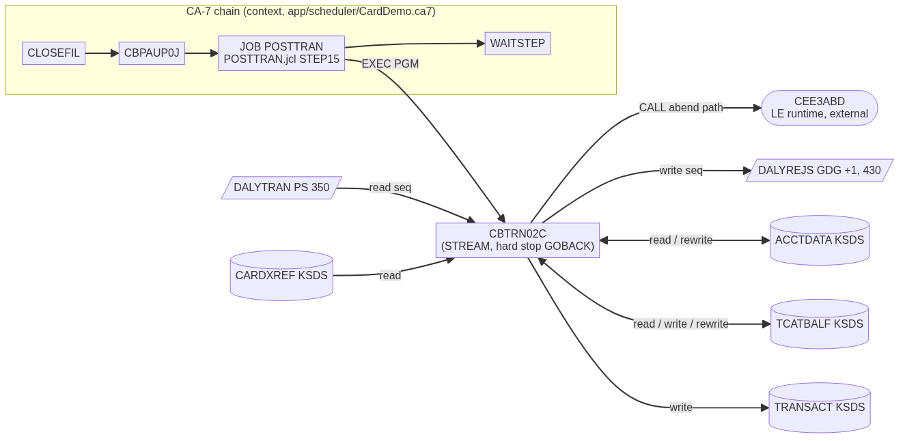

# CardDemo module inventory (POSTTRAN engagement)

Produced by `!mf_module_inventory_analysis` on 2026-11-19 from `main` @ `59cc6c2f`. Everything below is regenerated by `.migration/07_runbook.md` R-10/R-11; numbers are copied from `inventory/coverage.txt`.

## 1. Scope (STOP B: CONFIRMED)

**BATCH POSTTRAN = `app/jcl/POSTTRAN.jcl` STEP15 `EXEC PGM=CBTRN02C` (`POSTTRAN.jcl:23`) → `CBTRN02C`, hard stop `GOBACK` (`app/cbl/CBTRN02C.cbl:234`).** Confirmed against source (D-002):
- POSTTRAN.jcl has exactly one `EXEC` and no PROC (`edges.tsv`: single `JOB:POSTTRAN → CBTRN02C JCL_EXEC`).
- CBTRN02C has no CICS, SQL or DL/I statements; its only `CALL` is `'CEE3ABD'` on the abend path (`CBTRN02C.cbl:711`), an external LE service. Nothing executes after `GOBACK`.
- ONLINE and SUBTRANSACTION: N/A (no transaction or callee program in the closure).

## 2. Mechanical call graph

`inventory/callgraph.py` scans `app/` (read-only): 44 COBOL + 2 assembler sources = **46 programs**; JCL `EXEC PGM=`, PROC calls, IKJEFT01 `RUN PROGRAM`, DFSRRC00 `PARM=BMP|DLI`, CSD `DEFINE TRANSACTION`, COBOL `CALL` (static and dynamic, resolved through `VALUE`/`MOVE` literals including copybooks), CICS `XCTL`/`LINK`, CA-7 triggers. Comment lines and string literals are ignored. Output `inventory/edges.tsv`: 331 edges.

| Edge kind | Count |
|---|---|
| JCL_EXEC | 119 |
| JCL_PROC / JCL_DSN_RUN / JCL_IMS | 4 / 3 / 4 |
| CSD_TRAN | 25 |
| CALL_STATIC | 62 |
| CICS_XCTL / CICS_XCTL_TABLE | 49 / 19 |
| SCHED_DEF / SCHED_TRIGGER | 18 / 28 |

## 3. Coverage proof

Roots: 46 jobs + 25 CICS transactions = 71. Program reachability uses JCL/CSD/CALL/XCTL edges; scheduler edges order jobs but do not pull programs into another job's stream.

**46 = STREAM 1 + SHARED 0 + OUT_OF_STREAM 43 + UNREACHABLE 2 → True** (`coverage.py` exit 0).

| Class | Programs |
|---|---|
| STREAM (POSTTRAN only) | CBTRN02C |
| SHARED (POSTTRAN + another root) | none |
| OUT_OF_STREAM (other roots only) | the other 43 (see `coverage.txt`) |
| UNREACHABLE (no root) | CBTRN01C, COPAUS2C (no incoming edge in `app/`) |

| Check | Result |
|---|---|
| Stream closure `JOB:POSTTRAN` | `{CBTRN02C, CEE3ABD}`; CEE3ABD is external |
| Unresolved dynamic calls | 0 |
| Table-resolved XCTL (menu tables) | COADM01C, COMEN01C: online only, not in closure |
| Absent modules (referenced, no source) | COCRDSEC (CSD transaction CDV1, `app/csd/CARDDEMO.CSD:388`): online, not in closure |
| External modules | CEE3ABD, CEEDAYS, CBLTDLI, MQ API, IDCAMS, SORT, IEBGENER, IEFBR14, IKJEFT01/1B, DFSRRC00, DFHCSDUP, DSNTIAUL, SDSF, FTP |
| Orphan programs | CBTRN01C, COPAUS2C (= UNREACHABLE) |
| Jobs not in CA-7 | 31 (list in `coverage.txt`); POSTTRAN **is** scheduled |

The POSTTRAN slice is closed: one program, no shared program, no unresolved edge, no absent module.

## 4. Module-level flow

Source: `diagrams/posttran_module_flow.mmd` (rendered by R-12).

## 5. Data touched and shared-program map

| DD | Dataset | Copybook / LRECL | CBTRN02C access | Also used by |
|---|---|---|---|---|
| DALYTRAN | DALYTRAN.PS | CVTRA06Y / 350 | read sequential | TRANFILE.jcl |
| DALYREJS | DALYREJS(+1) | 350 + 80 = 430 | write sequential | DALYREJS.jcl (GDG base) |
| TRANFILE | TRANSACT.VSAM.KSDS | CVTRA05Y / 350 | `OPEN OUTPUT`, write | 7 jobs, 5 CICS programs |
| XREFFILE | CARDXREF.VSAM.KSDS | CVACT03Y / 50 | read random | 6 jobs, COTRN02C |
| ACCTFILE | ACCTDATA.VSAM.KSDS | CVACT01Y / 300 | read + rewrite | 5 jobs, 4 CICS programs |
| TCATBALF | TCATBALF.VSAM.KSDS | CVTRA01Y / 50 | read + write + rewrite | INTCALC, PRTCATBL, TCATBALF |

No program is shared; the KSDS files are. They are boundaries, not scope.

## 6. Boundary register extract

From `.migration/04_boundary_register.md` (all `REGISTERED`; decided by the plan step):

| Id | Class | Boundary |
|---|---|---|
| B-01 | DATASET_IN | DALYTRAN |
| B-02 | DATASET_OUT | DALYREJS GDG |
| B-03 | SHARED_DATA | TRANSACT |
| B-04 | SHARED_DATA | ACCTDATA |
| B-05 | SHARED_DATA | CARDXREF |
| B-06 | SHARED_DATA | TCATBALF |
| B-07 | RUNTIME_SERVICE | CEE3ABD |
| B-08 | SCHEDULER | CA-7 chain / RC |
| B-09 | ONLINE_COEXISTENCE | CICS file close/open window |

## 7. Waves (preview)

One program → one wave (W1 = CBTRN02C). Confirmed or changed by `!mf_stream_migration_plan`.
