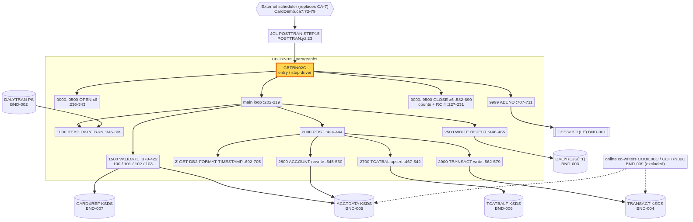
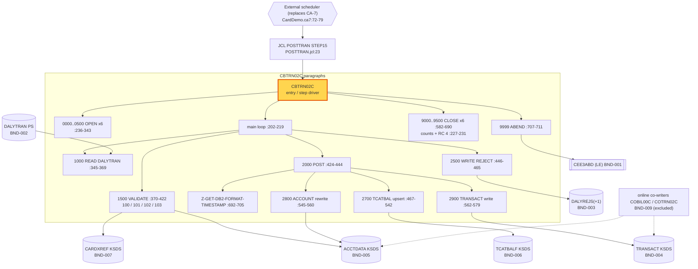

# POSTTRAN stream analysis

Produced by `!mf_stream_analysis` on 2026-11-19 (session devin-c4fce2ffab2c4abaac2aa02e217e00e4), branch `devin/1795090039-mf-posttran-stream` @ `3c07049`. Source `app/**` is read-only and ASCII (`.migration/02_conventions.md`). Inputs: `CardDemo_target_state.md` (CORE + BATCH + DATA/BOUNDARY; ONLINE and SUBTRANSACTION are N/A for this stream), `CardDemo_inventory.md`, decisions D-001..D-010. Analysis only: no FRs, plan or code.

## 1. Pinned stream (confirmed at STOP B, D-010)

| Item | Value | Cite |
|---|---|---|
| Process type | **BATCH** | `app/jcl/POSTTRAN.jcl:23`; D-010 |
| Scheduler | CA-7: CLOSEFIL -> CBPAUP0J -> **POSTTRAN** -> WAITSTEP -> OPENFIL. Not in Control-M | `app/scheduler/CardDemo.ca7:18-124` (POSTTRAN `:70-79`) |
| Job | `POSTTRAN JOB 'POSTTRAN',CLASS=A,MSGCLASS=0` | `app/jcl/POSTTRAN.jcl:1` |
| Steps | one: `STEP15 EXEC PGM=CBTRN02C`; no PARM, no COND, no SYSIN | `app/jcl/POSTTRAN.jcl:23` |
| DDs | TRANFILE (TRANSACT KSDS) `:28-29`, DALYTRAN (PS) `:30-31`, XREFFILE `:32-33`, DALYREJS (+1) NEW/CATLG LRECL 430 `:34-38`, ACCTFILE `:39-40`, TCATBALF `:41-42` | `app/jcl/POSTTRAN.jcl` |
| Entry | CBTRN02C PROCEDURE DIVISION | `app/cbl/CBTRN02C.cbl:193` |
| **Hard stop** | `GOBACK` | `app/cbl/CBTRN02C.cbl:234` |
| Exclusions | CBTRN01C; CLOSEFIL/CBPAUP0J/WAITSTEP/OPENFIL; TRANBKP/TRANIDX/COMBTRAN; INTCALC, TRANREPT, CREASTMT, CBEXPORT; online COBIL00C/COTRN02C; DALYTRAN producer / DALYREJS consumer; CEE3ABD -> RC 16 | `CardDemo_inventory.md` §9; D-010 |

The entry point is live (declared in JCL and CA-7), so the stream is not dead.

## 2. Program inventory and leaf-first DAG

| Program | Path | Role | Callees | Present | Shared (inventory §7) |
|---|---|---|---|---|---|
| CBTRN02C | `app/cbl/CBTRN02C.cbl` | entry + step driver + validate + write | `CEE3ABD` only (`:711`) | yes | **no** (exclusive to BAT-POSTTRAN) |
| CEE3ABD | IBM LE runtime | abend service | - | external (not in repo, by design) | n/a, boundary BND-001 |

Copybooks: CVTRA06Y (`:102`), CVTRA05Y (`:107`), CVACT03Y (`:112`), CVACT01Y (`:121`), CVTRA01Y (`:126`). No other CALL, no dynamic call, no EXEC CICS/SQL/DLI (mechanical sweep: `inventory/edges.tsv` rows with caller CBTRN02C).

Paragraph DAG (CBTRN02C is a single program, so its DAG has depth 1 and the leaf-first structure is internal):

| Paragraph | Lines | Role |
|---|---|---|
| main | `:193-234` | open 6 files, loop, close, counts, RC |
| 0000..0500-*-OPEN | `:236-343` | DALYTRAN INPUT, **TRANSACT OUTPUT** (`:256`), XREF INPUT, DALYREJS OUTPUT, ACCOUNT I-O, TCATBAL I-O; non-`00` -> abend |
| 1000-DALYTRAN-GET-NEXT | `:345-369` | sequential read; `10` = EOF; other -> abend |
| 1500-VALIDATE-TRAN | `:370-378` | XREF lookup, then account lookup only if XREF passed |
| 1500-A-LOOKUP-XREF | `:380-392` | random READ by card number; INVALID KEY -> 100 |
| 1500-B-LOOKUP-ACCT | `:393-422` | random READ by XREF-ACCT-ID; INVALID KEY -> 101; else overlimit (102) and expiry (103) checks, 103 evaluated last |
| 2000-POST-TRANSACTION | `:424-444` | build TRAN-RECORD, then TCATBAL, ACCOUNT, TRANSACT in that order |
| 2500-WRITE-REJECT-REC | `:446-465` | 350-byte input + 80-byte trailer |
| 2700-UPDATE-TCATBAL (+A create / B update) | `:467-542` | READ; `23` -> create with balance = amount; else REWRITE balance + amount |
| 2800-UPDATE-ACCOUNT-REC | `:545-560` | CURR-BAL += amt; amt >= 0 -> CYC-CREDIT += amt else CYC-DEBIT += amt; REWRITE INVALID KEY -> 109 (no reject) |
| 2900-WRITE-TRANSACTION-FILE | `:562-579` | WRITE; non-`00` (e.g. `22` duplicate) -> abend |
| 9000..9500-*-CLOSE | `:582-690` | non-`00` -> abend |
| Z-GET-DB2-FORMAT-TIMESTAMP | `:692-705` | `FUNCTION CURRENT-DATE` -> `YYYY-MM-DD-HH.MM.SS.hh0000` |
| 9999-ABEND-PROGRAM / 9910-DISPLAY-IO-STATUS | `:707-727` | `ABENDING PROGRAM`, `CEE3ABD` code 999; `FILE STATUS IS: NNNN<status>` |

## 3. Surface (BATCH)

| Aspect | Finding | Cite |
|---|---|---|
| Input dataset | DALYTRAN, PS, FB 350, layout CVTRA06Y, read sequentially to EOF | `POSTTRAN.jcl:30-31`; `CBTRN02C.cbl:29-32,66-69,346` |
| Output dataset | DALYREJS(+1), FB 430 = 350 input image + `WS-VALIDATION-FAIL-REASON 9(04)` + `DESC X(76)` | `POSTTRAN.jcl:34-38`; `CBTRN02C.cbl:176-182,446-451` |
| Masters updated | TRANSACT (write), ACCTDATA (rewrite), TCATBALF (write/rewrite); CARDXREF read-only | `:256,311,329,275` |
| Reports | none; SYSOUT DISPLAY lines are the only listing (`:194,227-228,232,476-477`) | |
| Control cards / PARM | none | `POSTTRAN.jcl:23` |
| Return codes | 0 = no rejects; 4 = at least one reject (`:229-231`); abend U999 via CEE3ABD on any unexpected file status (`:707-711`) | |
| Commit / checkpoint | none; VSAM updates are immediate per record, no checkpoint/restart logic | whole program |
| Restart / rerun | no restart; rerun reopens TRANSACT OUTPUT (`:256`). Java rule fixed by D-008 (rerun guard, RC 16 before posting) | D-008 |
| Scheduler gating | runs after CBPAUP0J in CA-7; operator script runs TRANBKP before and TRANIDX after | `CardDemo.ca7:70-79`; `scripts/run_posting.sh` |

Observable SYSOUT lines (verbatim): `START OF EXECUTION OF PROGRAM CBTRN02C` (`:194`); `TRANSACTIONS PROCESSED :` + 9(09) (`:227`); `TRANSACTIONS REJECTED  :` + 9(09) (`:228`); `END OF EXECUTION OF PROGRAM CBTRN02C` (`:232`); `TCATBAL record not found for key : <17-byte key>.. Creating.` (`:476-477`); error lines `ERROR OPENING ...`/`ERROR READING ...`/`ERROR WRITING ...`/`ERROR CLOSING ...` (`:247-685`), `ABENDING PROGRAM` (`:708`), `FILE STATUS IS: NNNN<xxxx>` (`:721,725`).

## 4. Data, dataset mapping and field dictionary

### 4.1 Dataset mapping (per BATCH profile and D-003)

| Dataset | Legacy form | Key | Target | Access by POSTTRAN | Other writers (BND) |
|---|---|---|---|---|---|
| DALYTRAN | PS FB 350 | - | file via `--dd=DALYTRAN=<file>` (ASCII line-sequential or EBCDIC CP037 FB) | read | external producer (BND-002) |
| DALYREJS | GDG (+1) FB 430 | - | file `<output-dir>/POSTTRAN/<yyyyMMdd-HHmmss-SSS>/DALYREJS` | create | none (BND-003) |
| TRANSACT | KSDS 350, `KEYS(16 0)`, AIX `KEYS(26 304)` (PROC-TS) | TRAN-ID | `transaction.transaction`, PK `tran_id`, index on `proc_ts` | insert (CRUD owner for POSTTRAN rows) | COBIL00C, COTRN02C, COMBTRAN (BND-004) |
| ACCTDATA | KSDS 300, `KEYS(11 0)` | ACCT-ID | `account.account`, PK `acct_id`, `@Version` | read + update balances | COBIL00C, COACTUPC, CBACT04C (BND-005) |
| TCATBALF | KSDS 50, `KEYS(17 0)` | acct+type+cat | `reference.tran_cat_balance`, PK (`acct_id`,`type_cd`,`cat_cd`), `@Version` | read + insert/update | CBACT04C reads; TCATBALF rebuild (BND-006) |
| CARDXREF | KSDS 50, `KEYS(16 0)`, AIX `KEYS(11,25)` | card number | `card.card_xref`, PK `card_num`, index `acct_id` | read-only reference | XREFFILE load, CBIMPORT (BND-007) |

KSDS cites: `app/jcl/TRANFILE.jcl:49-54,82-87`, `app/jcl/ACCTFILE.jcl:36-41`, `app/jcl/TCATBALF.jcl:36-41`, `app/jcl/XREFFILE.jcl:39-44,72-77`. No DB2/IMS: no `EXEC SQL`/DL/I in CBTRN02C, so **every data-access leaf's physical layer is VSAM**, mapped to PostgreSQL (DATA profile). No stored procedures.

### 4.2 Field dictionary (CORE type mapping; FACT = from copybook + conventions, INFERRED = needs confirmation)

| COBOL field | Copybook:line | PIC | Java | Column | Mark |
|---|---|---|---|---|---|
| DALYTRAN-ID / TRAN-ID | CVTRA06Y:5 / CVTRA05Y:5 | X(16) | String | `tran_id VARCHAR(16)` PK | FACT |
| *-TYPE-CD | CVTRA06Y:6 / CVTRA05Y:6 | X(02) | String | `type_cd VARCHAR(2)` | FACT |
| *-CAT-CD | CVTRA06Y:7 / CVTRA05Y:7 | 9(04) | Long | `cat_cd BIGINT CHECK 0..9999` | FACT |
| *-SOURCE | :8 | X(10) | String | `source VARCHAR(10)` | FACT |
| *-DESC | :9 | X(100) | String | `description VARCHAR(100)` | FACT |
| *-AMT | :10 | S9(09)V99 zoned | BigDecimal(2) | `amount NUMERIC(11,2)` | FACT |
| *-MERCHANT-ID | :11 | 9(09) | Long | `merchant_id BIGINT` | FACT |
| *-MERCHANT-NAME/CITY/ZIP | :12-14 | X(50)/X(50)/X(10) | String | VARCHAR | FACT |
| *-CARD-NUM | :15 | X(16) | String | `card_num VARCHAR(16)` | FACT |
| *-ORIG-TS | :16 | X(26) | LocalDateTime | `orig_ts TIMESTAMP(6)` | **INFERRED**: input format `YYYY-MM-DD HH:MM:SS.ffffff` (sample `app/data/ASCII/dailytran.txt`); must re-render byte-identically |
| TRAN-PROC-TS | CVTRA05Y:17 | X(26) | LocalDateTime | `proc_ts TIMESTAMP(6)` | **INFERRED**: written as `YYYY-MM-DD-HH.MM.SS.hh0000` (`CBTRN02C.cbl:692-705`), a different format from ORIG-TS; hundredths masked in parity (D-007) |
| DALYTRAN-PROC-TS | CVTRA06Y:17 | X(26) | (ignored) | - | FACT: never moved, TRAN-PROC-TS is regenerated (`:437-438`); preserved only inside the reject image |
| FILLER | CVTRA05Y:18 | X(20) | - | not stored; spaces on output | FACT |
| ACCT-ID | CVACT01Y:5 | 9(11) | Long | `acct_id BIGINT` PK | FACT |
| ACCT-ACTIVE-STATUS | :6 | X(01) | String | `active_status VARCHAR(1)` | FACT (not read by POSTTRAN) |
| ACCT-CURR-BAL | :7 | S9(10)V99 | BigDecimal(2) | `curr_bal NUMERIC(12,2)` | FACT |
| ACCT-CREDIT-LIMIT | :8 | S9(10)V99 | BigDecimal(2) | `credit_limit NUMERIC(12,2)` | FACT |
| ACCT-CASH-CREDIT-LIMIT | :9 | S9(10)V99 | BigDecimal(2) | `cash_credit_limit NUMERIC(12,2)` | FACT |
| ACCT-OPEN/REISSUE-DATE | :10,:12 | X(10) | LocalDate | DATE | INFERRED (not used by POSTTRAN) |
| ACCT-EXPIRAION-DATE | :11 | X(10) | LocalDate | `expiration_date DATE` | **INFERRED**: POSTTRAN compares it as a 10-byte string with `DALYTRAN-ORIG-TS(1:10)` (`:414`); equivalent to a date compare only for valid ISO dates |
| ACCT-CURR-CYC-CREDIT/DEBIT | :13-14 | S9(10)V99 | BigDecimal(2) | NUMERIC(12,2) | FACT; DEBIT accumulates negative amounts (verified, runbook R-11) |
| ACCT-ADDR-ZIP, ACCT-GROUP-ID | :15-16 | X(10) | String | VARCHAR(10) | FACT |
| FILLER | :17 | X(178) | - | not stored | FACT |
| XREF-CARD-NUM / CUST-ID / ACCT-ID | CVACT03Y:5-7 | X(16)/9(09)/9(11) | String/Long/Long | `card_num` PK / `cust_id` / `acct_id` | FACT |
| TRANCAT-ACCT-ID / TYPE-CD / CD | CVTRA01Y:6-8 | 9(11)/X(02)/9(04) | Long/String/Long | composite PK | FACT |
| TRAN-CAT-BAL | CVTRA01Y:9 | S9(09)V99 | BigDecimal(2) | `balance NUMERIC(11,2)` | FACT |
| Reject trailer | CBTRN02C.cbl:180-182 | 9(04)+X(76) | int + String | file only | FACT |
| WS-TEMP-BAL | CBTRN02C.cbl:187 | S9(09)V99 | BigDecimal(2) | - | FACT: **truncation risk**, it holds credit - debit + amount from S9(10)V99 operands; high-order digits are lost if the sum exceeds 9 integer digits (no ON SIZE ERROR) |

Encoding: zoned decimal with overpunch sign (sample ASCII uses `{`/`A..I`/`}`/`J..R`), so the codec must decode/encode overpunch (`02_conventions.md`; GnuCOBOL `-fsign=EBCDIC`).

## 5. Boundary table (register mode; BND-001..009 completed in `.migration/04_boundary_register.md`)

| BND | Class | Direction | Contract (from source) | Read/Write | Required action | Lead-time exposure | Contract complete? |
|---|---|---|---|---|---|---|---|
| 001 LE CEE3ABD | B11 | out | `CALL 'CEE3ABD' USING ABCODE S9(9) BINARY = 999, TIMING = 0` (`:707-711`); never returns; z/OS U999, GnuCOBOL exit 231 | n/a | replace with uncaught exception -> RC 16 (CORE) | none | YES |
| 002 DALYTRAN in | B7 | in | FB 350 CVTRA06Y; `00` ok, `10` EOF, else abend (`:345-367`); empty file -> 0 processed, RC 0 | read | keep byte contract; reader for ASCII + CP037 | OQ-5: producer + encoding unknown | **NO** (producer unknown); not a blocker for parity, which uses repo sample data |
| 003 DALYREJS out | B7 | out | FB 430 (`:81-84,176-182`); one record per reject, input order; empty generation when no rejects | write | keep byte contract in generation dir | OQ-5: consumer unknown | **NO** (consumer unknown); not a parity blocker |
| 004 TRANSACT | B10 | out | 350-byte TRAN-RECORD (CVTRA05Y), unique TRAN-ID; status `22` -> abend (`:562-579`); `OPEN OUTPUT` (`:256`) | insert | single-writer policy during coexistence; TRAN-ID uniqueness (online last+1, `COBIL00C.cbl:212-219`, `COTRN02C.cbl:444-451`) | none (no external system); policy decision | YES |
| 005 ACCTDATA | B10 | in/out | READ by ACCT-ID (`:395`), REWRITE (`:554`), INVALID KEY -> 109 | read/update | write ownership; `@Version` conflict = abend | none | YES |
| 006 TCATBALF | B10 | in/out | READ (`:474`), `23` -> WRITE (`:510`), else REWRITE (`:528`); other status -> abend | read/upsert | write ownership; upsert under PK | none | YES |
| 007 CARDXREF | B10 | in | READ by card (`:383`), INVALID KEY -> reject 100 | read-only | reference data load (seed) | none | YES |
| 008 scheduler | B9 | both | RC 0/4 = success, abend = failure; predecessor CBPAUP0J, successor WAITSTEP (`CardDemo.ca7:70-79`) | n/a | scheduler owner + completion signal | ops scheduler onboarding (owner unknown) | YES (for the Java side) |
| 009 online co-writers | B8 | both | CICS files closed by CLOSEFIL before the chain (`CLOSEFIL.jcl:22-26`), reopened by OPENFIL | n/a | coexistence window | none while COBOL stays the oracle | YES |

No B1-B6 crossings: no subroutine other than LE, no CICS, no MQ, no DB2/IMS. No unresolved contract blocks parity; BND-002/003 (OQ-5) block only production cutover.

## 6. Waves

CBTRN02C is one program with no in-module callees, so the DAG has a single program node and **one migration wave**. Its prerequisites are scaffolding and data seams, which the orchestrator runs as Phase 0 and Phase 1, not as waves:

| Step | Content (leaf-first) | Depends on | Repo/path |
|---|---|---|---|
| Phase 0 | app shell, common library (COBOL types, record codec, batch seam, CLI launcher), Postgres profile, CI | - | `modernization/` (BACKEND, same repo) |
| Phase 1 | Flyway schema for the 4 masters, entities/repositories, ASCII/EBCDIC loaders for ACCTDATA/CARDXREF/TCATBALF, DALYTRAN reader + DALYREJS writer (CVTRA06Y layout) | Phase 0 | `modernization/` |
| **Wave 1** | CBTRN02C -> `POSTTRAN` job: validation (1500), posting (2000/2700/2800/2900), reject writer (2500), counts/RC (main), timestamp (Z-GET), rerun guard (D-008), atomic unit (D-009) | Phase 1 (strict) | `modernization/` |

Shared programs ported on behalf of the module: **none** (inventory §7). The data seams built in Phase 1 (TRANSACT, ACCOUNT, TCATBAL, XREF repositories and layouts) are module property and will be reused by INTCALC, TRANREPT, CREASTMT and the online streams.

## 7. Risks

| Risk | Impact | Cite |
|---|---|---|
| DALYTRAN producer and encoding unknown; DALYREJS consumer unknown (OQ-5) | production cutover only | `POSTTRAN.jcl:30-38` |
| Two timestamp formats in one TRANSACT record; TIMESTAMP columns must re-render exact bytes | parity | CVTRA05Y:16-17; `CBTRN02C.cbl:692-705` |
| `WS-TEMP-BAL S9(09)V99` silently truncates large sums | parity on extreme balances | `CBTRN02C.cbl:187,403-405` |
| Reason 103 overwrites 102 when both fail; 102 compares against `CYC-CREDIT - CYC-DEBIT + AMT` where DEBIT is negative | business rule fidelity | `:403-420` (verified R-11) |
| Expiry check is a string compare | parity if a date is not ISO | `:414` |
| REWRITE INVALID KEY on ACCOUNT sets 109 after validation; reject not written, TRANSACT still written, RC unchanged | unreachable after a successful READ in the same run (dead in practice) | `:554-559` |
| `OPEN OUTPUT` on TRANSACT | resolved by D-008 | `:256` |
| Partial posting on abend | resolved by D-009 | `:440-442` |
| No checkpoint; Java chunk restart is new behavior | D-002 | BATCH profile |

Verified evidence (runbook R-04, R-11): sample run 300 read / 262 posted / 38 rejected (all 102) RC 4; synthetic run 6 read / 3 rejected (100, 103, 103 over 102) RC 4, TCATBAL row created for a new key; 2 clean records RC 0, +504.77 to CYC-CREDIT and -504.70 to CYC-DEBIT.
