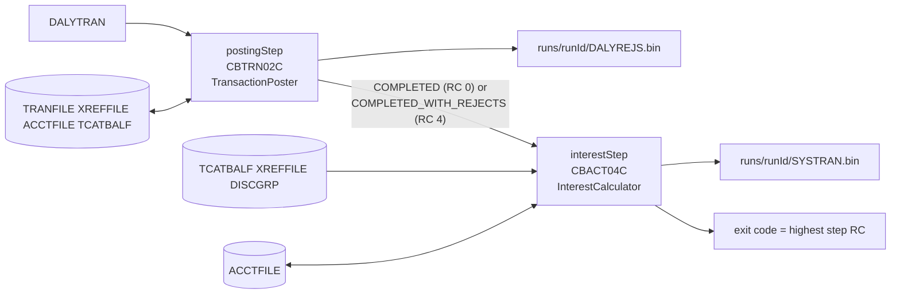

# batch: Spring Batch job for POSTTRAN and INTCALC

A Spring Boot 3 / Spring Batch application with one job, `dailyCycleJob`, and two steps in JCL order:

| Step | Replaces | Calls |
|---|---|---|
| `postingStep` | `app/jcl/POSTTRAN.jcl` STEP15, `PGM=CBTRN02C` | `TransactionPoster` (`posting` module) |
| `interestStep` | `app/jcl/INTCALC.jcl` STEP15, `PGM=CBACT04C,PARM='2022071800'` | `InterestCalculator` (`interest` module) |

The steps hold no business rules. They read and write fixed-length datasets with the `records` codecs and hand the
records to the two services. The job repository is the in-memory H2 database that Spring Boot configures, so no
external database is involved and nothing persists between runs.



## Running

```sh
mvn -f modernization/java21/pom.xml -pl batch -am package -DskipTests
java -jar modernization/java21/batch/target/batch-1.0-SNAPSHOT.jar \
  --carddemo.datasets-dir=datasets --carddemo.run-root=runs \
  runId=2022-07-18 parmDate=2022071800
```

`runId` and `parmDate` are job parameters. Arguments starting with `--` are `carddemo.*` properties.
`--carddemo.clock.fixed-instant=2022-07-18T12:34:56Z --carddemo.clock.zone=UTC` pins the clock, as the golden run did.
With no fixed instant the system clock in the system zone is used.

## JCL DD → property

Every DD is a file resource. The masters default to `${carddemo.datasets-dir}/<DD>.bin`, and the interest step
defaults to the same TCATBALF, XREFFILE and ACCTFILE as posting, so it reads the post-posting state.

| JCL | DD / parameter | Property | Default | Access |
|---|---|---|---|---|
| POSTTRAN STEP15 | `TRANFILE` | `carddemo.posting.tranfile` | `${carddemo.datasets-dir}/TRANFILE.bin` | output (KSDS, opened OUTPUT, rewritten) |
| POSTTRAN STEP15 | `DALYTRAN` | `carddemo.posting.dalytran` | `${carddemo.datasets-dir}/DALYTRAN.bin` | input, read in chunks |
| POSTTRAN STEP15 | `XREFFILE` | `carddemo.posting.xreffile` | `${carddemo.datasets-dir}/XREFFILE.bin` | input |
| POSTTRAN STEP15 | `DALYREJS` GDG `(+1)` | `carddemo.posting.dalyrejs` | `DALYREJS.bin` in the run directory | new file |
| POSTTRAN STEP15 | `ACCTFILE` | `carddemo.posting.acctfile` | `${carddemo.datasets-dir}/ACCTFILE.bin` | update in place |
| POSTTRAN STEP15 | `TCATBALF` | `carddemo.posting.tcatbalf` | `${carddemo.datasets-dir}/TCATBALF.bin` | update in place |
| POSTTRAN STEP15 | `SYSOUT` | `carddemo.posting.sysout` | `CBTRN02C.sysout.txt` in the run directory | new file |
| INTCALC STEP15 | `TCATBALF` | `carddemo.interest.tcatbalf` | `${carddemo.posting.tcatbalf}` | input |
| INTCALC STEP15 | `XREFFILE` (and `XREFFIL1`) | `carddemo.interest.xreffile` | `${carddemo.posting.xreffile}` | input |
| INTCALC STEP15 | `ACCTFILE` | `carddemo.interest.acctfile` | `${carddemo.posting.acctfile}` | update in place |
| INTCALC STEP15 | `DISCGRP` | `carddemo.interest.discgrp` | `${carddemo.datasets-dir}/DISCGRP.bin` | input |
| INTCALC STEP15 | `TRANSACT` GDG `(+1)` | `carddemo.interest.transact` | `SYSTRAN.bin` in the run directory | new file |
| INTCALC STEP15 | `SYSOUT` | `carddemo.interest.sysout` | `CBACT04C.sysout.txt` in the run directory | new file |
| INTCALC STEP15 | `PARM='2022071800'` | job parameter `parmDate` | required, exactly 10 characters | |
| | run generation | job parameter `runId` | required, a simple directory name | |

Other properties: `carddemo.encoding` (default `US-ASCII`, the encoding the golden fixtures use),
`carddemo.posting.chunk-size` (default 100) and `carddemo.run-root` (default `runs`).

**GDG `(+1)` outputs.** Each run writes its new generations to `${carddemo.run-root}/<runId>/`. The job creates that
directory when it starts and fails before any step if it already exists, so a run never overwrites an earlier
generation. `XREFFIL1` is not mapped separately: CBACT04C reads it by alternate key, and `InterestCalculator` takes
the cross-reference records as one list.

**Indexed files.** ACCTFILE, TCATBALF, TRANFILE and XREFFILE are KSDS clusters on the mainframe. Here they are
fixed-length files kept in key order. The posting step loads them when it opens, applies `TransactionPoster`'s reads
and writes in memory, and writes changed files back at every chunk commit. All changed files are staged to temporary
files first and then moved into place, so a failed write replaces none of them. The outputs do not depend on the
chunk size (`DailyCycleJobTest` runs chunk sizes 1, 3 and 100).

**Failures.** If a record fails (a duplicate transaction ID, for example), the effects of the records before it are
written back before the step fails, as the COBOL's record-by-record VSAM updates are never rolled back. The four
masters are separate files, and the moves into place are not atomic as a group, so recover a failed run the way the
mainframe cycle does: restore the masters from their pre-run copies and rerun with a new `runId`.

Run output names (`dalyrejs`, `transact`, both `sysout`) must be plain file names; a path separator, `..` or an
absolute path fails at startup, so no output can be written outside the run directory.

**Interest is one chunk.** `InterestCalculator.run` needs every category balance, account, cross-reference and
disclosure group at once, so the interest reader returns one `InterestInput` item.

## Return codes

| Outcome | Step exit status | Process exit code |
|---|---|---|
| Posting with no rejects | `COMPLETED` | 0 |
| Posting with any reject | `COMPLETED_WITH_REJECTS` (CBTRN02C RC 4) | 4 |
| Interest completes | `COMPLETED` | 0 |
| Any step fails, or the run directory already exists | `FAILED` | 12 |
| Invalid `runId`, `parmDate` or output file name | job not launched | 1 |

The process exit code is the highest step code, like a JCL job's maximum condition code. `CycleExitCodeGenerator`
computes it. Registering an `ExitCodeMapper` bean is not enough, because Boot's `JobExecutionExitCodeGenerator`
returns `BatchStatus.ordinal()`, which is 0 for a completed job with rejects; `CycleExitCodeGenerator` has the
highest precedence, so its value is the one that counts.

**Interest runs after posting returns RC 4.** In the documented cycle INTCALC runs after POSTTRAN whatever
POSTTRAN's condition code, and the golden run executed CBACT04C on the post-posting state after CBTRN02C returned 4.
The job therefore moves on to `interestStep` after both `COMPLETED` and `COMPLETED_WITH_REJECTS`. It stops on a
`FAILED` posting exit status, including one set after the chunks completed (the CBTRN02C SYSOUT could not be
written).

## Tests

`mvn -f modernization/java21/pom.xml verify` runs:

- `DailyCycleJobTest` (Surefire, in-process): chunk-size independence on the named set, a reused `runId`, an
  interest abend after posting rejects (exit 12, posting outputs kept, no SYSTRAN), a failing record after a posted
  one in the same chunk (the earlier posting is kept), a posting SYSOUT failure (interest does not run), output
  file-name validation, `parmDate` validation and the exit-code mapping.
- `PackagedJobIT` (Failsafe, after `package`): runs the repackaged jar as a separate process on the `mixed` and
  `volume` golden sets with the clock and PARM from `golden/expected/metadata.json`. It asserts the process exit code
  equals the highest code in `return-codes.json`, that the run directory holds exactly the four run outputs, and that
  every output is byte-identical to `golden/expected/`, after checking those golden files against
  `golden/acceptance.sha256`.

The intermediate `CBTRN02C.ACCTFILE.bin` snapshot (ACCTFILE between the two steps) is not visible after a full run;
the interest-abend test compares ACCTFILE with it, and the `posting` module's own differential tests cover it too.
