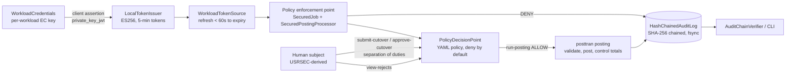

# zero-trust-controls

The modernized batch posting flow (ingest → validate → post → control totals → outbound
handoff to the downstream accounting system) with application-layer Zero Trust controls
wrapped around it. The posttran posting job runs unchanged; every call into it is
authenticated, authorized and audited.

## How to run

```bash
bash modernization/zero-trust/verify.sh
```

or the two steps by hand:

```bash
mvn -f modernization/posttran-cycle/pom.xml install -DskipTests -Dspring-boot.repackage.skip=true
mvn -f modernization/zero-trust/pom.xml verify
```

`verify.sh` additionally re-verifies the audit log the end-to-end test leaves at
`target/zero-trust-evidence/posting-audit.jsonl`, then tampers a copy of that log and shows
the verifier reporting `BROKEN` — the expected result.

## Architecture



Enforcement points:

- **Job level** (`SecuredJob`): verifies the workload token and authorizes `run-posting`
  before any step runs. Denial marks the JobExecution FAILED, audits `AUTHZ_DECISION DENY`,
  and no master or output dataset is touched. On completion it audits `JOB_COMPLETED` with
  the posttran control totals (transactionCount, rejectCount), the posted count and
  posted-amount sum accumulated per run by `SecuredOutcomeWriter` in the job ExecutionContext, and stores the audit head hash in
  the job ExecutionContext as `auditHeadHash`.
- **Item level** (`SecuredPostingProcessor` → `SecuredOutcomeWriter`): on every transaction
  the token is verified and `run-posting` is authorized; the verified caller travels with
  the outcome in a job-scoped buffer, and the `TRANSACTION_POSTED` / `TRANSACTION_REJECTED`
  entry is written by the decorated writer **only after the chunk has been written
  successfully**. A failed chunk yields `TRANSACTION_WRITE_FAILED` / `NOT_WRITTEN` entries
  instead — the chain never claims an outcome that did not reach the datasets. The per-item
  ALLOW is folded into the outcome entry (`authz=ALLOW role=… jti=…`) instead of a separate
  decision entry, so the chain gains one entry per transaction. Per-run totals live in the
  job ExecutionContext (`zt.postedCount`, `zt.postedAmount`), so concurrent executions
  cannot mix counters.
- **Human paths**: `view-rejects` (masked reject view over DALYREJS), `submit-cutover` /
  `approve-cutover` with separation of duties, and `read-audit`. Denials are audited too.

## Zero Trust pillar coverage (seven-pillar model)

| Pillar | Coverage |
|---|---|
| User | USRSEC-derived subjects, role assignments, separation of duties on approvals; authentication itself is inherited from the platform ICAM provider. |
| Device | Inherited from platform — not implemented here. |
| Application & Workload | Per-workload EC keys, signed client assertions (private_key_jwt), short-lived ES256 access tokens verified on every call, deny-by-default PDP. |
| Data | PAN/PII masking on every log and audit path; audit records never contain full card numbers or credentials. |
| Network & Environment | Inherited from platform — not implemented here. |
| Automation & Orchestration | Policy-as-data YAML; the secured job is wired by bean decoration of the unchanged posttran configuration. |
| Visibility & Analytics | Tamper-evident hash-chained audit log, fsync'd appends, fail-closed reopen, chain verifier CLI, head anchor for truncation detection. |

## NIST SP 800-53 Rev. 5 mapping

"Mapping indicates where this code implements or supports a control. It is not an
assessment; the authorizing official decides."

| Control | Status | Where |
|---|---|---|
| AC-2 Account management | supports | USRSEC-derived subjects, workload registry in `LocalTokenIssuer` |
| AC-3 Access enforcement | implements | `PolicyDecisionPoint`, job/item enforcement points |
| AC-5 Separation of duties | implements | `approve-cutover` constraint vs `submittedBy` resource attribute |
| AC-6 Least privilege | implements | role-permission grants, deny by default, WORKLOAD-only `run-posting` |
| AU-2 Event logging | implements | audit actions across authz, job, items, cutover, reads |
| AU-3 Content of audit records | implements | actor, kind, action, outcome, recordKey, detail, timestamps |
| AU-9 Protection of audit information | implements | hash chain + fail-closed reopen; WORM storage of anchor inherited |
| AU-10 Non-repudiation | supports | signed workload identity on each audited call |
| AU-12 Audit generation | implements | audit log + per-run head anchor |
| IA-2 User identification and authentication | supports | human authn inherited from ICAM; subjects derived here |
| IA-5 Authenticator management | implements | short-lived tokens, per-workload keys, no shared secrets |
| IA-9 Service identification and authentication | implements | client-assertion workload authentication |
| SC-8 Transmission confidentiality | supports | TLS inherited; tokens are signed, not a transport control |
| SC-12 / SC-13 Cryptographic key establishment / protection | supports | ES256 via Nimbus; key custody inherited |
| SC-28 Protection of information at rest | supports | masking; encryption at rest inherited |
| SI-4 System monitoring | supports | audit stream + verifier as monitoring input |
| SI-10 Information input validation | supports | input validation is the existing posttran validator |

## Inherited from the platform (not claimed by this code)

Network segmentation / micro-segmentation; TLS/mTLS in transit; device posture/endpoint
compliance; the ICAM / OIDC identity provider and MFA for human users; production workload
identity issuance (key custody/HSM/KMS); WORM/immutable storage for the audit log and
anchor; SIEM ingestion and alerting; encryption at rest; continuous monitoring / ATO.

## Allow / deny matrix

| Subject | run-posting | view-rejects | submit-cutover | approve-cutover | read-audit |
|---|---|---|---|---|---|
| ADMIN001 (type A) | deny | allow | allow | allow | allow |
| USER0001 (type U) | deny | allow | deny | deny | deny |
| USER0005 (type U + read-only-auditor) | deny | allow | deny | deny | allow |
| type X (unknown type) | deny | deny | deny | deny | deny |
| svc-posttran-post | allow | deny | deny | deny | deny |
| svc-posttran-report | deny | allow | deny | deny | deny |
| svc-unknown | deny | deny | deny | deny | deny |

`approve-cutover` additionally requires the approver to differ from the submitter
(separation of duties). This table mirrors `PolicyDecisionPointTest`.

`PolicyDecisionPoint` trusts the `Subject` it is given: it is an authorization point, not
an authentication boundary. Human `Subject`s must be built only from an authenticated
principal issued by the platform ICAM/OIDC provider (inherited, listed above); callers must
not construct a `Subject` from unauthenticated input. `CutoverApprovals` and audit reads are
authorization points, not authentication boundaries.

## Limitations

- The local issuer is for tests and local runs only; production issuance is the platform
  OIDC/ICAM provider and platform workload-identity system.
- The hash chain alone does not stop full-log replacement or truncation; that requires an
  externally held anchor (`AuditAnchor` / the `auditHeadHash` job context value).
- The regex scrubber over-masks: any 13–19 digit run is masked, including 16-digit
  transaction ids in free text. That is the safe direction and is intentional.
- The per-item ALLOW is folded into the posting audit entry rather than a separate
  AUTHZ_DECISION record, to avoid doubling the chain.
- If audit finalization fails after the delegate job has committed its terminal status, the
  execution is persisted FAILED, but the posttran output datasets may already be flushed —
  a re-run needs operator reconciliation, and no safe automatic retry is claimed.
- `PolicyDecisionPoint` trusts the `Subject` it is given (see the note above): human
  authentication is inherited from the platform ICAM/OIDC provider and is not performed here.
